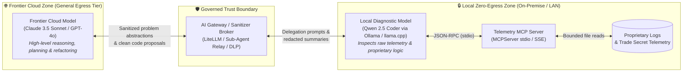
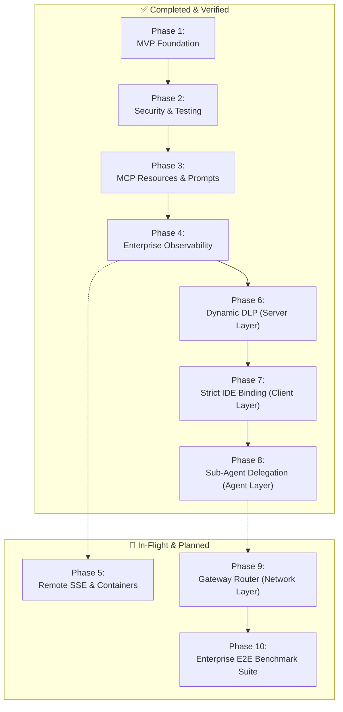

# Telemetry MCP Server: Governed Observability & Hybrid-Trust Architecture

[](https://modelcontextprotocol.io/)
[](https://www.python.org/)
[](https://docs.astral.sh/uv/)
[-purple.svg)](https://github.com/modelcontextprotocol/python-sdk)
[](https://github.com/astral-sh/ruff)
[](https://mypy-lang.org/)
[](https://pytest.org/)
[](#-hybrid-trust-architecture-protecting-trade-secrets)

> **A production-ready Model Context Protocol (MCP) server providing governed application telemetry, system health probes, and log diagnostics to AI agents—featuring an enterprise Hybrid-Trust Architecture to protect trade secrets and sensitive customer data.**

---

## 🌟 The Core Paradigm: Governed Tool Integration

When integrating Large Language Models (LLMs) into SRE, DevOps, or diagnostic workflows, developers face a critical security choice:

```
┌────────────────────────────────────────────────────────────────────────┐
│  ❌ THE UNSAFE PATTERN: Raw Shell Access                               │
│  LLM  ──>  bash / zsh  ──>  cat / rm / curl / arbitrary terminal       │
│  Risk: Prompt injection can wipe drives, drop databases, or exfiltrate  │
│         confidential keys and source code.                             │
└────────────────────────────────────────────────────────────────────────┘

┌────────────────────────────────────────────────────────────────────────┐
│  ✅ THE GOVERNED PATTERN: Model Context Protocol (MCP)                 │
│  LLM  ──>  JSON-RPC 2.0  ──>  Telemetry MCP Server                    │
│                              ├── get_system_health()                  │
│                              ├── read_recent_errors()                 │
│                              ├── filter_logs()                        │
│                              └── delegate_telemetry_investigation()   │
│  Benefit: Strict API boundaries, path-traversal containment, bounded  │
│           context windows, and automated compliance scrubbing.        │
└────────────────────────────────────────────────────────────────────────┘
```

Instead of granting raw terminal access, the **Telemetry MCP Server** acts as a strictly bounded, observable API layer. The AI agent can diagnose issues autonomously while system administrators retain full control over data access, payload redaction, and execution safety.

---

## 🏗️ Architecture Overview

The server communicates with client applications (Continue.dev, Claude Desktop, Cursor, or custom agent runtimes) over **standard input/output (`stdio`)** using the open **Model Context Protocol (JSON-RPC 2.0)**.

```mermaid
flowchart LR
    subgraph Host["Host Environment (e.g., VS Code / Continue / Claude Desktop)"]
        User["Developer / SRE"]
        LLM["AI Model (Claude 3.5 / Qwen 2.5 / GPT-4o)"]
        Client["MCP Client Engine"]
    end

    subgraph Server["Telemetry MCP Server (Python MCPServer / MCP SDK 2.x)"]
        RPC["JSON-RPC 2.0 Router (stdio / SSE)"]
        Sec["Security & Path Traversal Guards"]
        DLP["Dynamic DLP Sanitization Engine"]
        
        subgraph Tools["Diagnostic & Hybrid-Trust Tools"]
            T1["get_system_health()"]
            T2["read_recent_errors(service, lines)"]
            T3["search_logs_by_pattern(service, query)"]
            T4["filter_logs(service, level, time_window)"]
            T5["delegate_telemetry_investigation(service, issue)"]
            T6["get_security_posture()"]
            T7["sanitize_telemetry_payload(payload, mode)"]
            T8["list_available_services()"]
        end

        subgraph Resources["MCP Resources"]
            R1["telemetry://health"]
            R2["telemetry://security"]
            R3["telemetry://services"]
            R4["telemetry://logs/{service}"]
        end

        subgraph Prompts["MCP Prompts"]
            P1["incident_triage"]
            P2["hybrid_trust_triage"]
        end
    end

    subgraph Data["Telemetry Storage"]
        Logs["Service Logs (/logs/*.log)"]
        Metrics["Real / Mock Metric Probes"]
    end

    User -->|"Prompt: Investigate checkout failure"| LLM
    LLM -->|"Call: delegate_telemetry_investigation('payment')"| Client
    Client <-->|"JSON-RPC over stdio"| RPC
    RPC --> Sec
    Sec --> Tools
    Sec --> Resources
    Tools --> DLP
    DLP --> Logs
    DLP --> Metrics
    RPC -->|"Sanitized Brief (<400 tokens)"| Client
    Client -->|"Clean Context"| LLM
    LLM -->|"Remediation Plan"| User
```



---

## 🛡️ Hybrid-Trust Architecture: Protecting Trade Secrets

While MCP enforces governed API boundaries, enterprise deployments face a critical challenge: **how can teams leverage the reasoning power of frontier cloud models (Claude 3.5 Sonnet, GPT-4o) without exposing trade secrets embedded in application telemetry?**

Production logs frequently contain proprietary algorithm parameters, internal infrastructure topologies (RFC 1918 IPs), and regulated customer data (PII/PCI/HIPAA). Transmitting raw logs to cloud APIs introduces significant IP exfiltration, training ingestion, and compliance risks.

The **Hybrid-Trust Architecture** solves this by establishing two distinct operational trust zones:



### 📐 Supported Hybrid-Trust Design Patterns

| Pattern | Architectural Layer | Primary Protection Target | Developer Friction | Implementation Status |
| :--- | :--- | :--- | :--- | :--- |
| 🛡️ [**Dynamic DLP at MCP Layer**](./docs/architecture/dynamic_dlp_pattern.md) | MCP Server Middleware | PCI-DSS cardholder data (Luhn-checked), HIPAA PII, JWTs, RFC 1918 IPs | **Zero** (Completely Transparent) | **Implemented & Verified** |
| 🤝 [**Sub-Agent Delegation**](./docs/architecture/sub_agent_delegation_pattern.md) | Agent Orchestration | Core proprietary algorithms, quantitative trading weights, ring buffers | Low (Handled by Primary Agent) | **Implemented & Verified** |
| ⚙️ [**Strict IDE Profile Binding**](./docs/architecture/strict_ide_profile_binding.md) | Client Extension (Continue / VS Code) | Air-gapped defense (ITAR), accidental cloud tool exposure | Low-Medium (Profile Switch) | **Implemented & Verified** |
| 🔀 [**Gateway Router Pattern**](./docs/architecture/gateway_router_pattern.md) | Network Proxy (LiteLLM) | Enterprise developer fleets, dynamic token arbitrage, unified audit trails | **Zero** (Automated at Network Layer) | **Architected & Specified** |

👉 *For pattern selection flowcharts, 4-layer defense architecture, threat modeling, and deep-dive use cases (HFT quantitative trading, HIPAA/PCI-DSS, air-gapped defense), explore the [**Architecture & Hybrid-Trust Hub**](./docs/architecture/README.md) and [**Enterprise Use Cases Guide**](./docs/architecture/hybrid_trust_use_cases.md).*

---

## 🧰 Implemented Tool & Capability Matrix

The server exposes a complete diagnostic and telemetry governance toolkit:

### 1. Diagnostic Tools
- [`get_system_health()`](./docs/tools_reference.md#21-get_system_health): Returns aggregated platform health metrics, active service counts, error rates, and system-wide alert levels.
- [`list_available_services()`](./docs/tools_reference.md#22-list_available_services): Discovers and enumerates monitored application services available in the telemetry root directory.
- [`read_recent_errors(service_name, lines)`](./docs/tools_reference.md#23-read_recent_errors): Bounded tail of error logs for an affected service, protected by strict path-traversal sanitization.
- [`search_logs_by_pattern(service_name, pattern, max_matches)`](./docs/tools_reference.md#24-search_logs_by_pattern): High-performance regex and substring search for pinpointing trace IDs, status codes, or exception classes.
- [`filter_logs(service_name, level, start_time, lines)`](./docs/tools_reference.md#25-filter_logs): Structured log parser filtering by severity (`CRITICAL`, `ERROR`, `WARNING`, `INFO`) and ISO 8601 timestamps.

### 2. Hybrid-Trust & Security Governance Tools
- [`delegate_telemetry_investigation(service_name, issue_description, max_summary_tokens)`](./docs/tools_reference.md#26-delegate_telemetry_investigation): Multi-tier sub-agent delegation tool. Queries local Ollama or OpenAI-compatible endpoints with heuristic fallback to produce an abstract, trade-secret-free incident brief (< 400 tokens).
- [`get_security_posture()`](./docs/tools_reference.md#27-get_security_posture): Reports active security mode (`STRICT_LOCAL`, `REDACTED_CLOUD`, `AUDIT_ONLY`), trust zone, and cumulative DLP redaction metrics.
- [`sanitize_telemetry_payload(payload, mode)`](./docs/tools_reference.md#28-sanitize_telemetry_payload): Programmatic sanitization utility applying Luhn-checked PAN masking, HIPAA scrubbing, token redaction, and IP masking.

### 3. MCP Resources & Prompts
- **Resources:** `telemetry://health` (system metrics), `telemetry://security` (security posture), `telemetry://services` (service directory), `telemetry://logs/{service}` (live stream).
- **Prompts:** `incident_triage(service_name, incident_id)` (guided 3-step investigation) and `hybrid_trust_triage(service_name, issue_description)` (governed local delegation and cloud escalation).

---

## 🛠️ Operational Tooling & Scripts

Beyond the MCP server itself, the repository provides production tooling for testing, simulation, and governance:

1. **Synthetic Incident Generator (`scripts/simulate_incident.py`):**
   - Continuously injects realistic multi-service faults (Redis timeouts, database deadlocks, memory leaks, and HFT race conditions) into mock log files.
   - Supports continuous mode, timed runs, and instant burst testing.
   ```bash
   python scripts/simulate_incident.py --burst 15 --scenario all
   ```

2. **Pre-Flight IDE Configuration Linter (`scripts/verify_ide_isolation.py`):**
   - Lints Continue.dev, VS Code, and Cursor configuration files.
   - Verifies air-gapping: ensures sensitive internal MCP servers are never bound to external cloud models without DLP protection.
   ```bash
   python scripts/verify_ide_isolation.py --config examples/continue_config.json
   ```

3. **Production Continue.dev Reference Config (`examples/continue_config.json`):**
   - Turnkey dual-profile setup pairing Claude 3.5 Sonnet (general engineering) with local Qwen 2.5 Coder on Ollama (secure telemetry).

---

## 🗺️ Project Roadmap & Current Status

The project follows a 10-phase skill development curriculum spanning core protocol implementation, security hardening, enterprise observability, and hybrid-trust architectures.



| Phase | Milestone Name | Key Deliverables | Status |
| :---: | :--- | :--- | :---: |
| **01** | **MVP Foundation** | `MCPServer` instance, stdio transport, initial health probes & log tailing | **Completed** |
| **02** | **Security Hardening & Testing** | Canonical path validation, regex identifier checks, line clamping, pytest suite | **Completed** |
| **03** | **MCP Resources & Prompts** | `telemetry://` resources, dynamic service discovery, `incident_triage` prompt | **Completed** |
| **04** | **Enterprise Observability** | Structured JSON log filtering, regex pattern search, incident simulator script | **Completed** |
| **05** | **Remote SSE & Containers** | Multi-stage Dockerfile, Starlette SSE transport daemon, HTTP Bearer auth | *In-Flight* |
| **06** | **Hybrid-Trust: Dynamic DLP** | Luhn-validated PAN masking, HIPAA scrubbing, token redactions, origin modes | **Completed** |
| **07** | **Hybrid-Trust: Strict IDE Binding** | Continue.dev dual profiles, `verify_ide_isolation.py` pre-flight linter | **Completed** |
| **08** | **Hybrid-Trust: Sub-Agent Delegation** | Two-tier agent hierarchy, `delegate_telemetry_investigation`, local fallback | **Completed** |
| **09** | **Hybrid-Trust: Gateway Router** | Tool-triggered proxy model swapping with LiteLLM / Envoy sidecar | *Architected* |
| **10** | **Enterprise E2E Verification** | High-concurrency benchmarks, end-to-end chaos tests, SOC 2 compliance pack | *Planned* |

👉 *For exhaustive milestone deliverables, code snippets, and learning competencies, see the [**Full Project Roadmap (`docs/roadmap.md`)**](./docs/roadmap.md).*

---

## ⚡ Quickstart Guide

### 1. Prerequisites
- **Python:** `>= 3.12`
- **`uv` (Package Manager):**
  ```bash
  curl -LsSf https://astral.sh/uv/install.sh | sh
  ```
- **Node.js & `npx` (Optional, required only for the `mcp dev` web inspector UI):**
  ```bash
  brew install node
  ```

### 2. Clone & Setup
```bash
git clone https://github.com/RESTfulInSeattle/Hybrid_Trust_Telemetry_MCP_Server.git
cd Hybrid_Trust_Telemetry_MCP_Server

# Synchronize dependencies
uv sync
```

### 3. Verify the Installation

#### Option A: Automated Test Suite & Static Analysis
Execute the full regression test suite (happy paths, negative security boundaries, path traversal matrix, and DLP rules):
```bash
# Execute automated unit, DLP, and security tests across 9 test modules
uv run pytest -v

# Verify code formatting, linting, and strict typing
uv run ruff check .
uv run ruff format --check .
uv run mypy src/ scripts/ tests/
```

#### Option B: Direct Python Smoke Test (No Node.js needed)
```bash
uv run python -c "from telemetry_mcp_server.server import get_system_health, get_security_posture; print(get_system_health()); print(get_security_posture())"
```

#### Option C: Interactive Web Inspector (`mcp dev`)
Inspect tool schemas and test invocations in a browser UI using the official MCP inspector:
```bash
uv run mcp dev src/telemetry_mcp_server/server.py
```

#### Option D: Synthetic Incident Simulator & Pre-Flight Linter
```bash
# Inject 15 realistic multi-service faults for testing
python scripts/simulate_incident.py --burst 15 --scenario all

# Audit IDE configuration against Hybrid-Trust isolation rules
python scripts/verify_ide_isolation.py --config examples/continue_config.json
```

---

## 🔌 Connecting to LLM Clients & IDEs

Because the Telemetry MCP server communicates over standard input/output (`stdio`), **you do not need to start it manually**. Your MCP-compatible client will automatically spawn and manage the server process in the background.

### Option 1: Continue.dev (Recommended for Hybrid-Trust Dual Profiles)
Copy [`examples/continue_config.json`](./examples/continue_config.json) to `~/.continue/config.json`. This provides:
1. **Cloud Profile ("Cloud - General Engineering"):** Claude 3.5 Sonnet for planning and refactoring without internal telemetry access.
2. **Local Profile ("Local - Secure Telemetry"):** Qwen 2.5 Coder via Ollama attached to `TelemetryInspector` with zero cloud egress.

```json
{
  "models": [
    {
      "title": "Cloud - General Engineering (No Internal Telemetry)",
      "provider": "anthropic",
      "model": "claude-3-5-sonnet-20241022",
      "apiKey": "${ANTHROPIC_API_KEY}"
    },
    {
      "title": "Local - Secure Telemetry (Zero Cloud Egress)",
      "provider": "ollama",
      "model": "qwen2.5-coder:32b",
      "apiBase": "http://localhost:11434"
    }
  ],
  "mcpServers": {
    "telemetry-inspector-secure": {
      "command": "uv",
      "args": ["run", "--directory", "/path/to/Telemetry_MCP_Server", "python", "-m", "telemetry_mcp_server.server"],
      "env": {
        "TELEMETRY_LOG_DIR": "/path/to/Telemetry_MCP_Server/logs",
        "SECURITY_MODE": "STRICT_LOCAL",
        "TELEMETRY_DLP_ENABLED": "true"
      }
    }
  }
}
```

### Option 2: Claude Desktop (`claude_desktop_config.json`)
For Claude Desktop (which transmits context to Anthropic's cloud APIs), **always enforce `REDACTED_CLOUD` mode**:

```json
{
  "mcpServers": {
    "telemetry-inspector": {
      "command": "uv",
      "args": [
        "run",
        "--directory",
        "/path/to/Telemetry_MCP_Server",
        "python",
        "-m",
        "telemetry_mcp_server.server"
      ],
      "env": {
        "SECURITY_MODE": "REDACTED_CLOUD",
        "TELEMETRY_DLP_ENABLED": "true"
      }
    }
  }
}
```

---

## 💼 Portfolio & Technical Interview Framing

This project demonstrates advanced, production-grade AI systems engineering concepts:

| Interview Talking Point | Implementation in this Repository |
| :--- | :--- |
| **Agent Governance & Safety** | Fine-grained, least-privilege MCP tool boundaries instead of high-risk arbitrary shell execution. |
| **Hybrid-Trust Architecture** | Dual-zone ecosystem pairing local models (Qwen, Llama on Ollama) for zero-egress telemetry with frontier cloud models (Claude, GPT-4) for architectural synthesis. |
| **Dynamic Data Loss Prevention (DLP)** | In-server regex and Luhn-validated card masking, HIPAA scrubbing, token redactions, and RFC 1918 masking (`dlp.py`). |
| **Multi-Agent Delegation** | Hierarchical delegation (`delegate_telemetry_investigation`) compressing 10,000 log lines into <400-token abstract briefs (97% token savings). |
| **Automated Pre-Flight Governance** | AST and configuration linters (`verify_ide_isolation.py`) preventing accidental cloud exposure in pre-commit and CI. |
| **Protocol Currency (MCP 2.x)** | Up-to-date with the official Anthropic MCP 2.x standard (`MCPServer`), migrating cleanly from legacy FastMCP. |
| **Context Window Economics** | Bounded line tailing and pagination preventing context window pollution and "Lost in the Middle" model degradation. |
| **AI-First Pedigree** | Machine-readable development contract codified in [`AGENTS.md`](./AGENTS.md). |

---

## 📚 Supporting Documentation & Architecture Index

- 🧭 [**Documentation Hub (`docs/README.md`)**](./docs/README.md) — Central documentation index, Diátaxis structure, and reading paths.
- 🏛️ [**Architecture & Hybrid-Trust Hub (`docs/architecture/README.md`)**](./docs/architecture/README.md) — 4-layer defense model, decision flowcharts, and pattern comparisons.
- 🛡️ [**Hybrid-Trust Enterprise Use Cases (`docs/architecture/hybrid_trust_use_cases.md`)**](./docs/architecture/hybrid_trust_use_cases.md) — Deep-dive HFT, HIPAA/PCI, and air-gapped threat models.
- 🔬 [**Dynamic DLP Pattern Specification (`docs/architecture/dynamic_dlp_pattern.md`)**](./docs/architecture/dynamic_dlp_pattern.md) — In-server payload redaction mechanics.
- 🤝 [**Sub-Agent Delegation Pattern (`docs/architecture/sub_agent_delegation_pattern.md`)**](./docs/architecture/sub_agent_delegation_pattern.md) — Two-tier agent orchestration guide.
- ⚙️ [**Strict IDE Profile Binding (`docs/architecture/strict_ide_profile_binding.md`)**](./docs/architecture/strict_ide_profile_binding.md) — UI air-gapping and pre-flight linter guide.
- 🔀 [**Gateway Router Pattern (`docs/architecture/gateway_router_pattern.md`)**](./docs/architecture/gateway_router_pattern.md) — Tool-triggered proxy model swapping.
- 🔧 [**Agent Tools Reference (`docs/tools_reference.md`)**](./docs/tools_reference.md) — Complete schemas and security specifications for all MCP tools.
- 🗺️ [**Skill Development Roadmap (`docs/roadmap.md`)**](./docs/roadmap.md) — Phased curriculum from MVP to Enterprise Architectures.
- 🎬 [**Showcase Runbook (`docs/runbooks/showcase_runbook.md`)**](./docs/runbooks/showcase_runbook.md) — 5-minute live demo script and interview walkthrough.
- 📖 [**Tutorial: Building Your First MCP Server (`docs/tutorials/building_your_first_mcp_server.md`)**](./docs/tutorials/building_your_first_mcp_server.md) — Foundation walkthrough.
- 🤖 [**AI Agent Contract (`AGENTS.md`)**](./AGENTS.md) — Operating guidelines and quality gates for AI collaborators.

---

## 📄 License
MIT License. Free to use for research, portfolio showcases, and enterprise production adaptations.
