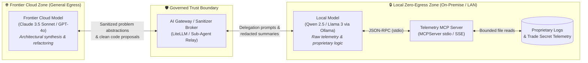

# Telemetry MCP Server: Governed Observability for AI Agents

[](https://modelcontextprotocol.io/)
[](https://www.python.org/)
[](https://docs.astral.sh/uv/)
[-purple.svg)](https://github.com/modelcontextprotocol/python-sdk)
[](https://github.com/astral-sh/ruff)

> **A production-ready Model Context Protocol (MCP) server providing governed, secure application telemetry, system health probes, and log diagnostics to AI models.**

---

## 🌟 The Core Paradigm: Governed Tool Integration

When integrating Large Language Models (LLMs) into SRE, DevOps, or diagnostic workflows, developers face a critical security choice:

```
┌────────────────────────────────────────────────────────┐
│  ❌ THE UNSAFE PATTERN: Raw Shell Access                │
│  LLM  ──>  bash / zsh  ──>  cat / rm / curl / arbitrary │
│  Risk: Prompt injection can wipe drives or exfiltrate  │
└────────────────────────────────────────────────────────┘

┌────────────────────────────────────────────────────────┐
│  ✅ THE GOVERNED PATTERN: Model Context Protocol (MCP)  │
│  LLM  ──>  JSON-RPC 2.0  ──>  Telemetry MCP Server     │
│                              ├── get_system_health()   │
│                              └── read_recent_errors()  │
│  Benefit: Strict API boundaries, path-traversal guards,│
│           bounded context windows, audit logging.       │
└────────────────────────────────────────────────────────┘
```

Instead of granting raw terminal access, the **Telemetry MCP Server** acts as a strictly bounded, observable API layer. The AI agent can diagnose issues autonomously while system administrators retain full control over data access and execution safety.

---

## 🏗️ Architecture Overview

The server communicates with client applications (Continue.dev, Claude Desktop, Cursor, or custom agent runtimes) over **standard input/output (stdio)** using the open **Model Context Protocol (JSON-RPC 2.0)**.

```mermaid
flowchart LR
    subgraph Host["Host Environment (e.g., VS Code / Continue)"]
        User["Developer / Operator"]
        LLM["AI Model (Claude / Qwen / GPT-4)"]
        Client["MCP Client Engine"]
    end

    subgraph Server["Telemetry MCP Server (Python MCPServer / MCP 2.x)"]
        RPC["JSON-RPC 2.0 Router (stdio)"]
        Sec["Security & Path Boundary Guards"]
        
        subgraph Tools["Exposed MCP Tools"]
            T1["get_system_health()"]
            T2["read_recent_errors(service, lines)"]
            T3["search_logs_by_pattern(service, query)"]
            T4["list_available_services()"]
        end

        subgraph Resources["MCP Resources"]
            R1["telemetry://health"]
            R2["telemetry://logs/{service}"]
        end
    end

    subgraph Data["Telemetry Storage"]
        Logs["Service Logs (/logs/*.log)"]
        Metrics["Mock / Real Metric Providers"]
    end

    User -->|"Prompt: Why is auth failing?"| LLM
    LLM -->|"Call: read_recent_errors('auth')"| Client
    Client <-->|"JSON-RPC over stdio"| RPC
    RPC --> Sec
    Sec --> Tools
    Sec --> Resources
    Tools --> Logs
    Tools --> Metrics
    RPC -->|"Structured Error/Log Context"| Client
    Client -->|"Synthesized Diagnosis"| LLM
    LLM -->|"Root Cause: Redis timeout"| User
```



---

## 🛡️ Hybrid-Trust Architecture: Protecting Trade Secrets

While MCP enforces governed API boundaries, enterprise deployments face a critical challenge: **how can teams leverage the reasoning power of frontier cloud models (Claude 3.5 Sonnet, GPT-4o) without exposing trade secrets embedded in application telemetry?**

Real-world production logs frequently contain proprietary algorithm parameters, internal infrastructure topologies (RFC 1918 IPs), and regulated customer data (PII/PCI/HIPAA). Transmitting raw logs to cloud APIs introduces significant IP exfiltration, training ingestion, and compliance risks.

The **Hybrid-Trust Architecture** eliminates this dilemma by establishing two distinct operational trust zones:

1. **Zero-Egress Zone (Local Trust Tier):** A local on-premise model (e.g., Qwen 2.5 32B or Llama 3 via Ollama / `llama.cpp` on an Apple Silicon Mac Studio or private LAN) connects directly to the Telemetry MCP Server. It inspects raw logs, parses proprietary stack traces, and analyzes internal telemetry entirely behind the firewall.
2. **General Egress Zone (Frontier Tier):** Frontier cloud models receive only **sanitized summaries, abstract computer science problems, or scrubbed metrics**, allowing them to generate high-level architectural proposals, complex code refactorings, and pull requests without ever seeing raw trade secrets.



### 📐 Supported Hybrid-Trust Patterns

| Pattern | Mechanism | Best Used For |
| :--- | :--- | :--- |
| 🛡️ [**Dynamic DLP at MCP Layer**](./docs/architecture/dynamic_dlp_pattern.md) | In-server context-aware redaction evaluating client identity and network origin. | Scrubbing PII, tokens, and internal IPs before delivery to external agents. |
| 🤝 [**Sub-Agent Delegation**](./docs/architecture/sub_agent_delegation_pattern.md) | Frontier cloud model prompts a local sub-agent to inspect raw logs and return a summary. | Proprietary trading algorithms, quantitative models, and core IP. |
| ⚙️ [**Strict IDE Profile Binding**](./docs/architecture/strict_ide_profile_binding.md) | Air-gapping MCP servers strictly to local model profiles in Continue.dev / VS Code. | Air-gapped environments, defense systems (ITAR), and zero-cloud compliance. |
| 🔀 [**Gateway Router Pattern**](./docs/architecture/gateway_router_pattern.md) | AI Gateway (LiteLLM) dynamically swaps models based on tool sensitivity. | Enterprise developer fleets requiring automated model switching. |

👉 *For deep-dive use cases (HFT algorithmic trading, HIPAA/PCI compliance, air-gapped systems), threat modeling, and reference configs, see the [**Hybrid-Trust Architecture & Use Cases Guide**](./docs/architecture/hybrid_trust_use_cases.md).*

---

## 🚀 Key Features

- 🛡️ **Defense-in-Depth Path Traversal Protection:** Validates every file access against directory traversal attacks (`../`, symlinks, null-byte injections).
- 🔒 **Hybrid-Trust & Trade Secret Defense:** Architectural patterns for pairing local on-premise models (zero cloud egress) with frontier models, preventing proprietary log leakage.
- 📊 **Context-Budget Aware:** Automatically clamps log output to prevent context window explosion or token exhaustion.
- ⚡ **High-Performance Python Tooling:** Built on Python 3.11+ and packaged with Astral's `uv` for instantaneous dependency resolution.
- 🔄 **Modern MCP 2.x Native:** Uses the official Anthropic MCP 2.x `MCPServer` architecture with full backwards conceptual compatibility with FastMCP.
- 🧪 **First-Class Testing & Verification:** Includes comprehensive test suites for happy paths, negative boundaries, and edge cases.
- 🤖 **AI-First Specification (`AGENTS.md`):** Designed from day one to be developed, maintained, and extended by autonomous AI coding agents.

---

## ⚡ Quickstart Guide

### 1. Prerequisites
- **Python:** `>= 3.11`
- **`uv` (Package Manager):**
  ```bash
  curl -LsSf https://astral.sh/uv/install.sh | sh
  ```
- **Node.js & `npx` (Optional, required only for the `mcp dev` web inspector UI):**
  ```bash
  brew install node
  ```

### 2. Clone & Setup
```bash
git clone https://github.com/YOUR_USERNAME/Telemetry_MCP_Server.git
cd Telemetry_MCP_Server

# Synchronize dependencies
uv sync
```

### 3. Test the Server

#### Option A: Interactive Web Inspector (`mcp dev`)
Test your tools in a browser-based UI using the official MCP inspector:
```bash
uv run mcp dev src/telemetry_mcp_server/server.py
```
*(Requires `npx` / Node.js installed via `brew install node`).*

#### Option B: Direct Python Smoke Test (No Node.js needed)
```bash
uv run python -c "from telemetry_mcp_server.server import get_system_health; print(get_system_health())"
```

#### Option C: Automated Test Suite & Static Analysis
Execute the full regression test suite (happy paths, boundary conditions, and path traversal matrix) alongside code quality gates:
```bash
# Execute 36+ automated unit & security tests
uv run pytest -v

# Verify code formatting, linting, and strict type hints
uv run ruff check .
uv run ruff format --check .
uv run mypy src/
```

---

## 🔌 Connecting to LLM Hosts

### VS Code with Continue.dev (Standard Setup)
Add the server configuration to `~/.continue/config.json`:

```json
{
  "mcpServers": [
    {
      "name": "TelemetryInspector",
      "command": "uv",
      "args": [
        "run",
        "--directory",
        "/Users/YOUR_MAC_USERNAME/Development/Telemetry_MCP_Server",
        "python",
        "src/telemetry_mcp_server/server.py"
      ]
    }
  ]
}
```

### Hybrid-Trust Dual-Profile Setup (Continue.dev)
To enforce air-gapping between trade secrets and cloud APIs, isolate the Telemetry MCP server to a local model profile:

```json
{
  "models": [
    {
      "title": "Cloud (No Telemetry Tools)",
      "provider": "anthropic",
      "model": "claude-3-5-sonnet-20241022",
      "apiKey": "${ANTHROPIC_API_KEY}"
    },
    {
      "title": "Local Secure (Telemetry & Trade Secrets)",
      "provider": "ollama",
      "model": "qwen2.5-coder:32b",
      "apiBase": "http://192.168.1.136:11434"
    }
  ],
  "mcpServers": {
    "TelemetryInspector": {
      "command": "uv",
      "args": [
        "run",
        "--directory",
        "/Users/YOUR_MAC_USERNAME/Development/Telemetry_MCP_Server",
        "python",
        "src/telemetry_mcp_server/server.py"
      ]
    }
  }
}
```

### Claude Desktop
Add to your Claude Desktop config (`~/Library/Application Support/Claude/claude_desktop_config.json` on macOS):

```json
{
  "mcpServers": {
    "telemetry-inspector": {
      "command": "uv",
      "args": [
        "run",
        "--directory",
        "/Users/YOUR_MAC_USERNAME/Development/Telemetry_MCP_Server",
        "python",
        "src/telemetry_mcp_server/server.py"
      ]
    }
  }
}
```

### Local AI Distributed Coding Environment (Tier 3 Context Layer)

When integrated into the **Local AI Distributed Coding Environment** (M5 Pro host running `vllm-mlx` and `litellm` alongside Mac and Windows 11 clients):

#### Mode A: Local Client on Mac Host (Standard stdio)
For VS Code or Continue running locally on the Mac inference host:

```json
{
  "mcpServers": [
    {
      "name": "TelemetryInspector",
      "command": "uv",
      "args": [
        "run",
        "--directory",
        "/Users/YOUR_MAC_USERNAME/Development/Telemetry_MCP_Server",
        "telemetry-mcp-server"
      ]
    }
  ]
}
```
*(Or invoke via `"args": ["run", "--directory", "...", "python", "src/telemetry_mcp_server/server.py"]`)*

#### Mode B: Remote LAN Clients (Windows 11 / Remote IDEs via SSE)
Because Windows 11 clients on the local network cannot spawn local child processes on the Mac host over stdio, run the Telemetry MCP Server as a background daemon on the Mac listening on all network interfaces via SSE:

```bash
# On Mac Host (Terminal):
uv run telemetry-mcp-server --transport sse --host 0.0.0.0 --port 8080
```

Then configure your remote Windows client (VS Code / Continue.dev / Agent Harness) to connect directly to the Mac's LAN IP:

```json
{
  "mcpServers": [
    {
      "name": "TelemetryInspector",
      "url": "http://<mac_ip_address>:8080/sse"
    }
  ]
}
```

#### CLI Options & Environment Variables
| Option | Environment Variable | Default | Description |
| :--- | :--- | :--- | :--- |
| `--transport` | `MCP_TRANSPORT` | `stdio` | Transport protocol (`stdio`, `sse`, `streamable-http`) |
| `--host` | `MCP_HOST` | `0.0.0.0` | Bind host address for network transports |
| `--port` | `MCP_PORT` | `8080` | Bind port number for network transports |
| `--log-dir` | `TELEMETRY_LOG_DIR` | `./logs` | Directory path containing monitored service logs |

---

## 💬 Sample Agentic Interaction

Once connected, you can prompt your AI assistant naturally:

> **User:** *"Are there any active issues affecting our authentication service?"*

**Behind the Scenes:**
1. The LLM checks its available tool schemas and identifies `TelemetryInspector`.
2. It invokes `read_recent_errors(service_name="auth", lines=20)`.
3. The MCP server sanitizes the path, verifies that `logs/auth.log` exists inside the allowed root, tails the last 20 lines, and returns them over stdio.
4. The LLM reads the result and answers:
> *"Yes. The authentication service is experiencing intermittent Redis connection timeouts during token verification (`ConnectionTimeout: Redis cache unreachable at 10.0.4.12:6379`). The database connection pool remains healthy."*

---

## 💼 Portfolio & Interview Framing

This project is tailored to demonstrate senior-level AI systems engineering concepts:

| Interview Talking Point | Implementation in this Repository |
| :--- | :--- |
| **Agent Governance** | Enforcing strict API boundaries rather than raw terminal execution. |
| **Protocol Evolution (MCP 2.x)** | Up-to-date with the official Anthropic MCP 2.x standard (`MCPServer`), migrating cleanly from v1 `FastMCP`. |
| **Tool Design for LLMs** | Semantic docstrings engineered for zero-shot tool selection by small/local LLMs (Qwen 30B, Llama 3) and frontier models. |
| **Security & Containment** | Defensive path resolution preventing directory traversal (`tests/test_security.py`). |
| **Context Window Economics** | Bounded line tailing and pagination to prevent log flooding into LLM prompts. |
| **Hybrid-Trust Architecture** | Protecting trade secrets by binding local models (Qwen, Llama) to sensitive telemetry while using cloud frontier models (Claude, GPT) for general reasoning. |
| **AI-First Engineering** | Machine-readable development contract codified in [`AGENTS.md`](./AGENTS.md). |

---

## 📚 Supporting Documentation

- 🧭 [**Documentation Hub (`docs/README.md`)**](./docs/README.md) — Central documentation index and navigation map.
- 🤖 [**`AGENTS.md`**](./AGENTS.md) — The AI agent operating contract, coding standards, and runbooks.
- 🏛️ [**`docs/architecture.md`**](./docs/architecture.md) — Deep dive into the MCP protocol, security boundary design, and wire protocol.
- 🛡️ [**`docs/architecture/hybrid_trust_use_cases.md`**](./docs/architecture/hybrid_trust_use_cases.md) — Enterprise hybrid-trust use cases, trade secret protection, and threat models.
- 📐 [**`docs/architecture/README.md`**](./docs/architecture/README.md) — Modular architecture patterns (Dynamic DLP, Sub-Agent, Profile Binding, Gateway Router).
- 🗺️ [**`docs/roadmap.md`**](./docs/roadmap.md) — Phased skill development curriculum (MVP to Enterprise OpenTelemetry).
- 🎬 [**`docs/runbooks/showcase_runbook.md`**](./docs/runbooks/showcase_runbook.md) — 5-minute live demo script and interview walkthrough.
- 📖 [**`docs/tutorials/building_your_first_mcp_server.md`**](./docs/tutorials/building_your_first_mcp_server.md) — Step-by-step foundation walkthrough.

---

## 📄 License
MIT License. Free to use for learning, portfolio showcases, and production adaptations.
