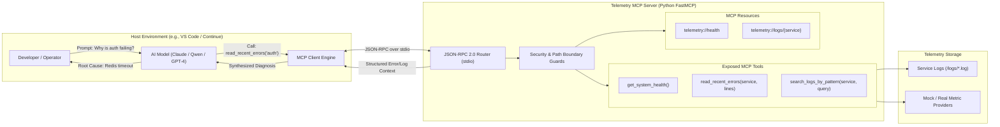

# Telemetry MCP Server: Governed Observability for AI Agents

[](https://modelcontextprotocol.io/)
[](https://www.python.org/)
[](https://docs.astral.sh/uv/)
[](https://github.com/modelcontextprotocol/python-sdk)
[](https://github.com/astral-sh/ruff)

> **A production-ready Model Context Protocol (MCP) server providing governed, secure application telemetry, system health probes, and log diagnostics to AI models.**

---

## 🌟 The Core Paradigm: Governed Tool Integration

When integrating Large Language Models (LLMs) into SRE, DevOps, or diagnostic workflows, developers face a critical security choice:

```
┌────────────────────────────────────────────────────────┐
│  ❌ THE UNSAFE PATTERN: Raw Shell Access                │
│  LLM  ──>  bash / zsh  ──>  cat / rm / curl / arbitrary │
│  Risk: Prompt injection can wipe drives or exfiltrate  │
└────────────────────────────────────────────────────────┘

┌────────────────────────────────────────────────────────┐
│  ✅ THE GOVERNED PATTERN: Model Context Protocol (MCP)  │
│  LLM  ──>  JSON-RPC 2.0  ──>  Telemetry MCP Server     │
│                              ├── get_system_health()   │
│                              └── read_recent_errors()  │
│  Benefit: Strict API boundaries, path-traversal guards,│
│           bounded context windows, audit logging.       │
└────────────────────────────────────────────────────────┘
```

Instead of granting raw terminal access, the **Telemetry MCP Server** acts as a strictly bounded, observable API layer. The AI agent can diagnose issues autonomously while system administrators retain full control over data access and execution safety.

---

## 🏗️ Architecture Overview

The server communicates with client applications (Continue.dev, Claude Desktop, Cursor, or custom agent runtimes) over **standard input/output (stdio)** using the open **Model Context Protocol (JSON-RPC 2.0)**.



---

## 🚀 Key Features

- 🛡️ **Defense-in-Depth Path Traversal Protection:** Validates every file access against directory traversal attacks (`../`, symlinks, null-byte injections).
- 📊 **Context-Budget Aware:** Automatically clamps log output to prevent context window explosion or token exhaustion.
- ⚡ **High-Performance Python Tooling:** Built on Python 3.11+ and packaged with Astral's `uv` for instantaneous dependency resolution.
- 🧪 **First-Class Testing & Verification:** Includes comprehensive test suites for happy paths, negative boundaries, and edge cases.
- 🤖 **AI-First Specification (`AGENTS.md`):** Designed from day one to be developed, maintained, and extended by autonomous AI coding agents.

---

## ⚡ Quickstart Guide

### 1. Prerequisites
Install `uv` (modern Python package manager):
```bash
curl -LsSf https://astral.sh/uv/install.sh | sh
```

### 2. Clone & Setup
```bash
git clone https://github.com/YOUR_USERNAME/Telemetry_MCP_Server.git
cd Telemetry_MCP_Server

# Synchronize dependencies
uv sync
```

### 3. Test with the Interactive MCP Inspector
The MCP SDK comes with an official web inspector. Spin it up instantly without needing an LLM:
```bash
uv run mcp dev src/telemetry_mcp/server.py
```
*Open the displayed browser URL to interactively invoke tools, inspect JSON schemas, and review protocol messages.*

---

## 🔌 Connecting to LLM Hosts

### VS Code with Continue.dev (Local LLM or API)
Add the server configuration to `~/.continue/config.json`:

```json
{
  "mcpServers": [
    {
      "name": "TelemetryInspector",
      "command": "uv",
      "args": [
        "run",
        "--directory",
        "/ABSOLUTE/PATH/TO/Telemetry_MCP_Server",
        "python",
        "-m",
        "telemetry_mcp.server"
      ]
    }
  ]
}
```

### Claude Desktop
Add to your Claude Desktop config (`~/Library/Application Support/Claude/claude_desktop_config.json` on macOS):

```json
{
  "mcpServers": {
    "telemetry-inspector": {
      "command": "uv",
      "args": [
        "run",
        "--directory",
        "/ABSOLUTE/PATH/TO/Telemetry_MCP_Server",
        "python",
        "-m",
        "telemetry_mcp.server"
      ]
    }
  }
}
```

---

## 💬 Sample Agentic Interaction

Once connected, you can prompt your AI assistant naturally:

> **User:** *"Are there any active issues affecting our authentication service?"*

**Behind the Scenes:**
1. The LLM checks its available tool schemas and identifies `TelemetryInspector`.
2. It invokes `read_recent_errors(service_name="auth", lines=20)`.
3. The MCP server sanitizes the path, verifies that `logs/auth.log` exists inside the allowed root, tails the last 20 lines, and returns them over stdio.
4. The LLM reads the result and answers:
> *"Yes. The authentication service is experiencing intermittent Redis connection timeouts during token verification (`ConnectionTimeout: Redis cache unreachable at 10.0.4.12:6379`). The database connection pool remains healthy."*

---

## 💼 Portfolio & Interview Framing (e.g. Microsoft Foundry)

This project is tailored to demonstrate senior-level AI systems engineering concepts:

| Interview Talking Point | Implementation in this Repository |
| :--- | :--- |
| **Agent Governance** | Enforcing strict API boundaries rather than raw terminal execution. |
| **Tool Design for LLMs** | Semantic docstrings engineered for zero-shot tool selection by small/local LLMs (Qwen 30B, Llama 3) and frontier models. |
| **Security & Containment** | Defensive path resolution preventing directory traversal (`tests/test_security.py`). |
| **Context Window Economics** | Bounded line tailing and pagination to prevent log flooding into LLM prompts. |
| **AI-First Engineering** | Machine-readable development contract codified in [`AGENTS.md`](./AGENTS.md). |

---

## 📚 Supporting Documentation

- 🤖 [**`AGENTS.md`**](./AGENTS.md) — The AI agent operating contract, coding standards, and runbooks.
- 🏛️ [**`ARCHITECTURE.md`**](./ARCHITECTURE.md) — Deep dive into the MCP protocol, security boundary design, and wire protocol.
- 🗺️ [**`ROADMAP.md`**](./ROADMAP.md) — Phased skill development curriculum (MVP to Enterprise OpenTelemetry).
- 🎬 [**`SHOWCASE_RUNBOOK.md`**](./SHOWCASE_RUNBOOK.md) — 5-minute live demo script and interview walkthrough.
- 📖 [**`building_your_first_mcp_server.md`**](./building_your_first_mcp_server.md) — Original introductory walkthrough.

---

## 📄 License
MIT License. Free to use for learning, portfolio showcases, and production adaptations.
