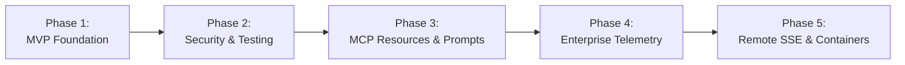

# Skill Development & Feature Roadmap

This roadmap is designed for **structured skill development** and **portfolio showcasing**. Each milestone builds tangible engineering competencies in AI systems, protocol design, tool governance, and automated testing.

---

## 🎯 Milestone Overview

---

## Phase 1: MVP Foundation (Completed Baseline)
*Focus: Understanding MCP basics, MCPServer architecture, and local LLM client binding.*

- [x] Initialize project using `uv` with official `mcp[cli]` (v2.x) SDK.
- [x] Implement baseline `MCPServer("TelemetryInspector")` instance.
- [x] Expose initial tools:
  - `get_system_health()`: Returns mock JSON with service health, latency, and alert count.
  - `read_recent_errors(service_name, lines)`: Tails local log files.
- [x] Local verification via `uv run python` or `uv run mcp dev src/telemetry_mcp_server/server.py`.
- [x] Bind to VS Code / Continue.dev configuration.

**Key Competencies Acquired:**
- Model Context Protocol primitives (stdio, tool discovery, client-host architecture).
- `MCPServer` tool decorators and dynamic OpenAPI schema generation.
- Local AI pairing with Continue.dev.
- Navigating evolving protocol SDK specifications (MCP 1.x to 2.x migration).

---

## Phase 2: Security Hardening & Automated Testing (Current Target)
*Focus: Defense-in-depth, input sanitization, test-driven tool development.*

- [ ] **Path Traversal Protection:**
  - Create `telemetry_mcp_server.security` module.
  - Implement canonical path validation (`os.path.realpath`, `os.path.commonpath`).
  - Restrict `service_name` to strict regex identifier (`^[a-zA-Z0-9_-]+$`).
- [ ] **Context Window Bounds:**
  - Clamp log tailing requests to safe upper limit (e.g., maximum 200 lines).
  - Truncate excessively long individual log lines (> 1,000 characters).
- [ ] **Automated Test Suite (`pytest`):**
  - Unit tests for happy-path log retrieval.
  - Negative security tests verifying rejection of `../`, `/etc/passwd`, and null bytes.
  - Mock log fixtures with realistic multi-service error scenarios.
- [ ] **Static Analysis & Typing:**
  - Add `ruff` formatting and linting rules.
  - Enforce `mypy` strict type checking on all tool signatures.

**Key Competencies Acquired:**
- AI safety: Preventing LLM prompt injection and Confused Deputy attacks.
- Robust Python API design with defense-in-depth sanitization.
- Automated testing of agentic tools.

---

## Phase 3: MCP Resources & Incident Prompts
*Focus: Mastering the complete MCP specification beyond simple tools.*

- [ ] **Implement MCP Resources:**
  - `telemetry://health`: Expose real-time platform health summary as a readable resource.
  - `telemetry://logs/{service}`: Expose live service log streams as dynamic MCP resources.
- [ ] **Implement MCP Prompts:**
  - `incident_triage(service_name, incident_id)`: A standardized diagnostic prompt template that instructs the LLM to:
    1. Query `get_system_health` to evaluate system-wide blast radius.
    2. Tail error logs for the affected service.
    3. Synthesize root cause and suggest remediation steps.
- [ ] **Service Discovery:**
  - Tool `list_monitored_services()`: Automatically scans the log directory and returns available service names.

**Key Competencies Acquired:**
- MCP Resources vs. Tools distinction and architectural trade-offs.
- Prompt template orchestration via the MCP protocol.
- Autonomous multi-step diagnosis patterns.

---

## Phase 4: Enterprise Observability & Synthetic Workloads
*Focus: Real-world SRE tooling, structured log parsing, and regex searching.*

- [ ] **Regex & Pattern Search Tool:**
  - Implement `search_logs_by_pattern(service_name, pattern, max_matches)` for pinpointing specific trace IDs, HTTP status codes, or exception classes.
- [ ] **Structured JSON Log Support:**
  - Add parsing for structured JSON log entries (timestamps, log level, trace_id, caller).
  - Implement `filter_logs(service_name, level, start_time)` (e.g., filter only `ERROR` or `CRITICAL`).
- [ ] **Synthetic Incident Generator Script:**
  - Create `scripts/simulate_incident.py` that continuously injects realistic traffic and faults (e.g., Redis timeouts, database deadlocks, memory leaks) into mock log files for live demonstrations.

**Key Competencies Acquired:**
- Structured log processing and high-performance text scanning in Python.
- Live incident simulation and automated AI-driven root cause analysis (RCA).

---

## Phase 5: Containerization & Remote Transport (SSE)
*Focus: Cloud-native deployment, containerization, and remote agent connectivity.*

- [ ] **Docker Packaging:**
  - Build a lightweight `Dockerfile` using multi-stage `uv` builds.
- [ ] **Server-Sent Events (SSE) Transport Mode:**
  - Support `--transport sse` for hosting the MCP server over HTTP/HTTPS for remote agents.
- [ ] **Authentication & Access Control:**
  - Basic API token validation for HTTP/SSE endpoints.

**Key Competencies Acquired:**
- Packaging MCP servers for production Kubernetes/container environments.
- Remote vs. local MCP architectures.
