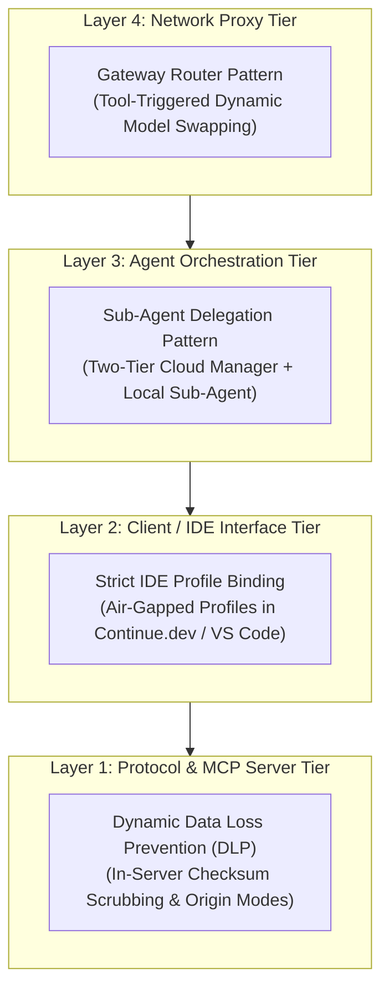
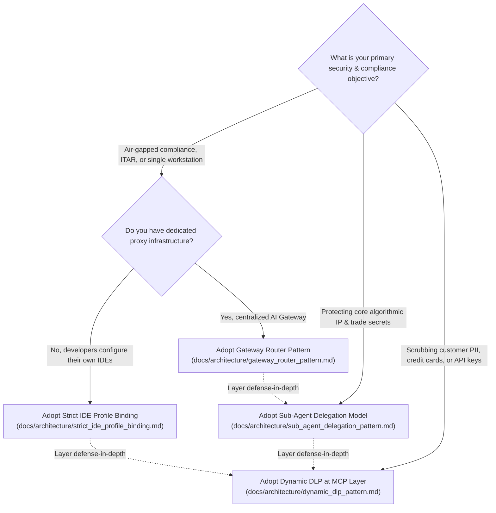

# Architecture & Hybrid-Trust Design Patterns

[](https://modelcontextprotocol.io/)
[](#)
[](#)

Welcome to the **Architecture & Hybrid-Trust Design Patterns Hub** for the **Telemetry MCP Server**. 

This directory serves as the comprehensive architectural specification for running Model Context Protocol servers in enterprise environments where **frontier cloud models** (Claude 3.5 Sonnet, GPT-4o) must be paired with **on-premise local models** (Qwen 2.5 Coder, Llama 3.3 via Ollama or `llama.cpp`) to diagnose production systems without exposing trade secrets, customer PII, or proprietary business logic.

---

## 🧭 The Hybrid-Trust Paradigm

Modern AI engineering faces a fundamental security challenge:

```
┌────────────────────────────────────────────────────────────────────────┐
│  ❌ THE NAIVE CLOUD PATTERN                                            │
│  Frontier Cloud LLM <─── Direct Raw Logs ─── Internal Infrastructure   │
│  Risks: Proprietary trade secrets, PANs, PII, and tokens uploaded to   │
│         third-party cloud endpoints; prompt injection exfiltration.    │
└────────────────────────────────────────────────────────────────────────┘

┌────────────────────────────────────────────────────────────────────────┐
│  ✅ THE HYBRID-TRUST PATTERN                                            │
│  Frontier Cloud LLM <─── Sanitized Brief ─── Local Sub-Agent / DLP     │
│                                                │                       │
│                                           Local Stdio                  │
│                                                ▼                       │
│                                      Telemetry MCP Server              │
│                                                │                       │
│                                         Bounded Read                   │
│                                                ▼                       │
│                                      Proprietary Logs & Telemetry      │
│  Guarantees: Zero raw cloud egress, 100% data sovereignty,             │
│              97% token reduction, and maximum architectural reasoning. │
└────────────────────────────────────────────────────────────────────────┘
```

---

## 📚 Architectural Documents & Design Patterns

The Telemetry MCP Server implements four complementary defense-in-depth patterns across four different layers of the AI engineering stack:



| Pattern & Document | Architectural Layer | Primary Protection Target | Developer Friction | Implementation Complexity |
| :--- | :--- | :--- | :--- | :--- |
| 🛡️ [**`dynamic_dlp_pattern.md`**](./dynamic_dlp_pattern.md) | **MCP Server / Middleware** | Customer PII, PCI-DSS cardholder data (Luhn-checked), JWTs, internal RFC 1918 IPs | **Zero** (Completely Transparent) | Medium (Regex & Luhn Checksums) |
| 🤝 [**`sub_agent_delegation_pattern.md`**](./sub_agent_delegation_pattern.md) | **Agent Orchestration** | Core proprietary algorithms, quantitative trading alpha weights, lock-free ring buffers | Low (Handled by Primary Agent) | Medium-High (Two-Tier LLM Hierarchy) |
| ⚙️ [**`strict_ide_profile_binding.md`**](./strict_ide_profile_binding.md) | **Client / IDE Configuration** | Defense systems (ITAR), air-gapped workstations, accidental cloud tool calls | Low-Medium (Profile Switch) | **Minimal** (Config JSON + Pre-Flight Linter) |
| 🔀 [**`gateway_router_pattern.md`**](./gateway_router_pattern.md) | **Network Proxy (LiteLLM)** | Enterprise developer fleets, dynamic token cost arbitrage, centralized audit logging | **Zero** (Automated at Network Layer) | **Implemented & Verified** |
| 🏢 [**`hybrid_trust_use_cases.md`**](./hybrid_trust_use_cases.md) | **Master Use Case Guide** | Quantitative finance (HFT), healthcare (HIPAA), payments (PCI-DSS), air-gapped defense | Reference | Reference Guide & Threat Models |

---

## 🎯 Architectural Selection Flowchart: Which Pattern Should You Use?

Use this decision matrix to determine the optimal pattern for your deployment:



---

## 🛠️ Verification, Linting & Simulation Tooling in this Repository

This repository doesn't just specify these patterns—it includes automated scripts and test suites to verify and demonstrate them live:

1. **Pre-Flight IDE Configuration Linter (`scripts/verify_ide_isolation.py`):**
   - Automatically inspects Continue.dev, VS Code, and Cursor configs.
   - Enforces air-gapping, checks for valid `SECURITY_MODE` settings, and prevents accidental binding of sensitive telemetry tools to cloud models.
   - Run via: `uv run python scripts/verify_ide_isolation.py --config examples/continue_config.json`.
2. **Synthetic Incident Generator (`scripts/simulate_incident.py`):**
   - Injects realistic, simulated faults (Redis timeouts, database deadlocks, memory leaks, and HFT race conditions) into mock log files for live agentic triage demonstrations.
   - Run via: `uv run python scripts/simulate_incident.py --services auth,payment,database --duration 30`.
3. **AI Gateway Router & Model Swapper Proxy (`scripts/gateway_proxy.py`):**
   - Intercepts OpenAI-compatible completions, inspects tool schemas and message history, and dynamically routes sensitive telemetry requests to `local-secure` with fail-closed security guarantees (zero cloud egress).
   - Reference config in [`config/litellm_config.yaml`](../../config/litellm_config.yaml).
   - Run via: `python scripts/gateway_proxy.py --port 4000 --config config/litellm_config.yaml`.
4. **Automated Hybrid-Trust Test Suite:**
   - [`tests/test_dlp.py`](../../tests/test_dlp.py): Verifies Luhn-valid PAN masking, SSN scrubbing, and JWT removal.
   - [`tests/test_delegation.py`](../../tests/test_delegation.py): Verifies sub-agent abstraction and heuristic fallbacks.
   - [`tests/test_verify_ide_isolation.py`](../../tests/test_verify_ide_isolation.py): Validates pre-flight configuration linter logic.
   - [`tests/test_security_posture.py`](../../tests/test_security_posture.py): Validates `get_security_posture()` compliance reporting.
   - [`tests/test_gateway_router.py`](../../tests/test_gateway_router.py): Validates tool call interception, dynamic model routing, fail-closed security, and context state pruning.

---

## 🔗 Related Documentation

- 📖 [**System Architecture Overview**](../architecture.md) — Baseline MCP 2.x protocol, stdio transport, and security boundaries.
- 📋 [**Agent Tool Reference**](../tools_reference.md) — Complete parameter specifications and schemas for all exposed MCP tools.
- 🚀 [**Showcase Runbook & Interview Script**](../runbooks/showcase_runbook.md) — 5-minute live demo script and interview talking points.
- 🛣️ [**Skill Development Roadmap**](../roadmap.md) — 10-phase curriculum from MVP to Enterprise Hybrid-Trust Architectures.
