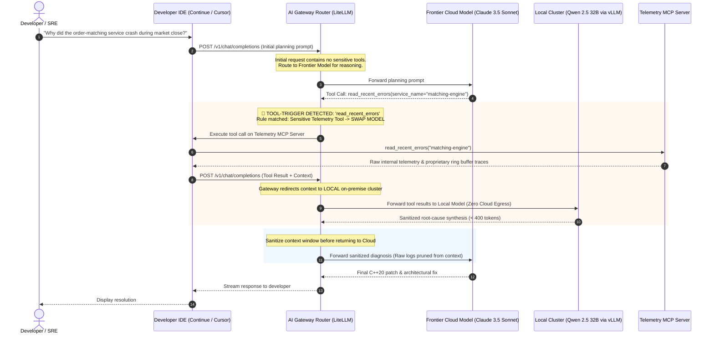
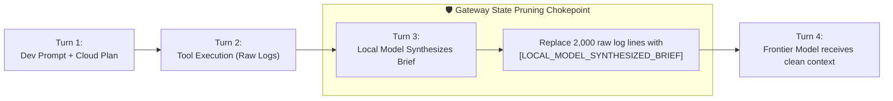

# Architecture Pattern: The AI Gateway Router (Tool-Triggered Dynamic Model Swapping)

[](https://modelcontextprotocol.io/)
[](#)
[](#)

## 1. Executive Summary & Problem Statement

In enterprise organizations with hundreds of software engineers, relying on developers to manually switch IDE profiles (the [Strict IDE Profile Binding](./strict_ide_profile_binding.md) pattern) introduces operational risk:
- **Human Error:** Engineers under incident stress may forget to toggle profiles, inadvertently asking cloud models to inspect raw internal telemetry.
- **Client Fragmentation:** Different teams use different editors (VS Code, Cursor, JetBrains, Continue.dev, Claude Desktop), making client-level enforcement difficult to audit centrally.
- **Lack of Unified Audit Trails:** Security and compliance teams cannot verify whether sensitive stack traces were transmitted to external cloud APIs without centralized network inspection.

**The Solution:** The **AI Gateway Router Pattern**. 
This pattern places an intelligent AI Gateway (such as **LiteLLM**, **Cloudflare AI Gateway**, or an enterprise Envoy/Kong proxy) between developer IDEs and inference providers. The gateway inspects outgoing JSON-RPC tool requests in real time. When a prompt triggers a sensitive telemetry tool, the gateway **dynamically hot-swaps the underlying model**, routing the conversation to an on-premise local inference engine without requiring any developer intervention.

---

## 2. Architectural Blueprint & Sequence Flow



---

## 3. Reference Implementation: LiteLLM Gateway Configuration

The following production configuration (`litellm_config.yaml`) illustrates how to implement tool-based routing and automated model swapping:

```yaml
model_list:
  # 1. Frontier Tier (Cloud Egress - High-level reasoning)
  - model_name: general-reasoning
    litellm_params:
      model: anthropic/claude-3-5-sonnet-20241022
      api_key: os.environ/ANTHROPIC_API_KEY
      rpm: 100

  # 2. Local Trust Tier (Zero Egress - Sensitive Telemetry & Trade Secrets)
  - model_name: local-telemetry-secure
    litellm_params:
      model: openai/qwen2.5-coder-32b
      api_base: http://vllm-cluster.internal.lan:8000/v1
      api_key: "none"
      tpm: 500000

router_settings:
  routing_strategy: "tool-name-inspection"
  rules:
    # Route sensitive diagnostic tools strictly to the local on-premise cluster
    - match_tool_names:
        - "read_recent_errors"
        - "search_logs_by_pattern"
        - "filter_logs"
        - "delegate_telemetry_investigation"
      route_to: "local-telemetry-secure"
      strip_raw_tool_results_before_cloud_handoff: true

    # Default all benign coding and planning tasks to the frontier model
    - default: "general-reasoning"

general_settings:
  master_key: os.environ/LITELLM_MASTER_KEY
  alerting: ["slack"]
  alerting_threshold: 500 # Alert on unexpected routing anomalies
```

---

## 4. Context Lifecycle & State Pruning

A major technical hurdle in tool-triggered model swapping is **context hygiene**:
If the local model processes 2,000 lines of raw proprietary logs to produce a diagnosis, that raw log output must **not** remain in the conversation history when control returns to the cloud model on the next turn.

The Gateway Router solves this via **State Pruning**:



1. **Before Cloud Resumption:** The Gateway replaces the multi-megabyte raw tool output in the message history with the local model's concise summary.
2. **Context Window Protection:** Prevents context window blowout and eliminates "Lost in the Middle" degradation.
3. **Guaranteed Zero-Egress:** Even if the conversation continues for 20 more turns with Claude 3.5, the raw proprietary logs are never transmitted upstream.

---

## 5. Enterprise Deployment Topologies

Organizations can deploy the Gateway Router in two primary architectures depending on infrastructure maturity:

### Topology A: Workstation-Local Proxy (Individual Developers)
- **Deployment:** A single Docker container running LiteLLM or an Envoy sidecar on `localhost:4000`.
- **Target:** Independent developers or small teams using an Apple Silicon Mac Studio running Ollama alongside cloud APIs.
- **Benefits:** Quick setup, zero cloud infrastructure cost.

### Topology B: Centralized Enterprise Kubernetes Cluster
- **Deployment:** A redundant LiteLLM ingress fleet deployed in a private Kubernetes cluster (EKS/GKE/on-premise).
- **Backend:** Routes local inference requests to a high-throughput **vLLM** or **Triton Inference Server** cluster equipped with private NVIDIA A100/H100 or L40S GPUs.
- **Benefits:** Unified enterprise audit logging, hardware cost amortization across 1,000+ developers, centralized DLP rule management.

---

## 6. Pattern Comparison & Selection Guide

| Architectural Dimension | [Dynamic DLP](./dynamic_dlp_pattern.md) | [Sub-Agent Delegation](./sub_agent_delegation_pattern.md) | [Strict IDE Binding](./strict_ide_profile_binding.md) | **Gateway Router Pattern** |
| :--- | :--- | :--- | :--- | :--- |
| **Trust Boundary** | MCP Server Payload | Agent Prompt Layer | IDE User Interface | **Network Proxy Layer** |
| **Enforcement Point** | Server-side (`dlp.py`) | Orchestrating Agent | Client Config (`config.json`) | Centralized Proxy (`litellm`) |
| **Developer Friction** | **Zero** | Low | Low-Medium (Profile Switch) | **Zero** (Completely Transparent) |
| **Implementation Effort** | Low-Medium | Medium | Minimal (Config only) | High (Requires Proxy Infra) |
| **Best Suited For** | Scrubbing PII, tokens, IPs | Proprietary algorithms & quants | Air-gapped / ITAR defense | **Enterprise-wide developer fleets** |

---

## 7. Related Documentation & Next Steps

- 🏢 [**Hybrid-Trust Architecture & Enterprise Use Cases**](./hybrid_trust_use_cases.md) — Comprehensive guide on quantitative trading, HIPAA, and air-gapped defense.
- 🛡️ [**Dynamic DLP Pattern**](./dynamic_dlp_pattern.md) — In-server payload sanitization and credential scrubbing.
- 🤝 [**Sub-Agent Delegation Pattern**](./sub_agent_delegation_pattern.md) — Two-tier agent orchestration with local sub-agents.
- ⚙️ [**Strict IDE Profile Binding**](./strict_ide_profile_binding.md) — UI air-gapping within Continue.dev.
