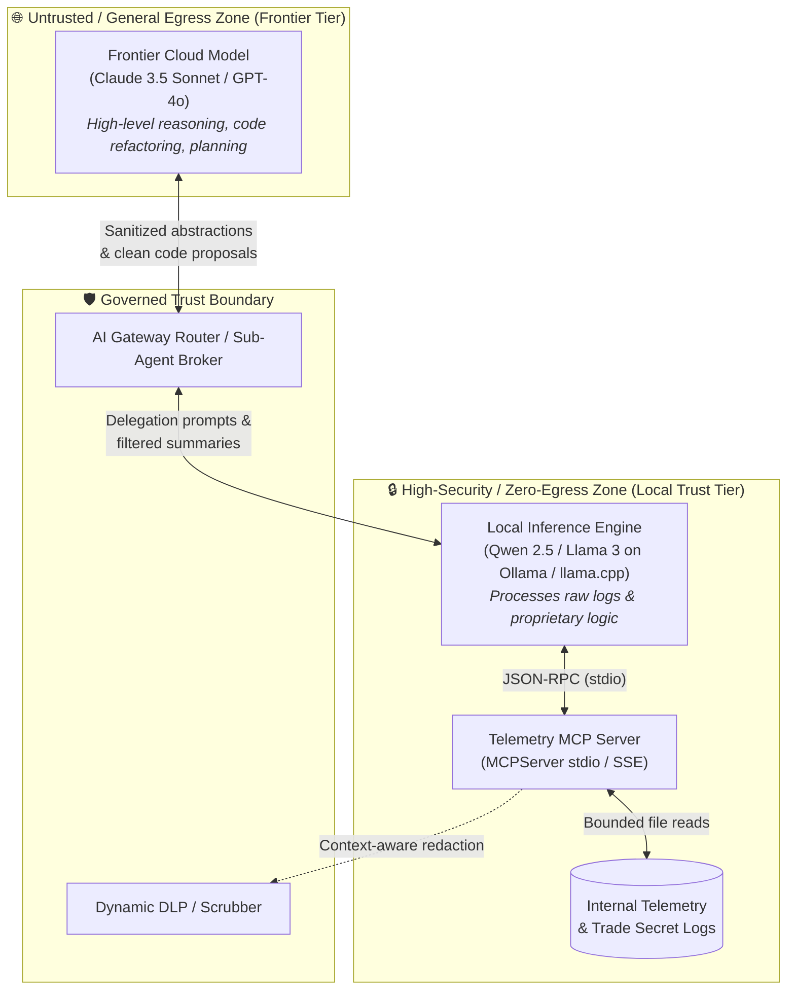

# Hybrid-Trust Architecture & Enterprise Use Cases

This document details the **Hybrid-Trust Architecture** for the **Telemetry MCP Server**. It explains how organizations can safely combine the high-level reasoning capabilities of **Frontier Cloud Models** (e.g., Claude 3.5 Sonnet, GPT-4o) with the privacy, compliance, and air-gapping guarantees of **Local On-Premise Models** (e.g., Qwen 2.5 32B/72B, Llama 3.3 70B via `llama.cpp` or Ollama) to protect trade secrets and sensitive telemetry.

---

## 🛡️ The Hybrid-Trust Paradigm

Modern AI engineering faces a fundamental security dilemma:

1. **Frontier Models** excel at deep architectural reasoning, cross-codebase synthesis, and complex code generation, but sending raw internal telemetry to external cloud endpoints introduces severe data exfiltration, regulatory violation, and trade-secret exposure risks.
2. **Local Models** running entirely on-premise (e.g., Apple Silicon M-series workstations or local LAN inference clusters) guarantee 100% data sovereignty and zero cloud egress, but have tighter resource constraints for enterprise-wide architectural synthesis.
3. **The Solution:** The **Hybrid-Trust Model**. By placing the **Telemetry MCP Server** at the boundary of a dual-trust ecosystem, organizations enforce strict capability boundaries. Raw telemetry, proprietary stack traces, and internal health metrics remain strictly inside the local trust zone, while sanitized findings and abstract problem statements are safely escalated to frontier models.



---

## 🏢 Enterprise Hybrid-Trust Use Cases

### 1. Proprietary Algorithm & High-Frequency Trading (HFT) Incident Diagnosis
* **Industry:** Quantitative Finance, Algorithmic Trading, Proprietary Market Making.
* **The Vulnerability:** Production error logs from an order matching engine reveal proprietary pricing formulas, fill probability models, execution tick data, or internal latency metrics. Ingesting these raw logs into a cloud model risks leaking core intellectual property into third-party cloud infrastructure or model training pools.
* **Hybrid-Trust Flow:**
  1. The user prompts the agent harness to investigate an execution anomaly.
  2. The local inference engine (e.g., Qwen 2.5 32B running locally on a dedicated Mac Studio or internal node `192.168.1.136`) invokes `read_recent_errors("matching-engine")`.
  3. The local model inspects raw execution logs and identifies a race condition in custom lock-free memory ring buffers.
  4. The local model **synthesizes and sanitizes** the finding into an abstract computer science problem:
     > *"Identified a concurrency hazard: Thread A updates atomic sequence pointer without release semantics prior to Thread B loading index."*
  5. The sanitized description is passed to Claude 3.5 Sonnet to generate an optimized, memory-safe C++20 / Rust patch.
* **Applicable Patterns:** [Sub-Agent Delegation Pattern](./sub_agent_delegation_pattern.md) & [Strict IDE Profile Binding](./strict_ide_profile_binding.md).

---

### 2. Regulated Healthcare & Financial Services (HIPAA / PCI-DSS / PII Triage)
* **Industry:** Healthcare (EHR/HealthTech), Payments (FinTech), Banking.
* **The Vulnerability:** Diagnostic logs generated during authentication failures, database deadlocks, or payment gateway timeouts often contain cardholder data (PANs), patient health identifiers (PHI), internal RFC 1918 IP addresses, or OAuth bearer tokens. Passing these to external cloud endpoints breaches PCI-DSS Requirement 3 and HIPAA Privacy Rules.
* **Hybrid-Trust Flow:**
  1. When a cloud agent initiates telemetry queries, the Telemetry MCP Server evaluates the request origin and client trust level.
  2. Outgoing JSON-RPC payloads pass through the server's **Dynamic DLP Layer**:
     - Credit card numbers are masked (`4111-XXXX-XXXX-1111`).
     - Healthcare identifiers are tokenized (`[PATIENT_ID_REDACTED]`).
     - Session tokens are scrubbed (`Bearer [TOKEN_SCRUBBED]`).
  3. The frontier model receives clean, compliant diagnostic traces sufficient to pinpoint the architectural bottleneck (e.g., Redis timeout or connection pool exhaustion) without regulatory exposure.
  4. If deep unredacted forensic investigation is required, the engineer switches to the local on-premise model, which reads unredacted logs under strict audit logging.
* **Applicable Pattern:** [Dynamic DLP Pattern at the MCP Layer](./dynamic_dlp_pattern.md).

---

### 3. Air-Gapped Core IP & Defense Systems (Zero-Cloud Telemetry)
* **Industry:** Defense, Aerospace, Critical Infrastructure, Secret Industrial Codebases.
* **The Vulnerability:** Under export controls (ITAR) or federal certifications (FedRAMP High / On-Premise Air-Gap), telemetry cannot touch internet-connected endpoints under any circumstances.
* **Hybrid-Trust Flow:**
  1. Developers utilize **Strict IDE Profile Binding** in Continue.dev or VS Code.
  2. The **"Cloud / Public" Profile** connects to commercial APIs exclusively for boilerplate code generation, public documentation queries, and UI styling. The Telemetry MCP Server is completely omitted from this profile configuration.
  3. The **"Internal / Air-Gapped" Profile** points to a local endpoint (`http://localhost:11434/v1` or `llama.cpp`) and attaches the Telemetry MCP Server via standard `stdio`.
  4. The model physically capable of calling `read_recent_errors` or `get_system_health` cannot transmit data outside the workstation's loopback interface.
* **Applicable Pattern:** [Strict IDE Profile Binding](./strict_ide_profile_binding.md).

---

### 4. Automated Incident Routing & Model Swapping via AI Gateway
* **Industry:** High-scale Enterprise SaaS Platforms.
* **The Vulnerability:** Developers and SREs often do not know in advance whether an error trace contains proprietary business logic or benign framework errors. Manually toggling profiles introduces friction and human error.
* **Hybrid-Trust Flow:**
  1. The IDE communicates with an intelligent AI Gateway (e.g., LiteLLM or an enterprise API proxy).
  2. The developer asks a broad question: *"Why is the checkout service degrading?"*
  3. The Gateway routes initial high-level planning to Claude 3.5 Sonnet.
  4. When the plan generates a tool call targeting restricted services (e.g., `read_recent_errors(service_name="payment_processor")`), the Gateway intercepts the tool call.
  5. The Gateway redirects the prompt, context, and tool execution to the **local inference engine**.
  6. The local engine executes the tool call, analyzes the proprietary stack trace, and generates an anonymized summary before returning control to the primary cloud session.
* **Applicable Pattern:** [Gateway Router Pattern](./gateway_router_pattern.md).

---

### 5. Cost & Context Window Optimization in Continuous Observability
* **Industry:** DevOps, Site Reliability Engineering (SRE), Autonomous Agentic Monitoring.
* **The Vulnerability:** Streaming hundreds of log lines or polling system health every 30 seconds against cloud frontier APIs incurs prohibitive token costs, rate-limiting risks, and context window pollution ("Lost in the Middle").
* **Hybrid-Trust Flow:**
  1. A lightweight local model (e.g., Qwen 2.5 14B / 32B) continuously polls `get_system_health()` and tails logs via `read_recent_errors(lines=50)` at **zero token cost**.
  2. The local model continuously classifies telemetry: `NOMINAL` vs `ANOMALY`.
  3. When an anomaly matches an unknown or critical pattern, the local model prepares a concise, bounded incident brief (< 500 tokens).
  4. The incident brief is escalated to a frontier model for multi-component root cause analysis and automated PR generation.
* **Applicable Patterns:** [Gateway Router Pattern](./gateway_router_pattern.md) & [Sub-Agent Delegation Pattern](./sub_agent_delegation_pattern.md).

---

## 📊 Pattern Comparison & Selection Matrix

| Pattern | Trust Boundary Location | Implementation Complexity | Developer Friction | Primary Protection Target |
| :--- | :--- | :--- | :--- | :--- |
| [**Dynamic DLP**](./dynamic_dlp_pattern.md) | Inside MCP Server Payload Pipeline | Medium (Regex / NLP Filters) | **Zero** (Completely Transparent) | PII, API Keys, Credentials, Customer Data |
| [**Sub-Agent Delegation**](./sub_agent_delegation_pattern.md) | Multi-Agent Orchestration Layer | Medium-High (Agent Prompting) | Low (Handled by Primary Agent) | Core Algorithmic IP, Proprietary Business Logic |
| [**Strict IDE Profile Binding**](./strict_ide_profile_binding.md) | Client Extension Configuration | **Minimal** (Config JSON only) | Low-Medium (Manual Profile Switch) | Air-Gapped Environments, ITAR, Zero-Egress |
| [**Gateway Router**](./gateway_router_pattern.md) | Network Proxy / AI Gateway Layer | High (Proxy & Routing Middleware) | **Zero** (Automated at Network Layer) | Enterprise Fleets, Dynamic Model Tiering |

---

## 🛠️ Reference Configurations

### Pattern A: Continue.dev Strict Profile Binding (`config.json`)

```json
{
  "models": [
    {
      "title": "Cloud - General Engineering (No Telemetry)",
      "provider": "anthropic",
      "model": "claude-3-5-sonnet-20241022",
      "apiKey": "${ANTHROPIC_API_KEY}"
    },
    {
      "title": "Local - Secure Telemetry & Trade Secrets",
      "provider": "ollama",
      "model": "qwen2.5-coder:32b",
      "apiBase": "http://192.168.1.136:11434"
    }
  ],
  "mcpServers": {
    "telemetry-inspector-secure": {
      "command": "uv",
      "args": ["run", "--directory", "/Users/clayton/Development/Telemetry_MCP_Server", "mcp", "run", "src/telemetry_mcp_server/server.py"],
      "env": {
        "TELEMETRY_LOG_DIR": "/Users/clayton/Development/Telemetry_MCP_Server/logs",
        "SECURITY_MODE": "STRICT_LOCAL"
      }
    }
  }
}
```

> [!IMPORTANT]
> In Continue.dev or Cursor, bind `"telemetry-inspector-secure"` exclusively to the Local model profile so the cloud model is never provided with the tool schema.

---

### Pattern B: AI Gateway Router Tool-Triggering (`litellm_config.yaml`)

```yaml
model_list:
  - model_name: frontier-reasoning
    litellm_params:
      model: anthropic/claude-3-5-sonnet-20241022
      api_key: os.environ/ANTHROPIC_API_KEY

  - model_name: local-secure
    litellm_params:
      model: openai/qwen2.5-coder-32b
      api_base: http://192.168.1.136:11434/v1
      api_key: "none"

router_settings:
  routing_strategy: "tool-name-inspection"
  rules:
    - match_tool_names: ["read_recent_errors", "get_system_health"]
      route_to: "local-secure"
    - default: "frontier-reasoning"
```

---

## 🔍 Threat Modeling: Cloud vs. Hybrid-Trust

| Attack / Failure Vector | Naive Cloud-Only Architecture | Telemetry Hybrid-Trust Architecture |
| :--- | :--- | :--- |
| **Indirect Prompt Injection**<br/>*(Malicious string in log file)* | Malicious prompt executes in cloud context; exfiltrates repo contents or cloud keys. | Log content never touches cloud context. Local model operates with least-privilege tool boundaries. |
| **Trade Secret Exfiltration** | Proprietary algorithm weights or state transmitted to cloud API and logged in provider consoles. | Raw logs never leave localhost or secure LAN (`192.168.1.x`). Only sanitized abstract problems are sent out. |
| **Regulatory Breach (PCI/HIPAA)** | Unsanitized credit card PANs or patient names stored in cloud LLM chat histories. | MCP Dynamic DLP or Local Sub-Agent sanitization strips all identifiers before cloud transmission. |
| **Context Window Blowout** | LLM ingests 5,000 raw log lines; crashes context window or costs \$10+ per debug session. | Bounded tailing (`max_lines=200`) and local sub-agent summarization (< 500 tokens). |

---

## 🔗 Related Documentation & Patterns

- 🏛️ [**`dynamic_dlp_pattern.md`**](./dynamic_dlp_pattern.md) — Context-aware payload scrubbing inside the MCP server.
- 🤝 [**`sub_agent_delegation_pattern.md`**](./sub_agent_delegation_pattern.md) — Two-tier orchestration with local sanitization agents.
- ⚙️ [**`strict_ide_profile_binding.md`**](./strict_ide_profile_binding.md) — UI & client profile isolation in VS Code/Continue.dev.
- 🔀 [**`gateway_router_pattern.md`**](./gateway_router_pattern.md) — Tool-triggered dynamic routing at the network proxy layer.
- 📖 [**System Architecture Overview**](../architecture.md) — Baseline MCP 2.x protocol and security boundary specifications.
