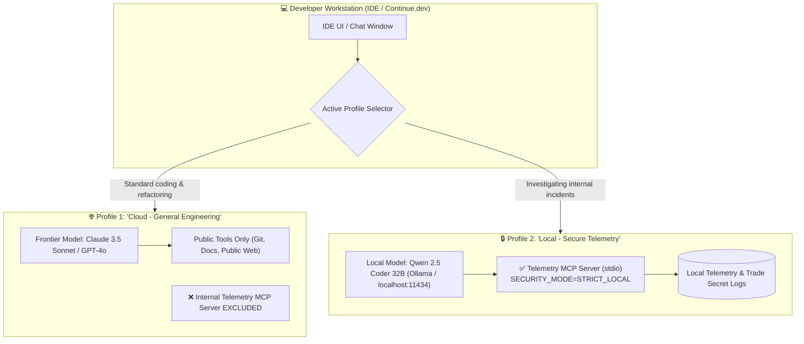

# Architecture Pattern: Strict IDE Profile Binding & Workspace Air-Gapping

[](https://modelcontextprotocol.io/)
[](#)
[](#)

## 1. Executive Summary & Problem Statement

Developers expect their AI assistant to be deeply integrated into their daily coding environment (VS Code, Continue.dev, Cursor, Claude Desktop). However, the way MCP servers are configured in developer IDEs introduces a critical attack and exposure vector:

**The "Confused Deputy" & Accidental Egress Hazard:**
If an engineer registers an internal diagnostic MCP server globally within their IDE, every LLM profile configured in that IDE receives the tool schemas during prompt construction. If the developer is chatting with an external cloud model (e.g., Claude 3.5 Sonnet or GPT-4o) and asks:
> *"Why is the payment service throwing errors in staging?"*

The cloud model automatically calls `read_recent_errors("payment")`. The IDE dutifully executes the local MCP tool and uploads raw internal telemetry, unmasked stack traces, and internal infrastructure IPs straight into external cloud provider servers.

**The Solution:** **Strict IDE Profile Binding**. 
This pattern enforces physical air-gapping at the IDE configuration layer:
1. Public/cloud LLM profiles are strictly stripped of all internal telemetry tool schemas.
2. Sensitive MCP servers are attached **exclusively** to local on-premise inference profiles (Ollama, `llama.cpp` on `localhost`).
3. Automated pre-flight linting via [`scripts/verify_ide_isolation.py`](../../scripts/verify_ide_isolation.py) blocks non-compliant configurations in CI and pre-commit hooks.

---

## 2. Architectural Blueprint



---

## 3. Reference Implementation: Continue.dev Dual-Profile Binding

The repository provides a production-tested reference configuration in [`examples/continue_config.json`](../../examples/continue_config.json):

```json
{
  "$schema": "https://continue.dev/schemas/config.json",
  "models": [
    {
      "title": "Cloud - General Engineering (No Internal Telemetry)",
      "provider": "anthropic",
      "model": "claude-3-5-sonnet-20241022",
      "apiKey": "${ANTHROPIC_API_KEY}",
      "description": "High-level architecture, code generation, and public library synthesis. Internal Telemetry MCP is excluded."
    },
    {
      "title": "Local - Secure Telemetry & Trade Secrets (Zero Cloud Egress)",
      "provider": "ollama",
      "model": "qwen2.5-coder:32b",
      "apiBase": "http://localhost:11434",
      "description": "Air-gapped local model for analyzing internal telemetry, trade secrets, and proprietary stack traces."
    }
  ],
  "mcpServers": {
    "telemetry-inspector-secure": {
      "command": "uv",
      "args": [
        "run",
        "--directory",
        "/Users/clayton/Development/Telemetry_MCP_Server",
        "python",
        "-m",
        "telemetry_mcp_server.server"
      ],
      "env": {
        "TELEMETRY_LOG_DIR": "/Users/clayton/Development/Telemetry_MCP_Server/logs",
        "SECURITY_MODE": "STRICT_LOCAL",
        "TELEMETRY_DLP_ENABLED": "true"
      }
    }
  },
  "customCommands": [
    {
      "name": "triage-incident",
      "prompt": "Call `get_security_posture()` and `get_system_health()`, then delegate investigation of the affected service using `delegate_telemetry_investigation`.",
      "description": "Execute governed hybrid-trust incident triage"
    }
  ]
}
```

### Key Configuration Directives:
1. **Explicit Profile Titles:** Model names clearly state their security classification (`Cloud - General Engineering (No Internal Telemetry)` vs. `Local - Secure Telemetry & Trade Secrets (Zero Cloud Egress)`).
2. **Environment Variable Injection:** The MCP server launches with `SECURITY_MODE=STRICT_LOCAL` and `TELEMETRY_DLP_ENABLED=true`, ensuring that even in local mode, DLP metrics and audit logs are actively maintained.
3. **Structured Custom Prompts:** The `/triage-incident` custom command orchestrates safe triage, instructing the model to check posture and delegate rather than dump unbounded logs.

---

## 4. Automated CI & Pre-Flight Verification: `verify_ide_isolation.py`

Relying on developer discipline alone is an anti-pattern. Engineers may inadvertently copy-paste configurations or accidentally attach internal MCP servers to cloud profiles.

The Telemetry MCP Server includes an automated verification script: [`scripts/verify_ide_isolation.py`](../../scripts/verify_ide_isolation.py).

### How the Pre-Flight Linter Works:
1. **Parses Configuration Files:** Evaluates JSON configurations from Continue.dev (`~/.continue/config.json`), Cursor (`~/.cursor/extensions`), or project-level settings.
2. **Detects Sensitive MCP Servers:** Checks for `telemetry-inspector`, `telemetry_mcp_server`, or custom sensitive names.
3. **Audits Security Modes:** Verifies that `TELEMETRY_DLP_ENABLED` is active and that `SECURITY_MODE` is set to an approved value (`STRICT_LOCAL`, `REDACTED_CLOUD`, or `AUDIT_ONLY`).
4. **Validates Model Air-Gapping:** Ensures that if a cloud model (Anthropic, OpenAI) is configured, either a local model exists to handle sensitive telemetry, or `SECURITY_MODE=REDACTED_CLOUD` is strictly enforced.

### Running the Linter:
```bash
# Verify the sample Continue.dev configuration:
uv run python scripts/verify_ide_isolation.py --config examples/continue_config.json
```

**Compliant Output:**
```text
======================================================================
🛡️  Hybrid-Trust IDE Configuration Audit
======================================================================
Target Config: /Users/clayton/Development/Telemetry_MCP_Server/examples/continue_config.json

[PASS] Sensitive MCP server 'telemetry-inspector-secure' configured with DLP enabled.
[PASS] Security mode validated: STRICT_LOCAL.
[PASS] Local inference engine detected (ollama @ http://localhost:11434).
[PASS] Model air-gapping verified: Cloud models segregated from raw telemetry tools.

Result: 0 violations, 0 warnings.
Status: COMPLIANT (Exit Code: 0)
```

**Non-Compliant Output (Catching Accidental Cloud Exposure):**
```text
======================================================================
🛡️  Hybrid-Trust IDE Configuration Audit
======================================================================
Target Config: /Users/clayton/.continue/config.json

[VIOLATION] MCP server 'telemetry-inspector' is configured with cloud model 'claude-3-5-sonnet' 
            without an air-gapped local model or REDACTED_CLOUD security mode!
[VIOLATION] Environment variable 'TELEMETRY_DLP_ENABLED' is set to 'false'.

Result: 2 violations, 0 warnings.
Status: NON-COMPLIANT (Exit Code: 1)
```

---

## 5. Integrating Pre-Flight Linter into Pre-Commit & CI

### 1. Pre-Commit Hook Configuration (`.pre-commit-config.yaml`):
```yaml
repos:
  - repo: local
    hooks:
      - id: verify-ide-isolation
        name: Verify Hybrid-Trust IDE Isolation
        entry: uv run python scripts/verify_ide_isolation.py --config examples/continue_config.json
        language: system
        files: ^(examples/.*\.json|\.continue/config\.json)$
```

### 2. GitHub Actions CI Step:
```yaml
- name: Verify IDE Isolation Governance
  run: |
    uv run python scripts/verify_ide_isolation.py --config examples/continue_config.json
```

---

## 6. Client Setup Guides

### Continue.dev (VS Code / JetBrains)
1. Copy [`examples/continue_config.json`](../../examples/continue_config.json) to `~/.continue/config.json`.
2. Ensure Ollama is running locally:
   ```bash
   ollama run qwen2.5-coder:32b
   ```
3. In Continue's chat interface, use the model dropdown to toggle between **Cloud** for code writing and **Local** for telemetry triage.

### Claude Desktop (`claude_desktop_config.json`)
For Claude Desktop (which only connects to Anthropic cloud models), **always enforce `REDACTED_CLOUD`**:
```json
{
  "mcpServers": {
    "telemetry-inspector": {
      "command": "uv",
      "args": ["run", "--directory", "/path/to/Telemetry_MCP_Server", "python", "-m", "telemetry_mcp_server.server"],
      "env": {
        "SECURITY_MODE": "REDACTED_CLOUD",
        "TELEMETRY_DLP_ENABLED": "true"
      }
    }
  }
}
```

---

## 7. Related Documentation & Next Steps

- 🏢 [**Hybrid-Trust Architecture & Enterprise Use Cases**](./hybrid_trust_use_cases.md) — Comprehensive guide on air-gapped systems and trade secret defense.
- 🛡️ [**Dynamic DLP Pattern**](./dynamic_dlp_pattern.md) — In-server payload sanitization and credential scrubbing.
- 🤝 [**Sub-Agent Delegation Pattern**](./sub_agent_delegation_pattern.md) — Hierarchical agent orchestration with local sub-agents.
- 📖 [**Agent Tool Reference**](../tools_reference.md) — Exhaustive documentation for all diagnostic MCP tools.
