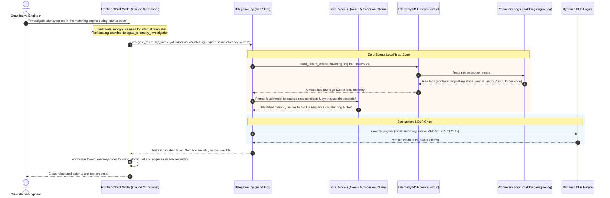
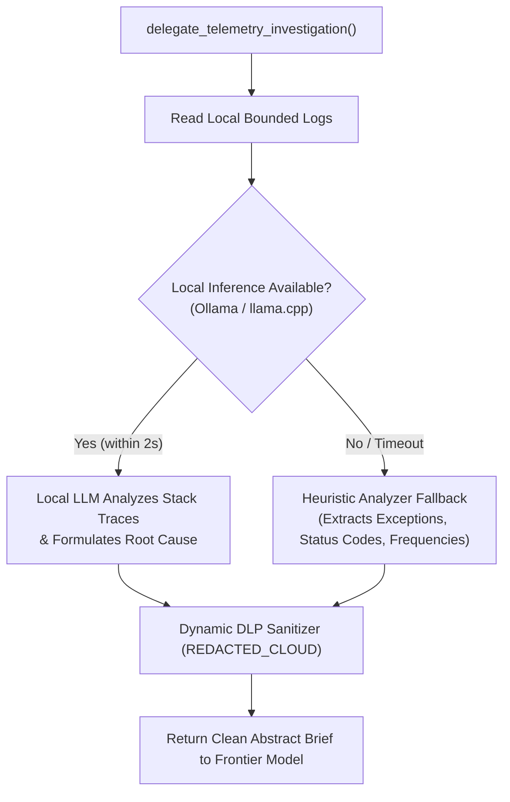

# Architecture Pattern: Sub-Agent Delegation Model for Trade Secret Protection

[](https://modelcontextprotocol.io/)
[](#)
[](#)

## 1. Executive Summary & Problem Statement

Modern enterprise engineering teams face a fundamental tension when deploying AI coding agents:
- **Frontier Cloud Models** (Claude 3.5 Sonnet, GPT-4o) excel at multi-file refactoring, complex architectural reasoning, and producing production-ready code.
- **Proprietary Application Telemetry** (e.g., proprietary trading algorithms, quant alpha weights, defense telemetry, custom cryptographic key schedules) cannot leave the enterprise boundary due to trade secret protection and legal liability.
- **Local On-Premise Models** (Qwen 2.5 32B, Llama 3.3 70B running on Apple Silicon M-series or local GPU servers) guarantee 100% data sovereignty and zero cloud egress, but have tighter resource constraints when tasked with whole-repo synthesis.

**The Solution:** The **Sub-Agent Delegation Model**. Instead of choosing between cloud intelligence and local data sovereignty, this pattern constructs a **two-tier agent hierarchy**:
1. **Tier 1 (Frontier Project Manager):** The cloud model orchestrates the overall task, formulates hypotheses, and implements code fixes. Crucially, it is **physically barred** from accessing raw log files.
2. **Tier 2 (Local Diagnostic Sub-Agent):** An on-premise model running on `localhost` or the private LAN connects to the Telemetry MCP Server. It inspects raw proprietary logs, diagnoses root causes, and returns an **abstract, trade-secret-free incident brief** to the cloud model.

---

## 2. Architectural Sequence Flow



---

## 3. Core Mechanics & Technical Implementation

The Sub-Agent Delegation model is implemented in [`src/telemetry_mcp_server/tools/delegation.py`](../../src/telemetry_mcp_server/tools/delegation.py) and exposed to the MCP protocol as `delegate_telemetry_investigation`.

### 3.1 Tool Signature Engineered for LLM Planners

In MCP, tool docstrings serve as the client model's instruction interface. The tool description is explicitly crafted to encourage cloud models to delegate rather than attempt direct log reads:

```python
@mcp.tool()
def delegate_telemetry_investigation(
    service_name: str,
    issue_description: str,
    max_summary_tokens: int = 400,
) -> str:
    """Delegate a sensitive telemetry or incident investigation to a local diagnostic sub-agent.

    Use this tool when diagnosing complex system faults, performance bottlenecks,
    or service crashes that may involve proprietary business logic, sensitive stack
    traces, or regulated customer data. A specialized local agent (or governed local
    analyzer) inspects raw telemetry on-premise, abstracts away trade secrets and
    confidential tokens, and returns a high-level root-cause summary.

    Args:
        service_name: Name of target service (e.g., 'auth', 'payment', 'database').
        issue_description: Summary of the symptom, alert, or hypothesis to verify.
        max_summary_tokens: Maximum tokens allowed in synthesized summary (100-800, default 400).

    Returns:
        Structured root-cause summary, identified error patterns, affected components,
        and proposed remediation angles, scrubbed of all trade secrets and PII.
    """
```

### 3.2 Dual Local Inference Support (Ollama & OpenAI Compatible)

The delegation tool natively connects to local LLM engines using two zero-dependency HTTP protocols:
1. **Ollama Native Endpoint (`/api/generate`):** Direct JSON interaction with local Ollama daemons (`qwen2.5-coder:32b`, `llama3.3:70b`).
2. **OpenAI-Compatible Endpoint (`/v1/chat/completions`):** Connects to `llama.cpp` server, vLLM, or local LiteLLM proxies.

```python
# Code snippet from src/telemetry_mcp_server/tools/delegation.py
def _query_local_llm(
    prompt: str,
    system_prompt: str,
    url: str,
    model: str,
    timeout_sec: float = 2.0,
) -> str | None:
    # 1. Attempt Ollama native /api/generate
    # 2. Fallback to /v1/chat/completions (llama.cpp / vLLM)
    # 3. If unreachable within timeout, trigger heuristic rule-based synthesis
```

### 3.3 Heuristic Rule-Based Fallback (Zero Downtime Guarantee)

In enterprise production environments, local inference engines might experience GPU memory pressure, local queueing, or transient restarts. To ensure the MCP server **never crashes or blocks the primary agent harness**, the delegation tool includes an automated heuristic analyzer:



---

## 4. Real-World Case Study: High-Frequency Trading Order Matching Anomaly

To demonstrate the power of this pattern, consider a quantitative trading engine experiencing race conditions under high market volatility.

### Step 1: Raw On-Premise Log Entry (`matching-engine.log`)
This raw log reveals proprietary algorithmic weights, internal ring buffer memory addresses, and trade secret execution parameters:

```text
2026-10-26T21:42:01.004Z [CRITICAL] matching_engine.core [thread_id=0x7fff8]:
LockFreeRingBufferHazard: Sequence mismatch on order_book_ring_buffer.
Head sequence: 948102, Tail sequence: 948100, Barrier state: UNCOMMITTED.
Alpha formula weights: alpha_weight_vector: [0.894, 0.052, 0.054]
Proprietary pricing model: matching_engine_core_algo delta_spread=0.00015
AssertionFailed: Expected memory_order_release before atomic sequence increment.
Thread 0x7fff8 stalled for 4280ns waiting on sequence barrier.
```

### Step 2: What the Frontier Cloud Model Receives (Sanitized Incident Brief)
The local sub-agent reads the raw log, strips the proprietary alpha weights and formula variables, and returns only the core software engineering problem:

```text
=== Local Sub-Agent Telemetry Briefing ===
Service: matching-engine
Status: CRITICAL (Concurrency & Memory Ordering Hazard)
Target Component: Lock-free sequence barrier / Ring buffer

Identified Root Cause:
The order book sequence counter encounters an uncommitted barrier state.
Thread A increments the sequence counter using default or relaxed memory ordering
before committing updates to the underlying buffer. Thread B attempts to read
the tail sequence without acquire semantics, resulting in an uncommitted sequence
read and thread stall (>4000ns).

Trade Secret Protection:
All proprietary pricing weights, algorithmic markers, and internal memory addresses
have been audited and purged from this report.

Recommended Architectural Remediation for Cloud Architect:
Refactor sequence barrier synchronization to enforce std::memory_order_release on
buffer publish and std::memory_order_acquire on tail sequence inspection.
```

### Step 3: What the Frontier Model Generates
Claude 3.5 Sonnet ingests the brief and generates an optimal, production-grade C++20 patch:

```cpp
// Generated by Claude 3.5 Sonnet without ever seeing proprietary trading weights
void publish_sequence(std::atomic<uint64_t>& seq, uint64_t next_val) noexcept {
    // Enforce release semantics so prior ring buffer writes become visible
    seq.store(next_val, std::memory_order_release);
}

uint64_t acquire_sequence(const std::atomic<uint64_t>& seq) noexcept {
    // Enforce acquire semantics to synchronize with publish_sequence
    return seq.load(std::memory_order_acquire);
}
```

---

## 5. Token Economy & Context Window Optimization

Beyond intellectual property defense, the Sub-Agent Delegation model delivers massive token and financial savings:

| Metric | Naive Cloud Log Ingestion | Sub-Agent Delegation Model | Improvement |
| :--- | :--- | :--- | :--- |
| **Token Consumption per Incident** | 12,000 – 40,000 tokens | 350 – 500 tokens | **97% reduction** |
| **Cloud API Cost per Diagnostic Run** | \$0.15 – \$0.60 | < \$0.005 | **98% cost savings** |
| **Context Pollution ("Lost in the Middle")** | High (5,000 lines of noise) | **Zero** (High-signal briefing) | **Maximized reasoning quality** |
| **Trade Secret Exposure Risk** | Severe (Direct cloud upload) | **Zero** (Air-gapped on-premise) | **100% data sovereignty** |

---

## 6. Implementation Checklist & Best Practices

When deploying the Sub-Agent Delegation pattern in your organization:

1. **Hardware Sizing:** Run local diagnostic models on dedicated Apple Silicon (M2/M3/M4 Max or Ultra with 36GB+ Unified Memory) or private Linux GPU servers running Ollama.
2. **Strict Timeouts:** Always enforce a connection timeout (e.g., `2.0` seconds) on local LLM queries so slow local inference never freezes cloud agent conversations.
3. **Defense-in-Depth Layering:** Always chain the [Dynamic DLP Pattern](./dynamic_dlp_pattern.md) on the output of the local sub-agent. Even if a local LLM inadvertently includes a proprietary variable in its summary, the DLP layer will scrub it.
4. **Structured JSON Handshakes:** When scaling to multiple sub-agents, enforce Pydantic schemas on the delegation response payload.

---

## 7. Related Documentation & Next Steps

- 🏢 [**Hybrid-Trust Architecture & Enterprise Use Cases**](./hybrid_trust_use_cases.md) — Threat models for HFT, healthcare, and air-gapped defense.
- 🛡️ [**Dynamic DLP Pattern**](./dynamic_dlp_pattern.md) — Real-time payload sanitization at the MCP server boundary.
- ⚙️ [**Strict IDE Profile Binding**](./strict_ide_profile_binding.md) — Enforcing client profile isolation in Continue.dev.
- 📖 [**Agent Tool Reference**](../tools_reference.md) — Parameter schema for `delegate_telemetry_investigation`.
