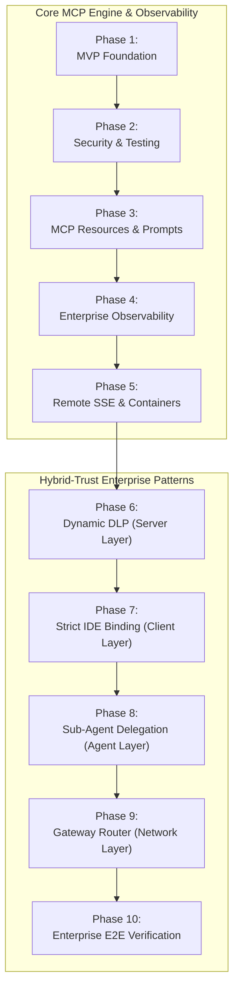

# Skill Development & Feature Roadmap

This roadmap is designed for **structured skill development** and **portfolio showcasing**. Each milestone builds tangible engineering competencies in AI systems, protocol design, tool governance, automated testing, and enterprise **hybrid-trust architectures**.

---

## 🎯 Milestone Overview

---

## Phase 1: MVP Foundation (Completed Baseline)
*Focus: Understanding MCP basics, MCPServer architecture, and local LLM client binding.*

- [x] Initialize project using `uv` with official `mcp[cli]` (v2.x) SDK.
- [x] Implement baseline `MCPServer("TelemetryInspector")` instance.
- [x] Expose initial tools:
  - `get_system_health()`: Returns mock JSON with service health, latency, and alert count.
  - `read_recent_errors(service_name, lines)`: Tails local log files.
- [x] Local verification via `uv run python` or `uv run mcp dev src/telemetry_mcp_server/server.py`.
- [x] Bind to VS Code / Continue.dev configuration.

**Key Competencies Acquired:**
- Model Context Protocol primitives (stdio, tool discovery, client-host architecture).
- `MCPServer` tool decorators and dynamic OpenAPI schema generation.
- Local AI pairing with Continue.dev.
- Navigating evolving protocol SDK specifications (MCP 1.x to 2.x migration).

---

## Phase 2: Security Hardening & Automated Testing (Completed)
*Focus: Defense-in-depth, input sanitization, test-driven tool development.*

- [x] **Path Traversal Protection:**
  - Create `telemetry_mcp_server.security` module.
  - Implement canonical path validation (`os.path.realpath`, `os.path.commonpath`).
  - Restrict `service_name` to strict regex identifier (`^[a-zA-Z0-9_-]+$`).
- [x] **Context Window Bounds:**
  - Clamp log tailing requests to safe upper limit (e.g., maximum 200 lines).
  - Truncate excessively long individual log lines (> 1,000 characters).
- [x] **Automated Test Suite (`pytest`):**
  - Unit tests for happy-path log retrieval.
  - Negative security tests verifying rejection of `../`, `/etc/passwd`, and null bytes.
  - Mock log fixtures with realistic multi-service error scenarios.
- [x] **Static Analysis & Typing:**
  - Add `ruff` formatting and linting rules.
  - Enforce `mypy` strict type checking on all tool signatures.

**Key Competencies Acquired:**
- AI safety: Preventing LLM prompt injection and Confused Deputy attacks.
- Robust Python API design with defense-in-depth sanitization.
- Automated testing of agentic tools.

---

## Phase 3: MCP Resources & Incident Prompts (Completed)
*Focus: Mastering the complete MCP specification beyond simple tools.*

- [x] **Implement MCP Resources:**
  - `telemetry://health`: Expose real-time platform health summary as a readable resource.
  - `telemetry://logs/{service}`: Expose live service log streams as dynamic MCP resources.
- [x] **Implement MCP Prompts:**
  - `incident_triage(service_name, incident_id)`: A standardized diagnostic prompt template that instructs the LLM to:
    1. Query `get_system_health` to evaluate system-wide blast radius.
    2. Tail error logs for the affected service.
    3. Synthesize root cause and suggest remediation steps.
- [x] **Service Discovery:**
  - Tool `list_available_services()`: Automatically scans the log directory and returns available service names.

**Key Competencies Acquired:**
- MCP Resources vs. Tools distinction and architectural trade-offs.
- Prompt template orchestration via the MCP protocol.
- Autonomous multi-step diagnosis patterns.

---

## Phase 4: Enterprise Observability & Synthetic Workloads (In Progress)
*Focus: Real-world SRE tooling, structured log parsing, and regex searching.*

- [x] **Regex & Pattern Search Tool:**
  - Implement `search_logs_by_pattern(service_name, pattern, max_matches)` for pinpointing specific trace IDs, HTTP status codes, or exception classes.
- [ ] **Structured JSON Log Support:**
  - Add parsing for structured JSON log entries (timestamps, log level, trace_id, caller).
  - Implement `filter_logs(service_name, level, start_time)` (e.g., filter only `ERROR` or `CRITICAL`).
- [ ] **Synthetic Incident Generator Script:**
  - Create `scripts/simulate_incident.py` that continuously injects realistic traffic and faults (e.g., Redis timeouts, database deadlocks, memory leaks) into mock log files for live demonstrations.

**Key Competencies Acquired:**
- Structured log processing and high-performance text scanning in Python.
- Live incident simulation and automated AI-driven root cause analysis (RCA).

---

## Phase 5: Containerization & Remote Transport (SSE)
*Focus: Cloud-native deployment, containerization, and remote agent connectivity.*

- [ ] **Docker Packaging:**
  - Build a lightweight `Dockerfile` using multi-stage `uv` builds.
  - Support non-root container execution with read-only mounted volume for `/logs`.
- [ ] **Server-Sent Events (SSE) Transport Mode:**
  - Expose `--transport sse` with Starlette / Uvicorn runner for remote AI agents and centralized observability gateways.
- [ ] **Authentication & Access Control:**
  - Implement HTTP Bearer token validation for SSE endpoints.
  - Map incoming tokens to client identity roles for downstream authorization.

**Key Competencies Acquired:**
- Packaging MCP servers for production Kubernetes/container environments.
- Remote vs. local MCP architectures and network security boundaries.

---

## Phase 6: Hybrid-Trust Pattern 1 — Dynamic Data Loss Prevention (DLP) at MCP Layer
*Focus: Embedding context-aware payload redaction and PII/credential scrubbing directly into the server pipeline.*  
*Architectural Specification:* [**`docs/architecture/dynamic_dlp_pattern.md`**](./architecture/dynamic_dlp_pattern.md) & [**`docs/architecture/hybrid_trust_use_cases.md`**](./architecture/hybrid_trust_use_cases.md#2-regulated-healthcare--financial-services-hipaa--pci-dss--pii-triage)

- [ ] **Core Scrubber Engine (`src/telemetry_mcp_server/dlp.py`):**
  - Implement high-throughput regex and pattern scrubbers:
    - **PCI-DSS / Payment Card Masking:** Match Luhn-valid PANs (`4111-XXXX-XXXX-1111`) and CVVs.
    - **HIPAA / PII Sanitization:** Mask Social Security Numbers, patient/medical identifiers (`[PATIENT_ID_REDACTED]`), emails, and phone numbers.
    - **Secrets & Credentials:** Strip OAuth `Bearer [TOKEN_SCRUBBED]`, AWS access keys (`AKIA[A-Z0-9]{16}`), SSH/RSA private keys, and database connection strings.
    - **Network Topography:** Mask RFC 1918 private IPv4 addresses (`10.x.x.x`, `172.16-31.x.x`, `192.168.x.x`) and internal DNS hostnames.
    - **Proprietary Symbol Redaction:** Redact configurable proprietary function names, algorithmic weight dumps, or trade secret markers (`[PROPRIETARY_ALGO_REDACTED]`).
- [ ] **Context-Aware Client Origin Evaluation:**
  - Extend server runtime to evaluate client identity and connection transport:
    - `STRICT_LOCAL` mode: Full unredacted telemetry permitted over trusted local `stdio` under local audit logging.
    - `REDACTED_CLOUD` mode: Enforces zero-leak redaction for cloud-hosted agent harnesses and remote SSE callers.
    - `AUDIT_ONLY` mode: Shadow evaluation mode logging what would have been redacted without modifying outputs.
- [ ] **MCP Pipeline Decorators & Resource Filtering:**
  - Apply DLP middleware seamlessly across tool returns (`read_recent_errors`, `search_logs_by_pattern`, `get_system_health`).
  - Apply DLP stream filtering to MCP resources (`telemetry://logs/{service}`, `telemetry://health`).
- [ ] **Redaction Telemetry & Audit Logging:**
  - Record audit events (patterns masked, counts by category, caller context) without leaking raw sensitive strings.
- [ ] **Automated Test Suite (`tests/test_dlp.py`):**
  - Unit tests for all masking rules (credit cards, JWTs, IPs, PII).
  - Negative security verification: Ensure zero secret leakage under simulated cloud client headers.

**Key Competencies Acquired:**
- Real-time payload sanitization and high-performance regex stream filtering.
- Context-aware data governance at the MCP protocol boundary.
- Compliance engineering for AI systems (HIPAA Privacy Rules, PCI-DSS Requirement 3).

---

## Phase 7: Hybrid-Trust Pattern 2 — Strict IDE Profile Binding & Workspace Air-Gapping
*Focus: Enforcing UI- and configuration-level air-gapping within IDE extensions to isolate sensitive MCP servers.*  
*Architectural Specification:* [**`docs/architecture/strict_ide_profile_binding.md`**](./architecture/strict_ide_profile_binding.md) & [**`docs/architecture/hybrid_trust_use_cases.md`**](./architecture/hybrid_trust_use_cases.md#3-air-gapped-core-ip--defense-systems-zero-cloud-telemetry)

- [ ] **Continue.dev Dual-Profile Reference Configuration:**
  - Provide tested reference configurations (`examples/continue_config.json`):
    - **Cloud Profile ("Cloud - General Engineering"):** Bound to Claude 3.5 Sonnet / GPT-4o. Public tools only (git, web search); `TelemetryInspector` is completely excluded from tool schemas.
    - **Local Profile ("Local - Secure Telemetry"):** Bound exclusively to local inference engines (Ollama / `llama.cpp` on `http://localhost:11434` or local LAN `192.168.1.136`). `TelemetryInspector` is attached via `stdio`.
- [ ] **Cursor & VS Code Multi-Profile Templates:**
  - Provide `.cursor/mcp.json` and `.vscode/settings.json` workspace templates isolating tool sets per development profile.
- [ ] **Configuration Validation Script (`scripts/verify_ide_isolation.py`):**
  - Implement a pre-flight linting script that inspects developer IDE configuration files:
    - Scans for inadvertent binding of sensitive MCP servers to external API keys or cloud models.
    - Returns actionable exit codes and remediation steps for CI or pre-commit hooks.
- [ ] **Zero-Egress Network Verification:**
  - Document network packet inspection runbook (using `lsof` / Wireshark) verifying zero outbound WAN traffic during local diagnostic sessions.
- [ ] **Developer Guide & Runbook:**
  - Author [**`docs/tutorials/ide_profile_binding_setup.md`**](./tutorials/building_your_first_mcp_server.md) covering setup, profile switching shortcuts, and security guarantees.

**Key Competencies Acquired:**
- Workspace-level security air-gapping and zero-trust developer ergonomics.
- Defense against Confused Deputy attacks at the IDE client interface.
- Automated security linting of agent configuration files.

---

## Phase 8: Hybrid-Trust Pattern 3 — Sub-Agent Delegation Model (Multi-Agent Orchestration)
*Focus: Constructing a two-tier agent hierarchy where a frontier model delegates raw telemetry analysis to a local model.*  
*Architectural Specification:* [**`docs/architecture/sub_agent_delegation_pattern.md`**](./architecture/sub_agent_delegation_pattern.md) & [**`docs/architecture/hybrid_trust_use_cases.md`**](./architecture/hybrid_trust_use_cases.md#1-proprietary-algorithm--high-frequency-trading-hft-incident-diagnosis)

- [ ] **Two-Tier Agent Architecture Design:**
  - **Tier 1 (Frontier Project Manager):** Cloud model (Claude 3.5 Sonnet) responsible for overall system reasoning, code generation, and test creation. Network-isolated from internal telemetry.
  - **Tier 2 (Local Diagnostic Sub-Agent):** On-premise model (Qwen 2.5 32B Coder via Ollama or `llama.cpp`) connected to `TelemetryInspector` via `stdio`.
- [ ] **Delegation Tool Interface (`src/telemetry_mcp_server/tools/delegation.py`):**
  - Implement `delegate_telemetry_investigation(service_name: str, issue_description: str, max_summary_tokens: int = 400) -> str`.
  - Tool description engineered to guide the frontier planner to hand off telemetry diagnostics rather than requesting raw logs.
- [ ] **Local Sub-Agent Triage Prompt Template (`src/telemetry_mcp_server/prompts/delegation.py`):**
  - Orchestrate local sub-agent steps:
    1. Invoke `get_system_health()` and `read_recent_errors(service_name)`.
    2. Analyze proprietary stack traces and internal memory/concurrency faults.
    3. Abstract proprietary business logic and private symbols into generic computer science concepts.
    4. Enforce strict output token budgeting (< 500 tokens) to prevent cloud context pollution.
- [ ] **End-to-End Orchestration Harness (`scripts/run_sub_agent_delegation.py`):**
  - Standalone runnable script executing the two-tier flow:
    - Dispatches user prompt to frontier client harness.
    - Intercepts delegation tool call and triggers local sub-agent inference.
    - Ingests sanitized local summary and completes root-cause remediation with frontier model.
- [ ] **Delegation Test Suite (`tests/test_sub_agent_delegation.py`):**
  - Unit tests with mock local LLM responses verifying proprietary algorithms are stripped before reaching frontier context.

**Key Competencies Acquired:**
- Multi-agent orchestration and hierarchical delegation design.
- Context window optimization and token cost reduction in agentic loops.
- Intellectual property isolation via agentic synthesis and semantic abstraction.

---

## Phase 9: Hybrid-Trust Pattern 4 — AI Gateway Router (Tool-Triggered Model Swapping)
*Focus: Intercepting JSON-RPC tool calls at the network proxy layer to dynamically route sensitive requests to local models.*  
*Architectural Specification:* [**`docs/architecture/gateway_router_pattern.md`**](./architecture/gateway_router_pattern.md) & [**`docs/architecture/hybrid_trust_use_cases.md`**](./architecture/hybrid_trust_use_cases.md#4-automated-incident-routing--model-swapping-via-ai-gateway)

- [ ] **LiteLLM Gateway Configuration (`config/litellm_config.yaml`):**
  - Define multi-model upstream targets:
    - `frontier-reasoning`: Points to Anthropic Claude 3.5 Sonnet / OpenAI GPT-4o.
    - `local-secure`: Points to local Ollama / `llama.cpp` instance (e.g., `http://192.168.1.136:11434/v1`).
- [ ] **Tool-Name Routing Rules Engine:**
  - Configure tool inspection rules:
    - Requests containing sensitive MCP tools (`read_recent_errors`, `get_system_health`, `search_logs_by_pattern`) route dynamically to `local-secure`.
    - Non-telemetry prompts and public tools route to `frontier-reasoning`.
- [ ] **Lightweight Gateway Proxy Prototype (`scripts/gateway_proxy.py`):**
  - Standalone FastAPI/Starlette proxy demonstrating JSON-RPC payload inspection:
    - Parses incoming OpenAI-compatible `/v1/chat/completions` requests.
    - Evaluates `tools` and `messages` for telemetry tool calls.
    - Transparently routes to local inference vs cloud endpoint based on tool classification.
- [ ] **Fail-Closed Security Guarantees:**
  - Implement fail-closed exception handling: If the local secure endpoint is unreachable, restricted tool calls abort with a clean error message rather than failing open to cloud providers.
- [ ] **Gateway Audit Logging & Metrics:**
  - Track route diversion metrics: Tool invocations diverted to local vs. cloud, latency distributions, and token savings.
- [ ] **Automated Gateway Tests (`tests/test_gateway_router.py`):**
  - Integration tests verifying tool call interception, dynamic routing, and fail-closed behavior.

**Key Competencies Acquired:**
- AI Gateway reverse proxy design and JSON-RPC payload interception.
- Policy-driven model routing and infrastructure-level cost governance.
- Fail-closed security architecture for agent tool execution.

---

## Phase 10: Enterprise Hybrid-Trust Verification & Live Showcase
*Focus: End-to-end integration across all 4 tiers, threat defense verification suite, and portfolio demonstration runbook.*  
*Architectural Specification:* [**`docs/architecture/hybrid_trust_use_cases.md`**](./architecture/hybrid_trust_use_cases.md) & [**`docs/runbooks/showcase_runbook.md`**](./runbooks/showcase_runbook.md)

- [ ] **End-to-End Enterprise Scenario Datasets:**
  - **Scenario A (HFT Quant Trading):** Simulated race condition in proprietary lock-free order book (`logs/matching_engine.log`).
  - **Scenario B (Healthcare/FinTech):** Simulated payment gateway deadlock with embedded PANs and patient tokens (`logs/payment.log`, `logs/ehr.log`).
- [ ] **Adversarial Threat Defense Test Suite (`tests/test_hybrid_trust_threats.py`):**
  - Regression testing across the 4 hybrid-trust defense layers:
    1. *Indirect Prompt Injection Defense:* Malicious log instructions cannot trigger unauthorized cloud egress.
    2. *Trade Secret Exfiltration Defense:* Zero proprietary code strings leak beyond localhost boundaries.
    3. *Regulatory Compliance Verification:* Zero PAN/PHI tokens present in cloud-bound payloads.
    4. *Context Window Blowout Prevention:* Verifying tail bounded limits and sub-agent brief token caps (< 500 tokens).
- [ ] **Benchmarking & Cost Analysis Report (`docs/architecture/hybrid_trust_benchmark.md`):**
  - Measure token reduction (cloud vs. local sub-agent) and latency trade-offs across all 4 patterns.
- [ ] **Showcase Runbook Updates (`docs/runbooks/showcase_runbook.md`):**
  - Add 5-minute interactive demonstration script walking through:
    1. Live incident trigger via `scripts/simulate_incident.py`.
    2. Dynamic DLP scrubbing demonstration in MCP inspector.
    3. Sub-agent delegation and sanitized RCA presentation.
    4. Gateway model swapping verification.

**Key Competencies Acquired:**
- Enterprise-grade defense-in-depth auditing for LLM and agentic systems.
- Quantitative benchmarking of hybrid-trust AI architectures.
- High-impact technical interview storytelling and executive presentation skills.

---

## 📊 Hybrid-Trust Architectural Tier Summary

| Phase | Pattern | Architectural Tier | Primary Protection Target | Primary Deliverable |
| :--- | :--- | :--- | :--- | :--- |
| **Phase 6** | [**Dynamic DLP**](./architecture/dynamic_dlp_pattern.md) | **Server Layer** (`MCPServer`) | PII, API Keys, Tokens, IPs | `src/telemetry_mcp_server/dlp.py` |
| **Phase 7** | [**Strict IDE Binding**](./architecture/strict_ide_profile_binding.md) | **Client / IDE Layer** | Air-gapped environments, ITAR | `examples/continue_config.json`, `verify_ide_isolation.py` |
| **Phase 8** | [**Sub-Agent Delegation**](./architecture/sub_agent_delegation_pattern.md) | **Agent Orchestration Layer** | Algorithmic IP, Trade Secrets | `tools/delegation.py`, `run_sub_agent_delegation.py` |
| **Phase 9** | [**Gateway Router**](./architecture/gateway_router_pattern.md) | **Network Proxy Layer** | Enterprise fleets, Cost optimization | `config/litellm_config.yaml`, `gateway_proxy.py` |
| **Phase 10** | [**Enterprise Showcase**](./architecture/hybrid_trust_use_cases.md) | **End-to-End System** | Defense-in-depth, Threat validation | `tests/test_hybrid_trust_threats.py`, Demo Runbook |
