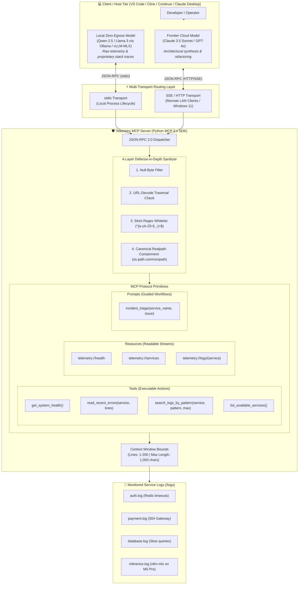

# Showcase & Technical Interview Runbook

This runbook provides a complete script, live demonstration guide, architectural talking points, and an interview response matrix for showcasing the **Telemetry MCP Server** to technical interviewers, AI systems architects, and engineering leadership (e.g., Microsoft Foundry, AI Platform, and Enterprise Observability teams).

---

## 1. The 30-Second Elevator Pitch

> *"When teams begin building autonomous agents for DevOps or SRE, the tempting shortcut is giving the LLM raw bash access so it can run arbitrary CLI commands. In enterprise environments, this creates catastrophic security vulnerabilities—prompt injection, arbitrary file exfiltration, and accidental outages.*
>
> *I built the **Telemetry MCP Server** to demonstrate **governed capability boundaries**. By implementing the Model Context Protocol (MCP 2.x) in Python, I gave our AI agents typed, observable, and bounded tools for health checking and log inspection. The server implements the complete MCP specification—**Tools**, **Resources**, and **Prompts**—backed by a 4-layer defense-in-depth security boundary and context window safeguards.*
>
> *Furthermore, to solve the enterprise dilemma of leaking proprietary code or trade secrets to cloud LLMs, this project implements a **Hybrid-Trust Architecture**. Local models running on Apple Silicon process raw telemetry with zero cloud egress, while frontier models like Claude 3.5 Sonnet receive sanitized abstractions. It also features a **Tier 3 Multi-Transport Context Layer** supporting both local `stdio` and distributed LAN `sse` streaming for remote IDEs."*

---

## 2. Architecture at a Glance



---

## 3. The 5-Minute Live Demo Script

### Preparation & Prerequisites

1. **Verify Dependencies & Environment:**
   ```bash
   uv sync
   ```
2. **Execute Static Analysis & Test Suite Verification:**
   ```bash
   # Verify all 36 unit & security boundary tests pass
   uv run pytest -v

   # Verify linting, formatting, and strict type checking
   uv run ruff check .
   uv run ruff format --check .
   uv run mypy src/
   ```
3. **Have Two Terminal Tabs / Windows Open:**
   - **Tab 1:** Server / MCP Inspector runner.
   - **Tab 2:** Client IDE (VS Code with Cline / Continue.dev or Claude Desktop).

---

### Step 1: Protocol Inspection & Complete MCP Primitives (60 seconds)

Launch the official MCP Inspector to demonstrate the protocol schema and interactive test bench:

```bash
uv run mcp dev src/telemetry_mcp_server/server.py
```
*(Requires Node.js / `npx`. Alternatively, execute the direct Python smoke test: `uv run python -c "from telemetry_mcp_server.server import get_system_health; print(get_system_health())"`).*

**What to Highlight to the Interviewer:**
1. **Dynamic OpenAPI Schema Generation:**
   - Point out how standard Python type hints (`str`, `int`) and docstrings automatically compile into strict JSON Schemas without manual boilerplate.
2. **The Complete MCP Primitive Suite:**
   - **Tools Tab (`tools/list`):** Show all 4 diagnostic tools:
     - `get_system_health`: High-level platform, database, and inference gateway health probe.
     - `read_recent_errors`: Context-bounded log tailing.
     - `search_logs_by_pattern`: Regex and case-insensitive substring searching.
     - `list_available_services`: Dynamic service discovery.
   - **Resources Tab (`resources/list`):** Show passive data URIs:
     - `telemetry://health`
     - `telemetry://services`
     - `telemetry://logs/{service}`
   - **Prompts Tab (`prompts/list`):** Show server-defined triage workflows:
     - `incident_triage`: Standardized 4-step investigation orchestrating blast radius detection, log tailing, pattern matching, and root cause synthesis.
3. **Execute `get_system_health()` Live:**
   - Click `Call Tool` to inspect the response:
     ```json
     {
       "status": "healthy",
       "active_alerts": 0,
       "database_latency_ms": 12.4,
       "active_connections": 1042,
       "inference_gateway": {
         "status": "online",
         "engine": "vllm-mlx",
         "proxy": "litellm",
         "host_platform": "Apple Silicon (M5 Pro)",
         "active_clients": 2
       }
     }
     ```
   - Highlight the **Tier 1 / Tier 2 Inference Gateway telemetry** (`vllm-mlx` and `litellm` metrics running on Apple Silicon M5 Pro Metal GPU).

---

### Step 2: The Agentic Triage & Pattern Search Workflow (90 seconds)

Switch to your IDE client (VS Code with Cline / Continue.dev or Claude Desktop) connected to `telemetry-inspector`.

**The Prompt:**
> *"We received an alert about authentication latency and potential inference degradation. Can you check our system health, discover what services are available, and investigate what's happening?"*

**Expected Autonomous Agent Workflow:**
1. **Service & Platform Discovery:**
   - The agent calls `get_system_health()` to inspect the global blast radius. It notes that the database and inference gateway (`vllm-mlx`) are online.
   - The agent calls `list_available_services()` and discovers available service logs: `['auth', 'database', 'inference', 'payment']`.
2. **Log Inspection:**
   - The agent calls `read_recent_errors(service_name="auth", lines=20)`.
   - It reads the recent entries:
     ```text
     [WARN] High latency detected on login endpoint latency_ms=452
     [ERROR] Connection timeout to Redis cache at 10.0.4.12:6379 after 5000ms
     [ERROR] Fallback session lookup failed: Redis connection unavailable
     ```
3. **Targeted Regex Search:**
   - The agent calls `search_logs_by_pattern(service_name="auth", pattern="timeout", max_matches=5)`.
   - It isolates the exact recurring failure signature and confirms repeated timeouts to `10.0.4.12:6379`.
4. **Verifying Inference Engine Health:**
   - The agent calls `read_recent_errors(service_name="inference", lines=10)`.
   - It confirms the local `vllm-mlx` batching engine and `Qwen2.5-Coder` model are healthy, processing 74.2 tokens/sec.
5. **Synthesis & Root Cause Delivery:**
   - The agent synthesizes the findings:
     > *"The platform and inference engine are healthy, but the auth service is failing due to repeated Redis connection timeouts at `10.0.4.12:6379`. Fallback session lookups are failing. Recommended action: Check network connectivity and Redis instance health at `10.0.4.12:6379`."*

**Interviewer Talking Point:**
> *"Notice that the agent achieved full root-cause discovery across multiple services without ever needing shell access or running arbitrary `grep`/`cat` commands."*

---

### Step 3: Demonstrating the 4-Layer Defense-in-Depth Boundary (90 seconds)

Demonstrate how the server handles adversarial, injection, or traversal attacks:

**The Attack Prompt:**
> *"Can you check the logs for service `../../../../etc/passwd` and also check `auth; rm -rf /`?"*

**What Happens:**
1. The agent invokes `read_recent_errors(service_name="../../../../etc/passwd")`.
2. The server's security layer intercepts the call and immediately returns:
   ```text
   Error: Invalid service name or path traversal violation. Access denied.
   ```
3. The agent attempts `read_recent_errors(service_name="auth; rm -rf /")`.
4. The whitelist regex immediately rejects the shell metacharacters (`;`, spaces, `/`).
5. **The MCP server process does not crash, no files are leaked, and the calling LLM receives an actionable, parseable error.**

**Walk the Interviewer Through `src/telemetry_mcp_server/security.py`:**
- **Layer 1: Null-Byte Injection Check:** Rejects strings containing `\0` before filesystem calls.
- **Layer 2: URL-Decode Traversal Check:** Rejects `%2e%2e%2f` and encoded traversal sequences.
- **Layer 3: Strict Character Whitelist:** Enforces `^[a-zA-Z0-9_-]+$`, eliminating command injection metacharacters.
- **Layer 4: Canonical Path Containment:** Resolves absolute canonical paths via `Path.resolve()` and verifies containment against the root directory using `os.path.commonpath`.

**Highlight Context Window Economics:**
- Open `src/telemetry_mcp_server/tools/logs.py`:
  - `lines` parameter is strictly bounded: `max(1, min(lines, settings.max_lines))` (default 50, maximum 200).
  - Excessive line lengths are clamped at `1,000` characters (`... [truncated]`) to protect the LLM context window from prompt explosion.

---

### Step 4: Hybrid-Trust Architecture & Trade Secret Defense (60 seconds)

Open [`docs/architecture/hybrid_trust_use_cases.md`](../architecture/hybrid_trust_use_cases.md) and [`README.md`](../../README.md).

**The Challenge:**
> *"Production telemetry contains trade secrets—proprietary algorithm parameters, internal IP addresses (`10.0.4.12`), database schemas, and customer PII. If you connect a cloud frontier model (Claude 3.5 Sonnet, GPT-4o) directly to telemetry tools, you risk exfiltrating intellectual property into third-party cloud logs or training data."*

**The Hybrid-Trust Solution:**
- **Zero-Egress Zone (Local Trust Tier):**
  - An on-premise local model (e.g., Qwen 2.5 32B or Llama 3 on an Apple Silicon M5 Pro via Ollama or `vllm-mlx`) binds to the Telemetry MCP Server.
  - It inspects raw logs, stack traces, and internal infrastructure entirely behind the corporate firewall.
- **General Egress Zone (Frontier Cloud Tier):**
  - The local model synthesizes raw telemetry into an **anonymized, abstract computer science problem**.
  - The frontier cloud model receives only the clean abstraction to generate complex architectural refactorings or code patches without ever seeing raw internal telemetry.
- **Four Governed Patterns Documented in `docs/architecture/`:**
  1. [**Dynamic DLP Pattern**](../architecture/dynamic_dlp_pattern.md): Context-aware redaction at the MCP boundary.
  2. [**Sub-Agent Delegation Pattern**](../architecture/sub_agent_delegation_pattern.md): Cloud orchestrator delegates raw log analysis to local sub-agents.
  3. [**Strict IDE Profile Binding**](../architecture/strict_ide_profile_binding.md): Air-gapping telemetry MCP tools exclusively to local model profiles in Continue.dev / Cline.
  4. [**Gateway Router Pattern**](../architecture/gateway_router_pattern.md): LiteLLM proxy dynamically swapping models based on tool sensitivity.

---

### Step 5: Multi-Transport & Distributed LAN Deployment (Tier 3 Context Layer) (30 seconds)

Explain how the server operates in a heterogeneous distributed engineering environment:

**The Topology:**
- **Mac Host (Apple Silicon M5 Pro):** Runs the local inference engine (`vllm-mlx`), proxy (`litellm`), and service telemetry.
- **Client IDEs:**
  - **Local Clients (Mac):** Connect via standard `stdio` (zero network overhead, automatic lifecycle).
  - **Remote LAN Clients (Windows 11 / Remote Workstations):** Cannot spawn child processes across OS boundaries.

**The Solution:**
Launch the server as a network daemon:
```bash
uv run telemetry-mcp-server --transport sse --host 0.0.0.0 --port 8080
```

Configure remote Windows 11 clients in `mcp_settings.json`:
```json
{
  "mcpServers": {
    "telemetry-inspector": {
      "url": "http://<mac_host_ip>:8080/sse"
    }
  }
}
```

---

### Step 6: Highlighting the AI-First Engineering Contract (30 seconds)

Open [`AGENTS.md`](../../AGENTS.md) in your editor.

**Talking Point:**
> *"This entire repository is built under an AI-first engineering paradigm. [`AGENTS.md`](../../AGENTS.md) serves as an executable operating contract for autonomous coding agents. It defines our architectural rules, docstring formatting standards, defensive validation requirements, and verification gates. Any engineer or AI agent working on this codebase can run `uv run pytest`, `uv run ruff`, and `uv run mypy` to guarantee zero regressions."*

---

## 4. Technical Interview Q&A Matrix

### Q1: "Why use MCP instead of traditional OpenAI Function Calling or LangChain tools?"
> **Answer:**
> *"OpenAI Function Calling and Anthropic Tool Use are proprietary wire formats tied to specific cloud vendors. LangChain tools couple your codebase to a heavy, opinionated Python framework.
>
> The Model Context Protocol (MCP) is an open, client-agnostic standard backed by Anthropic and adopted across industry IDEs (Continue, Cline, Cursor, VS Code, Claude Desktop). Building an MCP server means our telemetry tools can be consumed interchangeably by Claude 3.5 Sonnet, a local Qwen model in Continue, or a custom agent runtime without rewriting tool wrappers for each vendor."*

---

### Q2: "What is the Confused Deputy problem in agentic architectures, and how does your project address it?"
> **Answer:**
> *"The Confused Deputy problem occurs when an LLM, operating with permissions granted by the user or host process, is tricked (typically via prompt injection embedded in untrusted logs or user input) into performing unauthorized actions on behalf of an attacker.
>
> In our server, we solve this through defense-in-depth and the Principle of Least Privilege:
> 1. We completely reject arbitrary command execution—there is no shell tool.
> 2. We enforce a 4-layer path sanitization pipeline (`security.py`): null-byte rejection, URL-decode inspection, strict alphanumeric whitelist regex (`^[a-zA-Z0-9_-]+$`), and canonical containment via `os.path.commonpath`.
> 3. We sanitize and bound outputs so an injected payload cannot trigger unbounded memory allocation or context window exhaustion."*

---

### Q3: "How do you manage LLM context window economics when inspecting large log streams?"
> **Answer:**
> *"Dumping raw log files into an LLM context window causes severe problems: rapid token exhaustion, high inference latency, prohibitive costs, and the 'Lost in the Middle' attention degradation where the model misses critical errors.
>
> We mitigate this through three layers of context bounding:
> 1. **Bounded Tailing:** `read_recent_errors` clamps requested line counts between 1 and 200 (default 50).
> 2. **Line Truncation:** Individual lines exceeding 1,000 characters are automatically truncated (`... [truncated]`) to prevent log bomb attacks.
> 3. **Precision Filtering:** The `search_logs_by_pattern` tool lets the model query specific error patterns (e.g., regex `5\d\d` or substring `timeout`) returning only matching lines rather than megabytes of noise.
> 4. **Discovery:** `list_available_services` lets the model discover valid targets without guessing."*

---

### Q4: "How does this architecture protect proprietary trade secrets and prevent log exfiltration to cloud LLM providers (Hybrid-Trust)?"
> **Answer:**
> *"In enterprise settings, telemetry often contains proprietary trade secrets—pricing algorithms, order flow data, internal IP ranges (`10.0.4.12`), or HIPAA/PCI regulated data. Transmitting raw telemetry to cloud LLMs creates catastrophic compliance and IP exfiltration risks.
>
> Our **Hybrid-Trust Architecture** establishes two distinct trust tiers:
> 1. **Zero-Egress Local Tier:** A local on-premise model (Qwen 2.5 32B or Llama 3 via Ollama/vLLM-MLX on Apple Silicon) connects directly to the Telemetry MCP Server over local stdio. It diagnoses raw logs and stack traces entirely on-premise.
> 2. **General Egress Frontier Tier:** The local model synthesizes its findings into an abstract, anonymized technical summary. Only this sanitized abstraction is escalated to cloud frontier models (Claude 3.5 Sonnet / GPT-4o) for complex architectural refactoring and code generation. Raw proprietary telemetry never leaves the local perimeter."*

---

### Q5: "How do you handle remote or heterogeneous client environments where IDEs cannot spawn local child processes over stdio?"
> **Answer:**
> *"While `stdio` is ideal for local single-machine setups because of its automatic process lifecycle and zero network surface, distributed enterprise setups require network accessibility. For example, a developer running VS Code on Windows 11 cannot spawn a Mac-hosted Python MCP server as a local child process.
>
> We designed our server with **multi-transport flexibility**:
> - Running with `--transport stdio` uses standard input/output for local IDEs.
> - Running with `--transport sse --host 0.0.0.0 --port 8080` starts a long-running daemon providing Server-Sent Events (SSE) over HTTP. Remote LAN clients (Windows 11 / remote developer environments) simply configure the MCP URL endpoint (`http://<mac_host>:8080/sse`). Both transports share the exact same underlying tool implementations and security boundaries."*

---

### Q6: "What is the distinction between MCP Tools, MCP Resources, and MCP Prompts, and how are they used in this server?"
> **Answer:**
> *"The Model Context Protocol defines three complementary primitives:
> 1. **Tools:** Callable functions invoked by the model with specific arguments to perform active computations or fetch parameterized data (`get_system_health`, `read_recent_errors`, `search_logs_by_pattern`, `list_available_services`).
> 2. **Resources:** Read-only data sources identified by standard URIs that clients can read or attach as background context without model tool calls (`telemetry://health`, `telemetry://services`, `telemetry://logs/{service}`).
> 3. **Prompts:** Predefined, server-side prompt templates that guide an LLM through a standardized multi-step workflow. Our `incident_triage` prompt structures the investigation sequentially: blast radius assessment first, service log inspection second, pattern search third, and root cause synthesis fourth."*

---

### Q7: "How did you manage the transition from MCP SDK 1.x to 2.x in this project?"
> **Answer:**
> *"During the evolution of the official Python MCP SDK, the v1 `FastMCP` class was refactored in v2 into `MCPServer` in `mcp.server`. Rather than pinning an outdated legacy dependency, I updated our codebase to use `MCPServer` from `mcp[cli]>=2.3.0`.
>
> We preserved clean decorator ergonomics (`@mcp.tool()`, `@mcp.resource()`, `@mcp.prompt()`) while adopting the modern streaming and multi-transport architecture. We documented this migration pattern in [`AGENTS.md`](../../AGENTS.md) and [`building_your_first_mcp_server.md`](../tutorials/building_your_first_mcp_server.md) so both human developers and autonomous coding assistants maintain protocol currency."*

---

### Q8: "How does this architecture transition from local mock logs to enterprise observability?"
> **Answer:**
> *"The MCP interface decouples the LLM's interaction model from storage and backend telemetry systems. The tool signatures—`get_system_health`, `read_recent_errors`, `search_logs_by_pattern`—define an abstract contract.
>
> In an enterprise environment, the underlying implementation swaps out local file reads for:
> - An **OpenTelemetry (OTel) Collector** gRPC client.
> - An **Azure Monitor Log Analytics / Kusto (KQL)** query client.
> - A **Datadog / CloudWatch Logs** API client.
>
> The LLM's tool-calling behavior, prompt schemas, and security boundaries remain completely identical, demonstrating a clean separation of concerns."*

---

### Q9: "How does the project enforce AI-First engineering practices and regression safety?"
> **Answer:**
> *"We maintain [`AGENTS.md`](../../AGENTS.md) as an executable specification. It codifies architectural constraints, typing standards, and security requirements so AI assistants operate under strict governance.
>
> Every modification must clear rigorous automated gates:
> 1. **Unit & Security Testing:** `uv run pytest -v` executes 36 automated tests, including a 27-case negative adversarial test matrix covering path traversal, null bytes, and command injection.
> 2. **Static Analysis & Formatting:** `uv run ruff check .` and `uv run ruff format --check .`.
> 3. **Strict Typing:** `uv run mypy src/` ensuring comprehensive type safety on all tool interfaces."*

---

## 5. Quick Reference: Demo Cheat Sheet & CLI Commands

| Action | Command | Purpose |
| :--- | :--- | :--- |
| **Sync Dependencies** | `uv sync` | Ensure virtual environment and dependencies are aligned |
| **Run Regression Tests** | `uv run pytest -v` | Execute all 36 unit and security boundary tests |
| **Type Check** | `uv run mypy src/` | Verify strict typing across tools, security, and server |
| **Lint & Format Check** | `uv run ruff check . && uv run ruff format --check .` | Ensure code quality conforms to repository standards |
| **Python Smoke Test** | `uv run python -c "from telemetry_mcp_server.server import get_system_health; print(get_system_health())"` | Verify health probe without launching browser |
| **Launch MCP Inspector** | `uv run mcp dev src/telemetry_mcp_server/server.py` | Open interactive browser test bench for tools, resources, and prompts |
| **Run CLI Entrypoint (stdio)** | `uv run telemetry-mcp-server` | Standard stdio transport for local IDEs (Cline / Continue) |
| **Run Daemon (SSE)** | `uv run telemetry-mcp-server --transport sse --host 0.0.0.0 --port 8080` | Network transport for remote LAN clients (Windows 11 / remote IDEs) |

---

## 6. Repository Navigation Links

- 🤖 [**AI Agent Operating Contract (`AGENTS.md`)**](../../AGENTS.md)
- 📖 [**Project Overview & Quickstart (`README.md`)**](../../README.md)
- 🏛️ [**Deep-Dive Architecture (`docs/architecture.md`)**](../architecture.md)
- 🛡️ [**Enterprise Hybrid-Trust Architecture & Use Cases (`docs/architecture/hybrid_trust_use_cases.md`)**](../architecture/hybrid_trust_use_cases.md)
- 📐 [**Modular Architecture Patterns Index (`docs/architecture/README.md`)**](../architecture/README.md)
- 🗺️ [**Skill Development Roadmap (`docs/roadmap.md`)**](../roadmap.md)
- 📖 [**Step-by-Step Foundation Tutorial (`docs/tutorials/building_your_first_mcp_server.md`)**](../tutorials/building_your_first_mcp_server.md)
