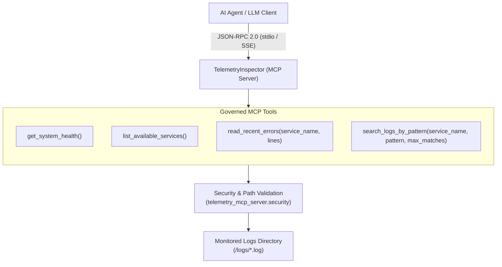
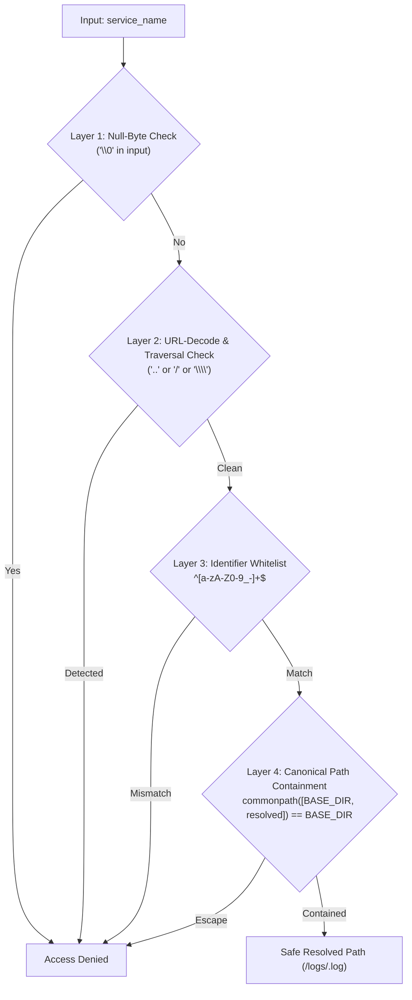
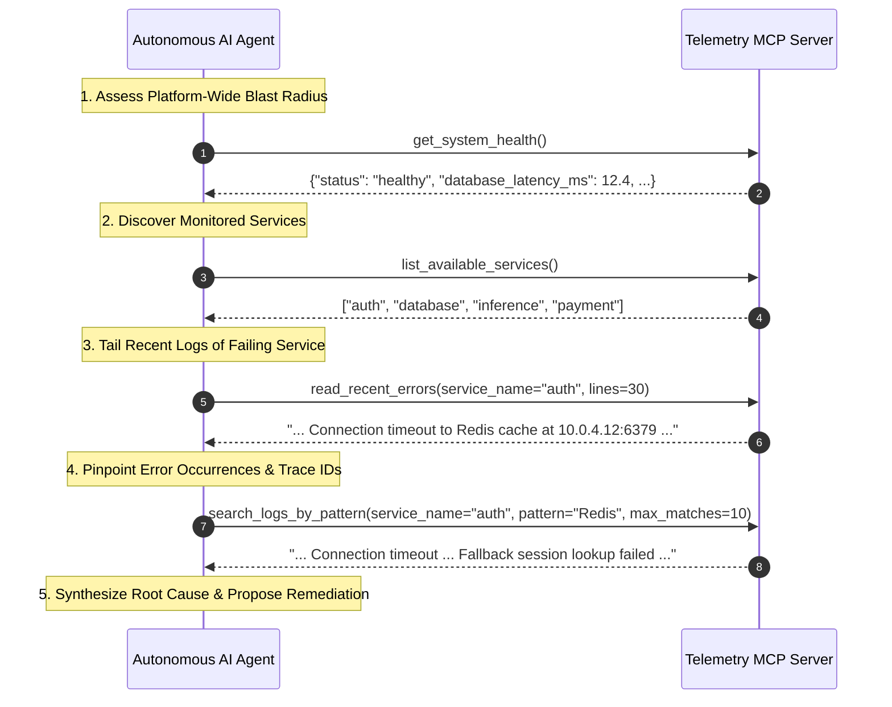

# Telemetry MCP Server: Agent Tools Reference Guide

This document provides a comprehensive operational and schema reference for all Model Context Protocol (MCP) tools exposed by `telemetry_mcp_server` (`TelemetryInspector`).

---

## 1. Overview & Governance Principles

The Telemetry MCP Server exposes a governed diagnostic API boundary for autonomous AI agents (e.g., Claude, Continue.dev, Cursor, Qwen). Unlike raw shell access (`bash`, `cat`, `grep`), which exposes the host system to arbitrary command execution and prompt injection hazards, MCP tools enforce:

- **Strict Least Privilege:** Only read-only observability operations are permitted; no filesystem modification or command execution is possible.
- **Defensive Path Containment:** Service identifiers are sanitized against directory traversal (`../`), null-byte injection (`\0`), and URL encoding tricks.
- **Context Window Protection:** Bounded response ceilings prevent multi-gigabyte log explosions from overwhelming the LLM's context window.
- **Actionable Deterministic Errors:** Informative failure messages guide the LLM to self-heal and discover valid services rather than hallucinating or retrying blindly.



---

## 2. Tool Reference Catalog

### 2.1 `get_system_health`

Retrieves the current high-level operational status of foundational services, database latency metrics, active connections, and inference runtime status.

- **Implementation:** [`get_system_health()`](../src/telemetry_mcp_server/server.py) -> [`tools.health.get_system_health()`](../src/telemetry_mcp_server/tools/health.py)
- **Primary Agent Use Case:** Call this tool at the start of any incident triage or performance investigation to assess system-wide blast radius before inspecting service-specific logs.

#### Signature & Parameters

```python
def get_system_health() -> str
```

- **Arguments:** None.
- **Returns:** Formatted JSON string containing operational health status and key metrics.

#### JSON Schema (MCP Contract)

```json
{
  "name": "get_system_health",
  "description": "Returns the current health status of foundational services and host metrics. Use this tool to check if the platform, inference engine, or database is currently experiencing downtime or performance degradation before triaging individual service logs.",
  "inputSchema": {
    "type": "object",
    "properties": {},
    "required": []
  }
}
```

#### Response Structure

| Field | Type | Description |
| :--- | :--- | :--- |
| `status` | `string` | System operational state: `"healthy"`, `"degraded"`, or `"unhealthy"`. |
| `active_alerts` | `integer` | Count of currently firing operational alerts. |
| `database_latency_ms`| `number` | Primary database query latency in milliseconds. |
| `active_connections` | `integer` | Total active client and service connections. |
| `inference_gateway` | `object` | Telemetry for local AI inference engine (`vllm-mlx`, `litellm`, client counts). |

#### Example Invocation & Return

```json
// JSON-RPC Request
{
  "jsonrpc": "2.0",
  "id": 1,
  "method": "tools/call",
  "params": {
    "name": "get_system_health",
    "arguments": {}
  }
}

// JSON-RPC Response Content
{
  "status": "healthy",
  "active_alerts": 0,
  "database_latency_ms": 12.4,
  "active_connections": 1042,
  "inference_gateway": {
    "status": "online",
    "engine": "vllm-mlx",
    "proxy": "litellm",
    "host_platform": "Apple Silicon (M5 Pro)",
    "active_clients": 2
  }
}
```

---

### 2.2 `list_available_services`

Scans the configured log directory and returns all service identifiers available for inspection.

- **Implementation:** [`list_available_services()`](../src/telemetry_mcp_server/server.py) -> [`tools.logs.list_available_services()`](../src/telemetry_mcp_server/tools/logs.py)
- **Primary Agent Use Case:** Discover active services before issuing log queries, preventing invalid service queries or guessing service names.

#### Signature & Parameters

```python
def list_available_services() -> list[str]
```

- **Arguments:** None.
- **Returns:** Alphabetically sorted list of valid service identifiers (e.g., `["auth", "database", "inference", "payment"]`).

#### JSON Schema (MCP Contract)

```json
{
  "name": "list_available_services",
  "description": "List all service identifiers available for telemetry and log inspection. Use this tool to discover what services (e.g., 'auth', 'payment', 'database', 'inference') currently have active log streams in the system.",
  "inputSchema": {
    "type": "object",
    "properties": {},
    "required": []
  }
}
```

#### Example Invocation & Return

```json
// JSON-RPC Request
{
  "jsonrpc": "2.0",
  "id": 2,
  "method": "tools/call",
  "params": {
    "name": "list_available_services",
    "arguments": {}
  }
}

// Response
[
  "auth",
  "database",
  "inference",
  "payment"
]
```

---

### 2.3 `read_recent_errors`

Tails the most recent log entries for a target service with strict context-window bounding.

- **Implementation:** [`read_recent_errors(service_name, lines)`](../src/telemetry_mcp_server/server.py) -> [`tools.logs.read_recent_errors()`](../src/telemetry_mcp_server/tools/logs.py)
- **Primary Agent Use Case:** Inspect recent errors, warnings, stack traces, and status changes for a specific service.

#### Signature & Parameters

```python
def read_recent_errors(service_name: str, lines: int = 50) -> str
```

| Parameter | Type | Required | Default | Bounds | Description |
| :--- | :--- | :--- | :--- | :--- | :--- |
| `service_name` | `string` | **Yes** | — | Regex `^[a-zA-Z0-9_-]+$` | Name of the target service (e.g., `"auth"`, `"payment"`, `"database"`, `"inference"`). |
| `lines` | `integer` | No | `50` | `1` to `200` (`settings.max_lines`) | Number of lines to tail from the end of the log file. |

#### JSON Schema (MCP Contract)

```json
{
  "name": "read_recent_errors",
  "description": "Retrieve the most recent log entries for a specific service. Use this tool when investigating errors, checking service state, or reviewing recent trace events across backend services or local AI inference components.",
  "inputSchema": {
    "type": "object",
    "properties": {
      "service_name": {
        "type": "string",
        "description": "Name of the service (e.g., 'auth', 'payment', 'database', 'inference')."
      },
      "lines": {
        "type": "integer",
        "default": 50,
        "description": "Number of lines to tail from the log file (1-200, default 50)."
      }
    },
    "required": ["service_name"]
  }
}
```

#### Returns & Guardrails

- **Success:** Newline-delimited log lines. Individual lines exceeding 1,000 characters are safely truncated (`... [truncated]`) to protect LLM context windows.
- **Service Not Found:** Actionable diagnostic string listing all valid services:
  ```text
  Error: Service 'billing' not found. Available services: ['auth', 'database', 'inference', 'payment']
  ```
- **Security Denial:** If an adversarial or malformed service name is passed:
  ```text
  Error: Invalid service name or path traversal violation. Access denied.
  ```

#### Example Invocation & Return

```json
// JSON-RPC Request
{
  "jsonrpc": "2.0",
  "id": 3,
  "method": "tools/call",
  "params": {
    "name": "read_recent_errors",
    "arguments": {
      "service_name": "auth",
      "lines": 3
    }
  }
}

// Return Content (text)
[2026-10-25 18:58:04] [WARN] High latency detected on login endpoint latency_ms=452
[2026-10-25 18:59:15] [ERROR] Connection timeout to Redis cache at 10.0.4.12:6379 after 5000ms
[2026-10-25 18:59:18] [ERROR] Fallback session lookup failed: Redis connection unavailable
```

---

### 2.4 `search_logs_by_pattern`

Searches log entries for a specific service using regular expressions or case-insensitive substrings.

- **Implementation:** [`search_logs_by_pattern(service_name, pattern, max_matches)`](../src/telemetry_mcp_server/server.py) -> [`tools.logs.search_logs_by_pattern()`](../src/telemetry_mcp_server/tools/logs.py)
- **Primary Agent Use Case:** Pinpoint specific trace IDs, HTTP status codes (`5\d\d`), exception classes (`ConnectionTimeout`, `NullPointerException`), or SQL queries across service logs.

#### Signature & Parameters

```python
def search_logs_by_pattern(service_name: str, pattern: str, max_matches: int = 20) -> str
```

| Parameter | Type | Required | Default | Bounds | Description |
| :--- | :--- | :--- | :--- | :--- | :--- |
| `service_name` | `string` | **Yes** | — | Regex `^[a-zA-Z0-9_-]+$` | Name of the target service. |
| `pattern` | `string` | **Yes** | — | Non-empty string | Regex or plain substring pattern (case-insensitive). |
| `max_matches` | `integer` | No | `20` | `1` to `100` | Maximum matching lines to return (returns the most recent matches). |

#### JSON Schema (MCP Contract)

```json
{
  "name": "search_logs_by_pattern",
  "description": "Search recent logs for a specific service matching a regex or substring. Use this tool when investigating errors or looking for specific trace IDs, HTTP status codes, or exception names across service logs.",
  "inputSchema": {
    "type": "object",
    "properties": {
      "service_name": {
        "type": "string",
        "description": "Name of target service (e.g., 'auth', 'payment', 'database', 'inference')."
      },
      "pattern": {
        "type": "string",
        "description": "Regex or substring pattern to match (e.g., '500 Internal', 'NullPointer', 'timeout')."
      },
      "max_matches": {
        "type": "integer",
        "default": 20,
        "description": "Maximum number of matching lines to return (1-100, default 20)."
      }
    },
    "required": ["service_name", "pattern"]
  }
}
```

#### Returns & Guardrails

- **Success (Matches Found):** Newline-delimited matching lines (up to `max_matches`, with lines capped at 1,000 characters).
- **Success (No Matches):** `No lines matching pattern '<pattern>' found in service '<service_name>'.`
- **Invalid Pattern Graceful Fallback:** If `pattern` is not a valid regex (e.g., unclosed parenthesis), the tool automatically falls back to case-insensitive plain substring matching rather than crashing.
- **Service Not Found & Traversal Denial:** Matches the standard defensive error handling structure.

#### Example Invocation & Return

```json
// JSON-RPC Request
{
  "jsonrpc": "2.0",
  "id": 4,
  "method": "tools/call",
  "params": {
    "name": "search_logs_by_pattern",
    "arguments": {
      "service_name": "payment",
      "pattern": "5\\d\\d",
      "max_matches": 5
    }
  }
}

// Return Content (text)
[2026-10-25 19:00:12] [ERROR] Payment capture failed tx_id=tx_994825: 504 Gateway Timeout
```

---

## 3. Defense-in-Depth Security Matrix

All tools that accept a `service_name` pass through [`telemetry_mcp_server.security.safe_resolve_log_path()`](../src/telemetry_mcp_server/security.py) before attempting any filesystem operation:



| Attack Payload | Target Tool | Defense Layer | Response |
| :--- | :--- | :--- | :--- |
| `../../etc/passwd` | `read_recent_errors` | Layer 2 & 3 | `Error: Invalid service name or path traversal violation. Access denied.` |
| `/etc/shadow` | `search_logs_by_pattern` | Layer 2 & 3 | `Error: Invalid service name or path traversal violation. Access denied.` |
| `auth\0.log` | `read_recent_errors` | Layer 1 | `Error: Invalid service name or path traversal violation. Access denied.` |
| `..%2F..%2Fetc%2Fpasswd` | `search_logs_by_pattern` | Layer 2 | `Error: Invalid service name or path traversal violation. Access denied.` |
| `auth; rm -rf /` | `read_recent_errors` | Layer 3 | `Error: Invalid service name or path traversal violation. Access denied.` |

---

## 4. Context Window & LLM Bounding Safeguards

To prevent token exhaustion and unexpected token bills when processing large volumes of telemetry:

1. **Tail Bounding:** The `lines` argument is clamped: `bounded_lines = max(1, min(lines, settings.max_lines))` (default max: 200 lines).
2. **Match Bounding:** The `max_matches` argument is clamped: `bounded_matches = max(1, min(max_matches, 100))`.
3. **Line Truncation:** Any single log line exceeding `settings.max_line_length` (1,000 characters) is truncated with `... [truncated]`.
4. **Non-Crashing Output:** All exceptions (`FileNotFoundError`, `OSError`, `re.error`) are caught and returned as clean diagnostic strings.

---

## 5. Complementary MCP Primitives

In addition to callable tools, the server exposes MCP Resources and MCP Prompts:

### MCP Resources
| URI | Description | MIME / Type |
| :--- | :--- | :--- |
| `telemetry://health` | Real-time system health summary and metrics. | `text/plain` (JSON) |
| `telemetry://services` | Current list of monitored services. | `application/json` |
| `telemetry://logs/{service}` | Tail stream of recent log entries for `{service}`. | `text/plain` |

### MCP Prompts
| Prompt Name | Parameters | Purpose |
| :--- | :--- | :--- |
| `incident_triage` | `service_name` (str), `issue_description` (str) | Standardized 4-stage triage prompt guiding LLMs through blast radius query, error log tailing, pattern matching, and root cause synthesis. |

---

## 6. Recommended Agent Investigation Workflow

When an autonomous agent is tasked with diagnosing an alert or performance anomaly, the optimal tool calling sequence is:


