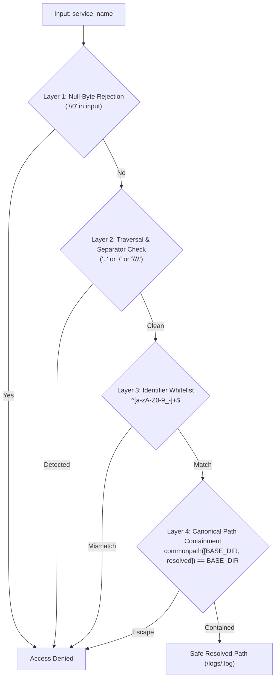
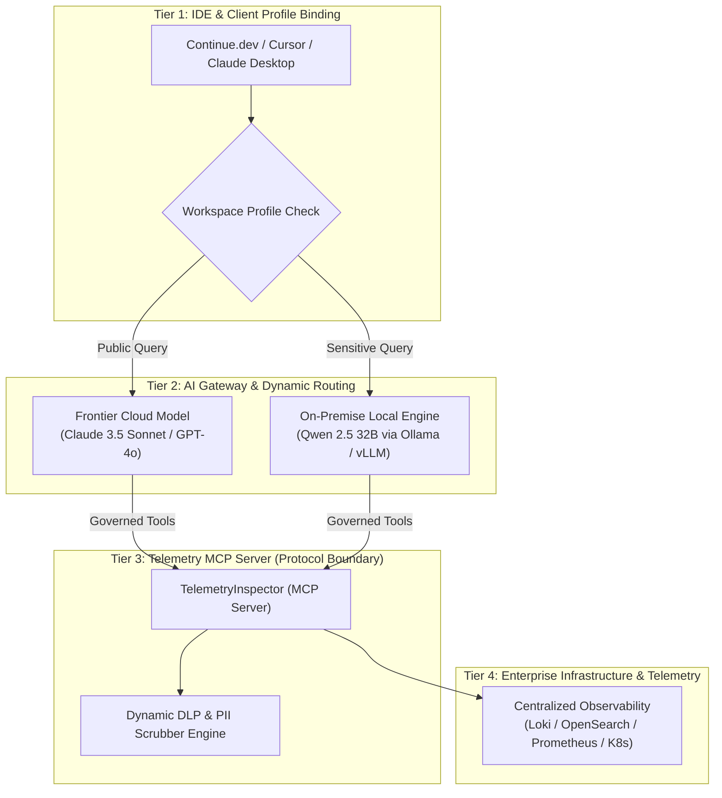
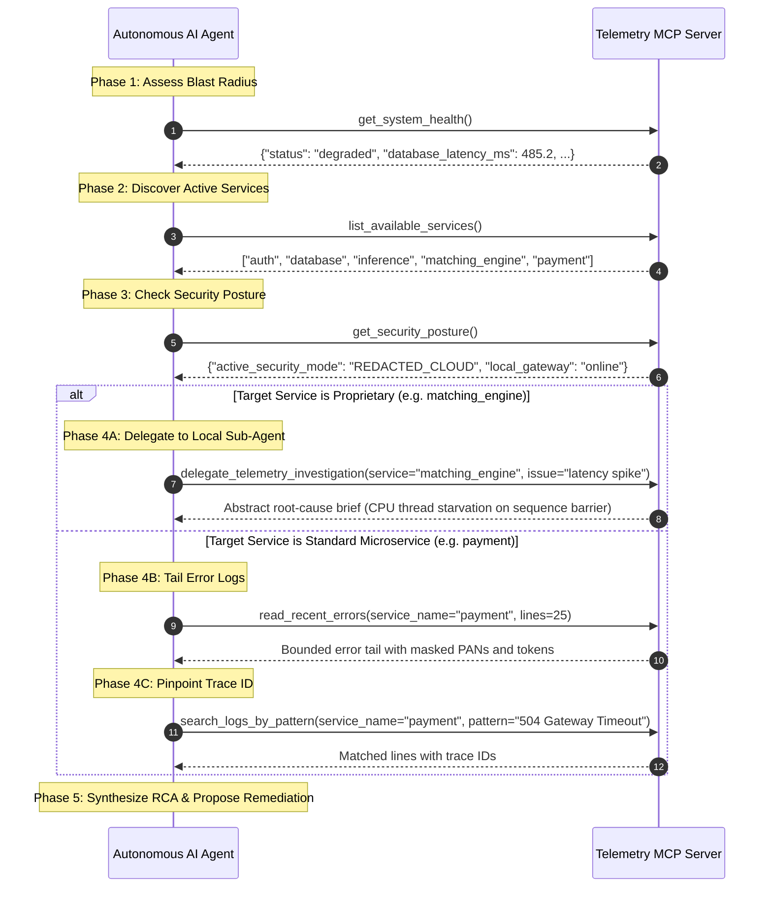

# Telemetry MCP Server: Enterprise Tools Catalog & Reference Directory

Welcome to the **Agent Tools Reference Directory** for the Telemetry Model Context Protocol (MCP) Server (`telemetry_mcp_server`, server identifier: `TelemetryInspector`).

This directory contains in-depth architectural specifications, schemas, security boundaries, and enterprise productionization blueprints for every callable MCP tool exposed by the server.

---

## 1. Directory Structure & Tool Navigation

Each tool has an exhaustive dedicated reference document detailing its signature, JSON-RPC 2.0 contract, security guardrails, failure modes, and enterprise expansion patterns:

```text
docs/tools_reference/
├── README.md                              # This master index & governance catalog
├── get_system_health.md                   # System-wide health, host metrics & inference gateway telemetry
├── list_available_services.md             # Governed service discovery & inventory enumeration
├── read_recent_errors.md                  # Context-bounded error tailing with DLP masking
├── search_logs_by_pattern.md              # ReDoS-safe regex & substring log search
├── filter_logs.md                         # Structured NDJSON/syslog severity & time-window filter
├── delegate_telemetry_investigation.md    # Two-tier on-premise sub-agent delegation for trade secrets
├── get_security_posture.md                # Real-time hybrid-trust posture & DLP audit telemetry
└── sanitize_telemetry_payload.md          # On-demand DLP scrubber (PCI-DSS, HIPAA, Secrets, RFC 1918)
```

---

## 2. Master Tool Comparison & Capabilities Matrix

| Tool Name | Module & Guide | Primary Agent Use Case | Parameters | Context Window Impact | Trust Classification | Enterprise Expansion |
| :--- | :--- | :--- | :--- | :--- | :--- | :--- |
| **`get_system_health`** | [`get_system_health.md`](./get_system_health.md) | Assess system-wide blast radius and platform health before inspecting logs. | None | Minimal (~350 tokens) | Public / Governed | OpenTelemetry, Prometheus (PromQL), K8s Pod CrashLoops, PagerDuty |
| **`list_available_services`** | [`list_available_services.md`](./list_available_services.md) | Enumerate monitored services to prevent hallucinated service queries. | None | Low (~20-50 tokens) | Public / Inventory | Backstage Catalog, HashiCorp Consul, RBAC/ABAC Tenant Isolation |
| **`read_recent_errors`** | [`read_recent_errors.md`](./read_recent_errors.md) | Tail recent errors and stack traces for a target service. | `service_name`, `lines` (default 50) | Bounded (~500-2,000 tokens) | High Sensitivity / DLP Governed | Grafana Loki (LogQL), Elasticsearch, Semantic Deduplication, Trace Linking |
| **`search_logs_by_pattern`** | [`search_logs_by_pattern.md`](./search_logs_by_pattern.md) | Pinpoint trace IDs, HTTP status codes (`5\d\d`), or exception classes. | `service_name`, `pattern`, `max_matches` (default 20) | Bounded (~200-1,000 tokens) | High Sensitivity / DLP Governed | Google `re2` Linear Engine, ClickHouse Bloom Filters, Hybrid Vector Search |
| **`filter_logs`** | [`filter_logs.md`](./filter_logs.md) | Filter structured logs by severity threshold and operational time window. | `service_name`, `level`, `start_time`, `end_time`, `max_lines` | Bounded (~500-2,000 tokens) | High Sensitivity / DLP Governed | DuckDB Vectorized Parquet Engine, SIMD execution, SSE Subscriptions |
| **`delegate_telemetry_investigation`** | [`delegate_telemetry_investigation.md`](./delegate_telemetry_investigation.md) | Hand off proprietary logs to an on-premise local sub-agent for abstract synthesis. | `service_name`, `issue_description`, `max_summary_tokens` | Fixed (~250-400 tokens) | Confidential / Trade-Secret Air-Gap | AWS Nitro Enclaves, AMD SEV-SNP, Specialized SRE SLMs, Local ReAct Loops |
| **`get_security_posture`** | [`get_security_posture.md`](./get_security_posture.md) | Verify active trust zones, DLP metrics, and local inference gateway health. | None | Low (~300 tokens) | Governance Telemetry | SIEM Streaming (Splunk / Sentinel), Continuous SOC2/HIPAA Auditing |
| **`sanitize_telemetry_payload`** | [`sanitize_telemetry_payload.md`](./sanitize_telemetry_payload.md) | Programmatic DLP utility to scrub PCI cards, SSNs, tokens, and internal IPs. | `payload`, `trust_mode` | Proportional to input | Utility / Privacy | Microsoft Presidio NLP NER, HashiCorp Vault Format-Preserving Tokenization |

---

## 3. Defense-in-Depth Security Matrix

All tools that ingest service identifiers or log data enforce four layers of deterministic defense:



### Threat Verification Matrix

| Attack Payload | Target Tool | Defense Layer | Response |
| :--- | :--- | :--- | :--- |
| `../../etc/passwd` | `read_recent_errors` | Layer 2 & 3 | `Error: Invalid service name or path traversal violation. Access denied.` |
| `/etc/shadow` | `search_logs_by_pattern` | Layer 2 & 3 | `Error: Invalid service name or path traversal violation. Access denied.` |
| `auth\0.log` | `read_recent_errors` | Layer 1 | `Error: Invalid service name or path traversal violation. Access denied.` |
| `..%2F..%2Fetc%2Fpasswd` | `search_logs_by_pattern` | Layer 2 | `Error: Invalid service name or path traversal violation. Access denied.` |
| `auth; rm -rf /` | `read_recent_errors` | Layer 3 | `Error: Invalid service name or path traversal violation. Access denied.` |

---

## 4. Context Window Safeguards & Cost Governance

To ensure autonomous agent loops remain cost-effective and prevent unexpected token exhaustion:

1. **Strict Tail Clamping:** Line counts are clamped: $\text{bounded\_lines} = \max(1, \min(\text{lines}, 200))$.
2. **Match Ceilings:** Pattern match results are capped: $\text{bounded\_matches} = \max(1, \min(\text{max\_matches}, 100))$.
3. **Line Truncation:** Individual lines exceeding 1,000 characters are safely truncated (`... [truncated]\n`).
4. **Deterministic Error Responses:** Missing services or malformed queries return helpful suggestions (`Available services: [...]`) rather than throwing uncaught Python exceptions, allowing LLMs to immediately self-correct without hallucinating.

---

## 5. Enterprise Hybrid-Trust Architecture

In production enterprise deployments, these 8 tools work collectively across a **Four-Tier Hybrid-Trust Architecture**:



1. **Client Isolation:** The IDE profile attaches `TelemetryInspector` only when running trusted configurations.
2. **Sub-Agent Delegation:** Cloud frontier models use [`delegate_telemetry_investigation`](./delegate_telemetry_investigation.md) to triage proprietary workloads inside the enterprise network.
3. **In-Flight DLP:** Outbound telemetry passes through [`sanitize_telemetry_payload`](./sanitize_telemetry_payload.md) to strip credentials, credit card PANs, SSNs, and internal topology before returning to the LLM.
4. **Continuous Auditing:** Security and compliance teams monitor [`get_security_posture`](./get_security_posture.md) for real-time redaction metrics and boundary enforcement.

---

## 6. Recommended Agent Investigation Workflow

When an autonomous agent responds to an alert or anomaly, the optimal tool calling sequence is:


