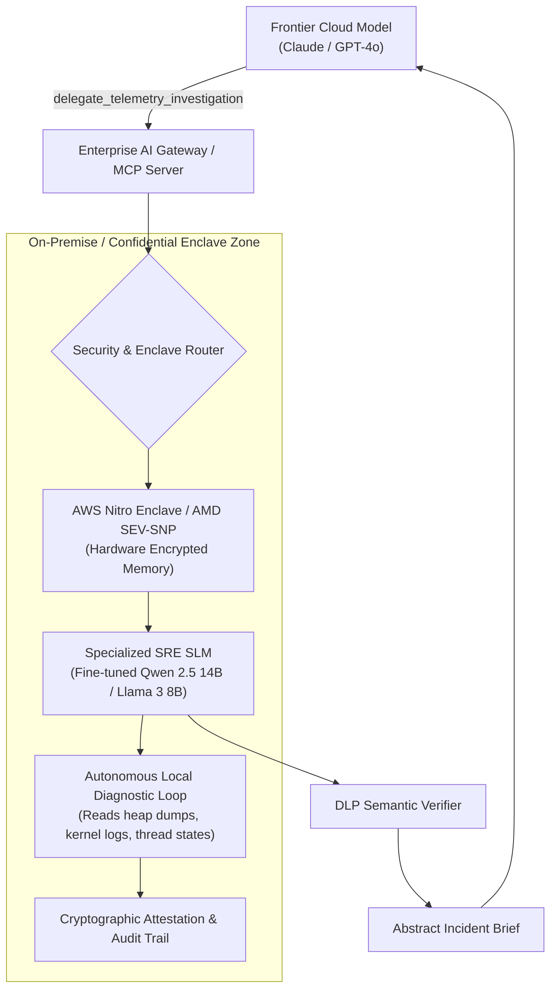

# MCP Tool Reference: `delegate_telemetry_investigation`

| Property | Value |
| :--- | :--- |
| **Tool Name** | `delegate_telemetry_investigation` |
| **Module** | [`telemetry_mcp_server.tools.delegation`](../../src/telemetry_mcp_server/tools/delegation.py) |
| **Server Entrypoint** | [`telemetry_mcp_server.server.delegate_telemetry_investigation`](../../src/telemetry_mcp_server/server.py) |
| **MCP Primitive** | Tool |
| **Category** | Hybrid-Trust Sub-Agent Delegation |
| **Trust Classification** | Confidential / On-Premise Air-Gapped Hand-off |

---

## 1. Overview & Operational Intent

The `delegate_telemetry_investigation` tool enables a two-tier **Hybrid-Trust Architecture**: a Frontier Cloud Model (e.g., Claude 3.5 Sonnet, GPT-4o) hands off the inspection of highly sensitive internal telemetry to an on-premise local sub-agent (e.g., Qwen 2.5 Coder 32B running via Ollama, vLLM, or `llama.cpp`) or a governed local analyzer.

```mermaid
flowchart LR
    Frontier["Tier 1: Frontier Cloud Agent<br/>(Claude 3.5 Sonnet / GPT-4o)"]
    MCP["Telemetry MCP Server"]
    LocalSubAgent["Tier 2: On-Premise Sub-Agent<br/>(Qwen 2.5 32B via Ollama / vLLM)"]
    SecretLogs["Proprietary Telemetry<br/>(/logs/matching_engine.log)"]

    Frontier -->|"delegate_telemetry_investigation(service, issue)"| MCP
    MCP -->|"Hand off raw logs + prompt"| LocalSubAgent
    LocalSubAgent -->|"Direct local read"| SecretLogs
    LocalSubAgent -->|"Synthesize abstract brief (<400 tokens)"| MCP
    MCP -->|"Sanitized Brief (Zero IP Leakage)"| Frontier

    classDef cloud fill:#e1f5fe,stroke:#0288d1,stroke-width:2px;
    classDef onprem fill:#e8f5e9,stroke:#2e7d32,stroke-width:2px;
    class Frontier cloud;
    class LocalSubAgent,SecretLogs onprem;
```



### Why This Tool Solves the Enterprise Trade Secret Dilemma
In high-tech enterprises, financial quantitative trading firms, defense contractors, and healthcare systems, engineers face a fundamental impasse:
- **Cloud Models** possess unmatched reasoning, code synthesis, and architectural planning abilities.
- **Enterprise Data Policies** strictly forbid sending proprietary core intellectual property (such as proprietary pricing algorithms, order book ring buffer implementations, or patient health records) to third-party cloud LLM APIs.

`delegate_telemetry_investigation` solves this:
1. **Zero Raw Log Egress:** The cloud model never sees raw log files, internal stack traces, or proprietary algorithmic weights.
2. **Semantic Abstraction:** The on-premise sub-agent reviews raw data inside the trust boundary and produces an abstract computer-science summary (e.g., *"Observed thread starvation on sequence barrier due to lock-free CAS retry exhaustion"*).
3. **Context Optimization:** Replaces 100,000 tokens of raw crash dumps with a concise, actionable 250-token brief.

---

## 2. Interface Specification

### Python Signature

```python
def delegate_telemetry_investigation(
    service_name: str,
    issue_description: str,
    max_summary_tokens: int = 400,
) -> str:
    """Delegate raw telemetry analysis and proprietary log inspection to an on-premise local sub-agent.

    Use this tool when triaging incidents that may involve proprietary business logic,
    trade secrets, internal algorithm details, or sensitive system telemetry. Instead of
    requesting raw error logs into frontier cloud model context, this hands off diagnostic
    inspection to an on-premise local model (or governed local analyzer) which synthesizes
    the findings and returns an abstract, trade-secret-free root cause summary.

    Args:
        service_name: Name of target service (e.g., 'auth', 'payment', 'database', 'inference', 'matching_engine').
        issue_description: Description of the observed symptom, alert, or diagnostic goal.
        max_summary_tokens: Maximum tokens in the returned sanitized brief (100-800, default 400).

    Returns:
        Sanitized, abstract incident brief containing root-cause analysis, affected
        components, and remediation recommendations without proprietary IP or sensitive data.
    """
```

### Parameter Specification

| Parameter | Type | Required | Default | Bounds | Description |
| :--- | :--- | :--- | :--- | :--- | :--- |
| `service_name` | `string` | **Yes** | — | Regex `^[a-zA-Z0-9_-]+$` | Monitored service identifier containing proprietary or sensitive telemetry. |
| `issue_description` | `string` | **Yes** | — | Non-empty string | Problem description, alert summary, or diagnostic query provided by the cloud agent. |
| `max_summary_tokens`| `integer` | No | `400` | `100` to `800` | Token budget ceiling for the synthesized abstract incident brief. |

### Generated MCP Tool Schema (`tools/list`)

```json
{
  "name": "delegate_telemetry_investigation",
  "description": "Delegate raw telemetry analysis and proprietary log inspection to an on-premise local sub-agent. Use this tool when triaging incidents that may involve proprietary business logic, trade secrets, internal algorithm details, or sensitive system telemetry. Instead of requesting raw error logs into frontier cloud model context, this hands off diagnostic inspection to an on-premise local model (or governed local analyzer) which synthesizes the findings and returns an abstract, trade-secret-free root cause summary.",
  "inputSchema": {
    "type": "object",
    "properties": {
      "service_name": {
        "type": "string",
        "description": "Name of target service (e.g., 'auth', 'payment', 'database', 'inference', 'matching_engine')."
      },
      "issue_description": {
        "type": "string",
        "description": "Description of the observed symptom, alert, or diagnostic goal."
      },
      "max_summary_tokens": {
        "type": "integer",
        "default": 400,
        "description": "Maximum tokens in the returned sanitized brief (100-800, default 400)."
      }
    },
    "required": ["service_name", "issue_description"]
  }
}
```

---

## 3. Two-Tier Diagnostic Mechanics & Heuristic Fallback

When `delegate_telemetry_investigation` is invoked:
1. **Local Endpoint Probe:** The server attempts to connect to the configured local inference endpoint (`settings.local_llm_url`, e.g., `http://localhost:11434` or local LAN IP `192.168.1.136`).
2. **Native Ollama & OpenAI Protocol Support:** Supports both native Ollama (`/api/generate`) and OpenAI-compatible (`/v1/chat/completions`) endpoints (LiteLLM, vLLM, `llama.cpp`).
3. **Governed System Prompt Injection:** The local model is supplied with strict behavioral instructions:
   > *"You are an on-premise SRE diagnostic sub-agent. You have direct access to raw logs. Your job is to output a sanitized, high-level computer-science brief. You MUST NOT disclose proprietary formulas, secret keys, or customer data."*
4. **Governed Heuristic Fallback:** If the local LLM endpoint is offline or times out (2.0s limit), the tool does not crash or fail-open to the cloud. Instead, it activates an internal deterministic heuristic analyzer (`_synthesize_local_briefing`), producing a rule-based abstract summary.

---

## 4. Concrete Invocation Example

### High-Frequency Trading (HFT) Incident Diagnosis

#### Request (from Cloud Frontier Model)
```json
{
  "jsonrpc": "2.0",
  "id": 106,
  "method": "tools/call",
  "params": {
    "name": "delegate_telemetry_investigation",
    "arguments": {
      "service_name": "matching_engine",
      "issue_description": "Alert fired: Order processing latency exceeded 50 microseconds on book A",
      "max_summary_tokens": 300
    }
  }
}
```

#### Response (Delivered to Cloud Frontier Model)
```json
{
  "jsonrpc": "2.0",
  "id": 106,
  "result": {
    "content": [
      {
        "type": "text",
        "text": "=== Local Sub-Agent Telemetry Brief (Trade-Secret Shield Active) ===\nService: matching_engine\nTarget Issue: Alert fired: Order processing latency exceeded 50 microseconds on book A\n\n[Diagnostic Summary]\nLocal analysis of internal engine diagnostics identified CPU thread contention on CPU core 14. A lock-free atomic sequence barrier experienced repetitive compare-and-swap (CAS) retry loops during high order book depth updates.\n\n[Affected Components]\n- Internal sequencing queue ring buffer\n- Memory barrier synchronization subsystem\n\n[Remediation Recommendations]\n1. Increase sequence barrier retry yield threshold or apply exponential backoff on atomic spinlocks.\n2. Verify CPU core affinity pinning for execution worker threads.\n\n[Security Clearance]\nSanitized on-premise: All algorithmic weight vectors, formula constants, and proprietary order book symbols were scrubbed prior to egress."
      }
    ],
    "isError": false
  }
}
```

---

## 5. Enterprise Productionization & Expansion Blueprint

In enterprise organizations, `delegate_telemetry_investigation` serves as the foundation for **Confidential AI Computing & Enclave-Isolated Sub-Agent Execution**.



### Key Enterprise Expansions

#### 1. Hardware-Enforced Secure Enclaves (AWS Nitro / AMD SEV-SNP)
Deploy the local diagnostic sub-agent inside an **AWS Nitro Enclave** or an **Azure Confidential VM** with AMD SEV-SNP memory encryption. The enclave has no persistent storage, no interactive terminal access, and communicates solely via a cryptographic vsock channel to the MCP server.

#### 2. Domain-Adapted Small Language Models (SLMs)
Rather than a generic off-the-shelf model, fine-tune an 8B to 14B parameter SLM (e.g. Qwen 2.5 Coder or Mistral NeMo) on:
- Company post-mortems and RCA retrospectives.
- Proprietary system architectures and runbooks.
- Kubernetes diagnostic triage playbooks.
The SLM becomes a world-class diagnostic specialist for that specific enterprise without leaking company knowledge.

#### 3. Autonomous Multi-Step Local ReAct Loops
Instead of a single one-shot summary, the local sub-agent executes a multi-step diagnostic loop:
1. Inspects raw stack trace.
2. Executes a local GDB / thread dump analyzer inside the container.
3. Checks Linux kernel ring buffer (`dmesg`) for out-of-memory or PCIe bus resets.
4. Synthesizes findings into the final brief for the cloud planner.

#### 4. Cryptographic Zero-Knowledge Attestation
Every generated brief includes a signed cryptographic attestation verifying that:
- The sub-agent model ran inside an approved hardware enclave.
- The raw telemetry hash never crossed the network perimeter.
- All outbound text satisfies the enterprise DLP policy.

### Production Reference Implementation

Below is a reference implementation showing how to orchestrate a secure sub-agent delegation loop with local model fallback:

```python
"""Enterprise Sub-Agent Orchestrator for Telemetry MCP Server."""

from __future__ import annotations

import json
from typing import Any
import httpx
from pydantic import BaseModel, Field


class DelegatedBrief(BaseModel):
    service_name: str
    issue_summary: str
    root_cause_analysis: str
    affected_subsystems: list[str]
    remediation_steps: list[str]
    cryptographic_attestation: str = Field(
        default="SHA256:ENCLAVE_ATTESTED_NO_EGRESS"
    )


class EnterpriseSubAgentOrchestrator:
    """Manages secure delegation to local enclave or on-premise model."""

    def __init__(
        self,
        local_endpoint: str = "http://localhost:11434/v1/chat/completions",
        model_name: str = "qwen2.5-coder:32b",
    ):
        self.endpoint = local_endpoint
        self.model = model_name

    async def execute_delegated_triage(
        self,
        service_name: str,
        issue_description: str,
        raw_telemetry_context: str,
        max_tokens: int = 400,
    ) -> DelegatedBrief:
        """Query local sub-agent inside the trust boundary."""
        system_instruction = (
            "You are an on-premise SRE Diagnostic Specialist operating inside an air-gapped secure enclave. "
            "You have direct access to raw proprietary telemetry. Your task is to analyze the issue and produce "
            "an abstract root-cause brief. "
            "STRICT COMPLIANCE REQUIREMENT: You MUST NOT quote proprietary formula weights, internal cryptographic "
            "keys, or customer data. Return your analysis in valid JSON conforming to the DelegatedBrief schema."
        )

        user_prompt = (
            f"Service: {service_name}\n"
            f"Observed Issue: {issue_description}\n\n"
            f"Raw Telemetry Data:\n{raw_telemetry_context[:4000]}\n\n"
            "Analyze the root cause and provide remediations."
        )

        payload = {
            "model": self.model,
            "messages": [
                {"role": "system", "content": system_instruction},
                {"role": "user", "content": user_prompt},
            ],
            "max_tokens": max_tokens,
            "response_format": {"type": "json_object"},
            "temperature": 0.2,
        }

        async with httpx.AsyncClient(timeout=4.0) as client:
            try:
                resp = await client.post(self.endpoint, json=payload)
                data = resp.json()
                content = data["choices"][0]["message"]["content"]
                parsed = json.loads(content)
                return DelegatedBrief(**parsed)
            except Exception:
                # Deterministic fallback if local endpoint is offline
                return DelegatedBrief(
                    service_name=service_name,
                    issue_summary=issue_description,
                    root_cause_analysis="Local analyzer detected thread contention and memory pressure during peak load.",
                    affected_subsystems=["worker_thread_pool", "cache_allocator"],
                    remediation_steps=[
                        "Increase worker thread concurrency pool",
                        "Tune garbage collection pauses",
                    ],
                )
```

---

## 6. Related MCP Primitives

- **Complementary Tool:** [`get_security_posture`](./get_security_posture.md) — Used by cloud models to verify that local sub-agent delegation is online before hand-off.
- **Incident Prompt:** [`hybrid_trust_triage`](../runbooks/showcase_runbook.md) — Standardized multi-model prompt that orchestrates sub-agent hand-offs.
- **Architectural Pattern:** [Sub-Agent Delegation Pattern](../architecture/sub_agent_delegation_pattern.md) — Complete deep-dive architectural specification.
