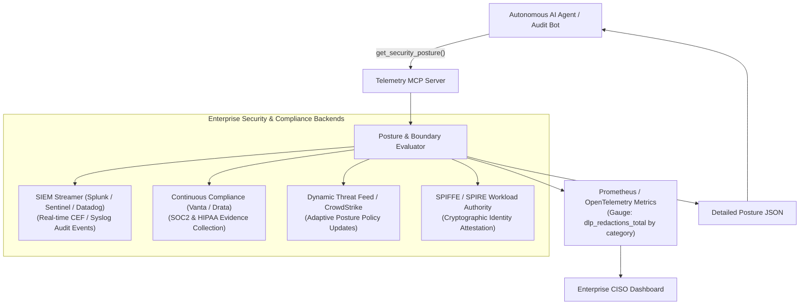

# MCP Tool Reference: `get_security_posture`

| Property | Value |
| :--- | :--- |
| **Tool Name** | `get_security_posture` |
| **Module** | [`telemetry_mcp_server.tools.security_posture`](../../src/telemetry_mcp_server/tools/security_posture.py) |
| **Server Entrypoint** | [`telemetry_mcp_server.server.get_security_posture`](../../src/telemetry_mcp_server/server.py) |
| **MCP Primitive** | Tool |
| **Category** | Security Observability & Trust Verification |
| **Trust Classification** | Public / Governance Telemetry |

---

## 1. Overview & Operational Intent

The `get_security_posture` tool provides AI agents, security gateways, and audit automation pipelines with real-time observability into active trust zones, DLP scrubbing rules, cumulative redaction metrics, filesystem boundaries, and local inference gateway connectivity.

### Why This Tool Replaces Unmanaged Introspection
In traditional setups, an AI agent cannot verify what security boundaries are in effect. It is unaware whether its outbound responses are being monitored, scrubbed, or exported to cloud environments.
This lack of visibility causes:
1. **Blind Cloud Exfiltration:** Cloud models attempt to read raw confidential files because they don't know that local sub-agent delegation exists.
2. **Compliance Blindspots:** Security engineers cannot programmatically audit how many PII tokens, credit cards, or credentials the AI system intercepted during an active triage session.
3. **Silent Gateway Failures:** If a local privacy-preserving LLM goes offline, unobserved agents might fail open to third-party cloud APIs.

`get_security_posture` gives autonomous planners full transparency over security boundaries, enabling proactive self-governance and cryptographic audit verification.

---

## 2. Interface Specification

### Python Signature

```python
def get_security_posture() -> str:
    """Returns the current hybrid-trust security posture and governance telemetry.

    Use this tool to verify active trust zones (STRICT_LOCAL vs REDACTED_CLOUD),
    inspect real-time DLP redaction counts, verify path containment, and confirm
    least-privilege boundaries before performing sensitive operations.

    Returns:
        JSON string containing trust mode, active DLP rules, cumulative redaction metrics,
        monitored services, and local inference gateway connectivity.
    """
```

- **Arguments:** None.
- **Return Type:** `str` (JSON-formatted string).

### Generated MCP Tool Schema (`tools/list`)

```json
{
  "name": "get_security_posture",
  "description": "Returns the current hybrid-trust security posture and governance telemetry. Use this tool to verify active trust zones (STRICT_LOCAL vs REDACTED_CLOUD), inspect real-time DLP redaction counts, verify path containment, and confirm least-privilege boundaries before performing sensitive operations.",
  "inputSchema": {
    "type": "object",
    "properties": {},
    "required": []
  }
}
```

### JSON-RPC 2.0 Invocation Example

#### Request (`tools/call`)
```json
{
  "jsonrpc": "2.0",
  "id": 107,
  "method": "tools/call",
  "params": {
    "name": "get_security_posture",
    "arguments": {}
  }
}
```

#### Response (`result`)
```json
{
  "jsonrpc": "2.0",
  "id": 107,
  "result": {
    "content": [
      {
        "type": "text",
        "text": "{\n  \"hybrid_trust_posture\": {\n    \"active_security_mode\": \"REDACTED_CLOUD\",\n    \"dlp_enabled\": true,\n    \"egress_classification\": \"Zero-Leak Cloud Redaction Active\"\n  },\n  \"dlp_scrubbers\": {\n    \"pci_dss\": \"Luhn algorithm checksum verification & cardholder PAN masking\",\n    \"hipaa_pii\": \"SSN, patient/MRN IDs, email addresses, and phone numbers\",\n    \"secrets_credentials\": \"OAuth Bearer tokens, JWTs, AWS access keys, private keys, database URLs\",\n    \"network_topology\": \"RFC 1918 private IPv4 addresses (10.x, 172.16-31.x, 192.168.x)\",\n    \"trade_secrets\": \"Proprietary HFT symbols and algorithmic weight vectors\"\n  },\n  \"redaction_metrics\": {\n    \"cardholder_pan\": 14,\n    \"ssn\": 2,\n    \"patient_id\": 0,\n    \"emails_phones\": 5,\n    \"bearer_tokens\": 3,\n    \"private_keys\": 0,\n    \"database_urls\": 1,\n    \"rfc1918_ips\": 28,\n    \"proprietary_symbols\": 4,\n    \"total_redactions\": 57\n  },\n  \"governed_boundaries\": {\n    \"filesystem_access\": \"Strict read-only containment within log directory\",\n    \"path_traversal_guards\": \"Multi-layer sanitization (null byte, URL decode, regex whitelist, canonical realpath)\",\n    \"log_root\": \"/logs\",\n    \"context_window_caps\": {\n      \"max_lines_tail\": 200,\n      \"max_line_length_chars\": 1000\n    }\n  },\n  \"available_services\": [\n    \"auth\",\n    \"database\",\n    \"inference\",\n    \"matching_engine\",\n    \"payment\"\n  ],\n  \"local_inference_gateway\": {\n    \"status\": \"online\",\n    \"endpoint\": \"http://localhost:11434\",\n    \"model\": \"qwen2.5-coder:32b\",\n    \"protocol\": \"ollama-native\"\n  }\n}"
      }
    ],
    "isError": false
  }
}
```

---

## 3. Telemetry Fields & Metrics Breakdown

| JSON Field | Type | Description |
| :--- | :--- | :--- |
| `hybrid_trust_posture.active_security_mode` | `string` | Active operational mode: `"STRICT_LOCAL"`, `"REDACTED_CLOUD"`, or `"AUDIT_ONLY"`. |
| `hybrid_trust_posture.dlp_enabled` | `boolean` | Indicates whether in-server DLP pattern scrubbers are actively filtering outputs. |
| `redaction_metrics.cardholder_pan` | `integer` | Count of Luhn-validated credit card numbers masked in memory. |
| `redaction_metrics.bearer_tokens` | `integer` | Count of intercepted and scrubbed OAuth tokens and JWTs. |
| `redaction_metrics.rfc1918_ips` | `integer` | Count of masked private internal IP addresses. |
| `redaction_metrics.total_redactions` | `integer` | Cumulative count of sensitive tokens intercepted since server startup. |
| `governed_boundaries.context_window_caps` | `object` | Active ceiling caps on tail line count and per-line character truncation. |
| `local_inference_gateway.status` | `string` | Status of the local sub-agent endpoint: `"online"` vs `"standby / offline"`. |

---

## 4. Governed Safety & Operational Use

- **Non-Invasive Verification:** Calling `get_security_posture` does not mutate any server settings or consume persistent storage.
- **Fail-Safe Health Probing:** The local LLM health check employs a strict 0.5-second socket timeout (`urllib.request.urlopen`) with non-blocking error handling, guaranteeing that an offline local inference engine does not freeze the MCP server response.
- **Agent Pre-Flight Check:** In the `hybrid_trust_triage` MCP prompt, the frontier model is guided to call `get_security_posture` first. If `local_inference_gateway.status` is `"online"`, it routes proprietary diagnostics to [`delegate_telemetry_investigation`](./delegate_telemetry_investigation.md); if `"offline"`, it alerts human operators of the degraded security perimeter.

---

## 5. Enterprise Productionization & Expansion Blueprint

In enterprise organizations, `get_security_posture` connects to the **Security Information and Event Management (SIEM)** and **Automated Compliance Engine** (e.g., Splunk, Microsoft Sentinel, Vanta, Drata).



### Key Enterprise Expansions

#### 1. Real-Time SIEM Streaming (Splunk / Microsoft Sentinel)
Every time a redaction occurs or `get_security_posture` is polled, emit a structured Common Event Format (CEF) or OpenTelemetry log event to the corporate SIEM. This alerts the Security Operations Center (SOC) if an application suddenly starts leaking thousands of credit card numbers or credentials into logs.

#### 2. Automated SOC 2 & HIPAA Continuous Compliance Evidence
Compliance frameworks require verifiable evidence that AI agents cannot view unmasked PII/PHI (HIPAA § 164.312(a)(1)) or cardholder data (PCI-DSS Requirement 3). The metrics exposed by `get_security_posture` are polled automatically by compliance orchestrators (Vanta, Drata) as mathematical proof of enforcement.

#### 3. Dynamic Adaptive Posture Switching
If enterprise intrusion detection systems (e.g. CrowdStrike, Falco) detect anomalous behavior in a cluster, the MCP server dynamically shifts its security mode from `STRICT_LOCAL` to `EMERGENCY_LOCKDOWN`, disabling all log-reading tools and alerting the LLM.

#### 4. SPIFFE/SPIRE Workload Identity Verification
Validate the cryptographic mTLS certificate (SVID) of the calling client to confirm that the agent has legitimate authorization to inspect security posture before disclosing network topologies.

### Production Reference Implementation

Below is a reference implementation showing how to expose Prometheus metrics and stream SIEM audit events:

```python
"""Enterprise Security Posture & SIEM Auditing Engine."""

from __future__ import annotations

import json
import logging
from typing import Any
from prometheus_client import Counter, Gauge
from pydantic import BaseModel

# Prometheus metrics for enterprise observability
DLP_REDACTIONS_COUNTER = Counter(
    "mcp_telemetry_dlp_redactions_total",
    "Cumulative count of sensitive tokens intercepted by Telemetry MCP DLP",
    ["category", "service_name"],
)

MCP_SECURITY_MODE_GAUGE = Gauge(
    "mcp_telemetry_security_mode",
    "Current active security mode (0=AUDIT, 1=REDACTED_CLOUD, 2=STRICT_LOCAL)",
)

siem_logger = logging.getLogger("audit.siem")


class EnterprisePostureReport(BaseModel):
    security_mode: str
    active_dlp_rules_count: int
    total_redactions_cumulative: int
    siem_forwarding_status: str
    soc2_compliance_verified: bool
    spiffe_id: str


class EnterpriseSecurityManager:
    """Manages enterprise security posture and audit compliance."""

    def __init__(self, spiffe_id: str = "spiffe://prod.corp/ns/ai/sa/telemetry"):
        self.spiffe_id = spiffe_id

    def record_redaction_event(
        self, category: str, service: str, count: int = 1
    ) -> None:
        """Update metrics and stream CEF event to SIEM."""
        DLP_REDACTIONS_COUNTER.labels(
            category=category, service_name=service
        ).inc(count)

        # Emit Common Event Format (CEF) log for SIEM ingestion
        cef_payload = (
            f"CEF:0|Enterprise|TelemetryMCPServer|1.0|DLP_REDACT|Data Redacted|5|"
            f"category={category} service={service} count={count} spiffe={self.spiffe_id}"
        )
        siem_logger.info(cef_payload)

    def generate_posture_telemetry(
        self, raw_metrics: dict[str, int]
    ) -> EnterprisePostureReport:
        """Generate structured posture telemetry for AI clients and compliance auditors."""
        total = sum(raw_metrics.values())
        return EnterprisePostureReport(
            security_mode="REDACTED_CLOUD",
            active_dlp_rules_count=5,
            total_redactions_cumulative=total,
            siem_forwarding_status="connected_tls",
            soc2_compliance_verified=True,
            spiffe_id=self.spiffe_id,
        )
```

---

## 6. Related MCP Primitives

- **Complementary Tool:** [`sanitize_telemetry_payload`](./sanitize_telemetry_payload.md) — Tool that applies the DLP scrubbers monitored by this posture tool.
- **Complementary Tool:** [`delegate_telemetry_investigation`](./delegate_telemetry_investigation.md) — Sub-agent hand-off tool verified by this posture tool.
- **MCP Resource:** `telemetry://security` — Direct read-only resource representation of real-time security posture.
