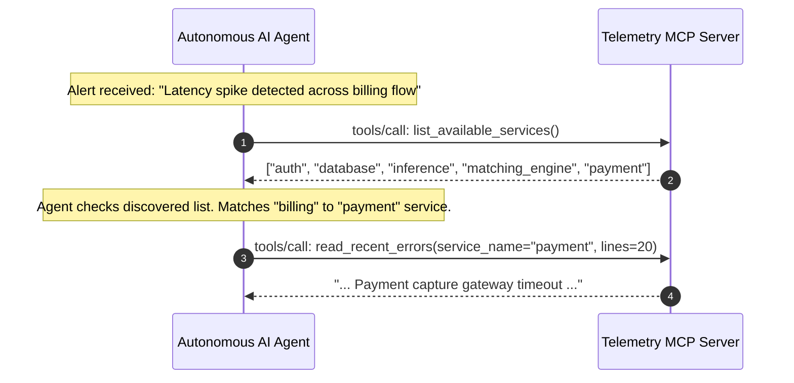
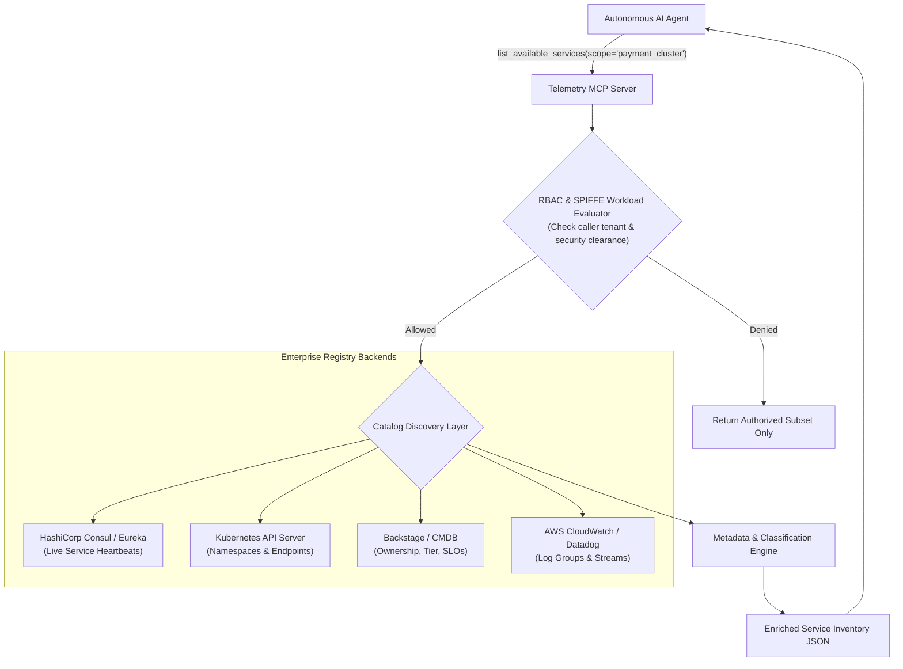

# MCP Tool Reference: `list_available_services`

| Property | Value |
| :--- | :--- |
| **Tool Name** | `list_available_services` |
| **Module** | [`telemetry_mcp_server.tools.logs`](../../src/telemetry_mcp_server/tools/logs.py) |
| **Server Entrypoint** | [`telemetry_mcp_server.server.list_available_services`](../../src/telemetry_mcp_server/server.py) |
| **MCP Primitive** | Tool |
| **Category** | Service Discovery & Inventory |
| **Trust Classification** | Public / Inventory |

---

## 1. Overview & Operational Intent

The `list_available_services` tool discovers and enumerates all monitored service identifiers currently active in the telemetry environment.

### Why This Tool Replaces Unrestricted Shell Commands
In an unmanaged shell environment, an AI agent attempting to find which services are running might execute:
```bash
ls -la /var/log/ && ps aux | grep python && systemctl list-units --type=service
```
This raw discovery pattern introduces substantial risks:
1. **Directory Traversal & Info Leakage:** Exposes system files, private keys, socket files, or unmonitored secrets in adjacent directories.
2. **Hallucination & Wild Guessing:** Without deterministic discovery, LLMs frequently guess invalid service names (e.g., querying `billing_service` or `auth_api` instead of `auth`), causing repeated 404/NotFound tool errors and wasting inference tokens.
3. **Execution Hijacking:** Exposing `ls` or `systemctl` gives malicious prompts opportunities to append command chains.

`list_available_services` provides a strictly governed, read-only discovery boundary that returns an alphabetically sorted, sanitized list of valid identifiers.

---

## 2. Interface Specification

### Python Signature

```python
def list_available_services() -> list[str]:
    """List all service identifiers available for telemetry and log inspection.

    Use this tool to discover what services (e.g., 'auth', 'payment', 'database', 'inference', 'matching_engine')
    currently have active log streams in the system.

    Returns:
        Sorted list of monitored service names.
    """
```

- **Arguments:** None.
- **Return Type:** `list[str]` (JSON array of strings).

### Generated MCP Tool Schema (`tools/list`)

```json
{
  "name": "list_available_services",
  "description": "List all service identifiers available for telemetry and log inspection. Use this tool to discover what services (e.g., 'auth', 'payment', 'database', 'inference', 'matching_engine') currently have active log streams in the system.",
  "inputSchema": {
    "type": "object",
    "properties": {},
    "required": []
  }
}
```

### JSON-RPC 2.0 Invocation Example

#### Request (`tools/call`)
```json
{
  "jsonrpc": "2.0",
  "id": 102,
  "method": "tools/call",
  "params": {
    "name": "list_available_services",
    "arguments": {}
  }
}
```

#### Response (`result`)
```json
{
  "jsonrpc": "2.0",
  "id": 102,
  "result": {
    "content": [
      {
        "type": "text",
        "text": "[\"auth\", \"database\", \"inference\", \"matching_engine\", \"payment\"]"
      }
    ],
    "isError": false
  }
}
```

---

## 3. Governed Safety & Guardrails

1. **Path Traversal Shielding:** The scanner only evaluates files directly inside the configured root log directory (`settings.log_dir`). It does not recurse into arbitrary subdirectories or follow untrusted symlinks.
2. **Strict Regex Identifier Whitelisting:** Discovered filenames must match `^[a-zA-Z0-9_-]+$`. Files containing special characters, spaces, shell metacharacters, or path separators (`/`, `\`, `..`) are filtered out and ignored.
3. **Deterministic Output:** Results are sorted lexicographically (`sorted(services)`), ensuring zero stochastic variability in responses across agent turns.
4. **Context Window Protection:** Because the return payload is a compact list of service names, it requires minimal context window overhead (~20-50 tokens).

---

## 4. Agent Diagnostic Workflow

In autonomous incident triage, `list_available_services` bridges high-level health alerts with specific log investigation:



---

## 5. Enterprise Productionization & Expansion Blueprint

In large enterprise topologies with hundreds or thousands of distributed microservices, a static disk scan is insufficient. `list_available_services` expands into an **Enterprise Service Registry & RBAC Directory**.



### Key Enterprise Expansions

#### 1. Dynamic Service Catalog Integration (Backstage & Consul)
In modern enterprises, services are cataloged in systems like Spotify Backstage or HashiCorp Consul. Expanding this tool allows returning live registered microservices with operational status, eliminating manual log directory provisioning.

#### 2. Role-Based Access Control (RBAC) & Tenant Isolation
Not all AI agents should see all services. A frontend engineering agent should only discover `web-ui`, `cdn-proxy`, and `bff-gateway`. It must not discover or access `core-ledger`, `hft-matching-engine`, or `hr-payroll`. The tool can evaluate caller authentication headers or SPIFFE IDs to filter the discovered list.

#### 3. Metadata & Tiering Enrichment
Enhance the return structure from a simple `list[str]` to structured metadata objects:
- **Tier Classification:** Tier 0 (Critical Path, 99.99% SLO) vs. Tier 3 (Internal Batch).
- **Owner Team:** Engineering team Slack handle, on-call rotation identifier, and Git repository link.
- **Log Format:** `NDJSON`, `Syslog`, `Protobuf`, or `CEF` (Common Event Format).

#### 4. Serverless & Ephemeral Container Grouping
In cloud-native serverless architectures (AWS Lambda, Google Cloud Run, Kubernetes Jobs), log groups are ephemeral. Enterprise expansion aggregates dynamic instance IDs (e.g. `payment-processor-pod-7df9b4-x9q`) into logical canonical service clusters (`payment-processor`).

### Production Reference Implementation

Below is a reference implementation showing how to expand `list_available_services` with Kubernetes namespace discovery, RBAC filtering, and rich service metadata:

```python
"""Enterprise Service Discovery with Kubernetes & RBAC for Telemetry MCP Server."""

from __future__ import annotations

import os
from typing import Any
from pydantic import BaseModel, Field


class ServiceMetadata(BaseModel):
    service_id: str
    tier: str = Field(description="Tier-0, Tier-1, Tier-2, or Tier-3")
    owner_team: str
    log_format: str
    active_replicas: int
    data_classification: str = Field(
        description="PUBLIC, INTERNAL, CONFIDENTIAL, or RESTRICTED"
    )


class EnterpriseServiceDirectory:
    """Enterprise service catalog integrating Kubernetes and security policies."""

    def __init__(self, k8s_namespace: str = "production"):
        self.namespace = k8s_namespace
        # In production, query K8s CoreV1Api().list_namespaced_service()
        self._mock_catalog: dict[str, ServiceMetadata] = {
            "auth": ServiceMetadata(
                service_id="auth",
                tier="Tier-0",
                owner_team="identity-sec",
                log_format="ndjson",
                active_replicas=12,
                data_classification="CONFIDENTIAL",
            ),
            "payment": ServiceMetadata(
                service_id="payment",
                tier="Tier-0",
                owner_team="checkout-eng",
                log_format="ndjson",
                active_replicas=8,
                data_classification="RESTRICTED",
            ),
            "matching_engine": ServiceMetadata(
                service_id="matching_engine",
                tier="Tier-0",
                owner_team="quant-core",
                log_format="syslog",
                active_replicas=4,
                data_classification="RESTRICTED",
            ),
            "database": ServiceMetadata(
                service_id="database",
                tier="Tier-0",
                owner_team="dba-infra",
                log_format="syslog",
                active_replicas=3,
                data_classification="RESTRICTED",
            ),
            "inference": ServiceMetadata(
                service_id="inference",
                tier="Tier-1",
                owner_team="ai-platform",
                log_format="ndjson",
                active_replicas=2,
                data_classification="INTERNAL",
            ),
        }

    def list_services_for_agent(
        self, agent_role: str = "general_sre"
    ) -> list[ServiceMetadata]:
        """Filter service catalog based on agent role clearance."""
        if agent_role == "restricted_cloud":
            # Cloud models cannot discover restricted trade-secret services
            return [
                meta
                for meta in self._mock_catalog.values()
                if meta.data_classification in ("PUBLIC", "INTERNAL")
            ]
        # On-premise local SRE agent sees full catalog
        return list(self._mock_catalog.values())


# Example enterprise MCP tool signature
def list_available_services_enterprise(
    include_metadata: bool = False, agent_role: str = "general_sre"
) -> Any:
    """Enterprise service discovery tool returning enriched service metadata."""
    directory = EnterpriseServiceDirectory()
    services = directory.list_services_for_agent(agent_role=agent_role)

    if not include_metadata:
        # Backward-compatible list of strings
        return sorted([s.service_id for s in services])

    return [s.model_dump() for s in services]
```

---

## 6. Related MCP Primitives

- **Complementary Tool:** [`read_recent_errors`](./read_recent_errors.md) — Once a service is discovered, call `read_recent_errors` with the discovered identifier.
- **MCP Resource:** `telemetry://services` — Exposes the current service list as a live, subscribable JSON resource.
- **Security Guard:** [`safe_resolve_log_path`](../../src/telemetry_mcp_server/security.py) — Enforces that service names returned and accepted conform to strict containment rules.
