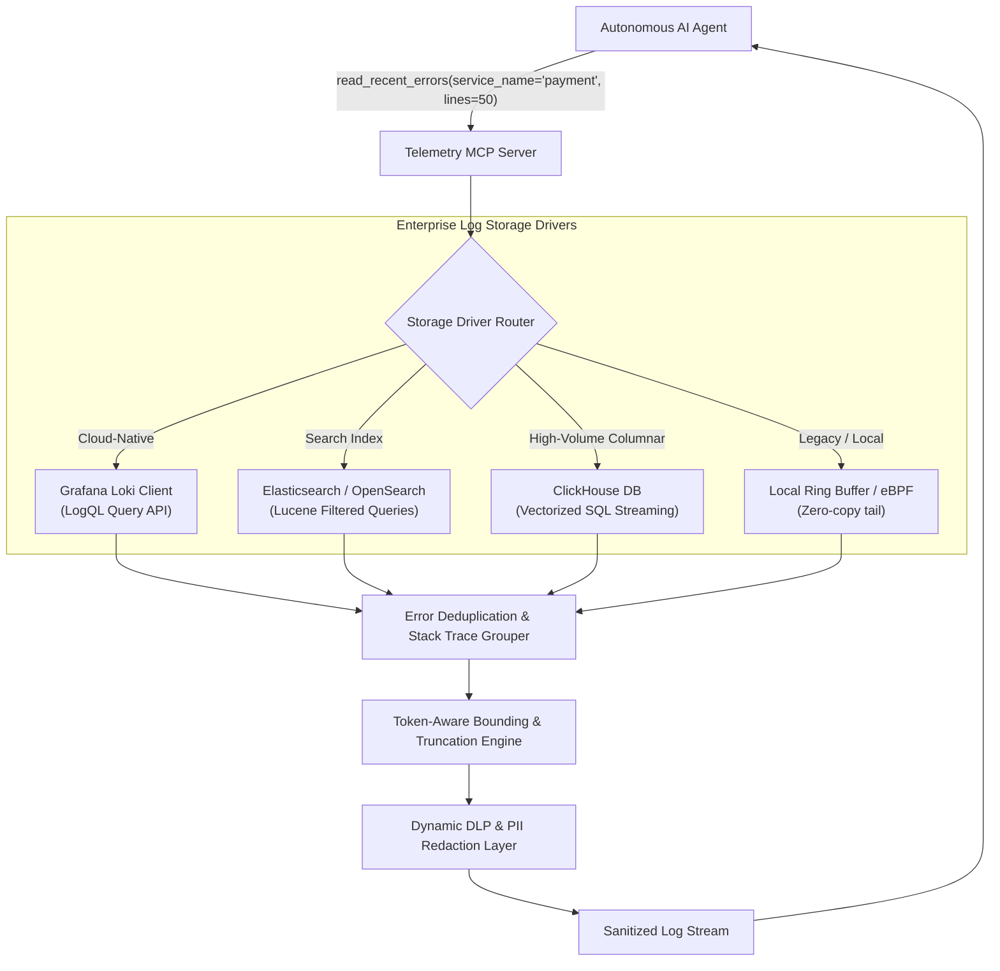

# MCP Tool Reference: `read_recent_errors`

| Property | Value |
| :--- | :--- |
| **Tool Name** | `read_recent_errors` |
| **Module** | [`telemetry_mcp_server.tools.logs`](../../src/telemetry_mcp_server/tools/logs.py) |
| **Server Entrypoint** | [`telemetry_mcp_server.server.read_recent_errors`](../../src/telemetry_mcp_server/server.py) |
| **MCP Primitive** | Tool |
| **Category** | Diagnostic Log Inspection |
| **Trust Classification** | High Sensitivity / Governed by DLP Middleware |

---

## 1. Overview & Operational Intent

The `read_recent_errors` tool tails recent log events for a designated service with strict bounds on line counts and line lengths, governed by dynamic DLP redaction.

### Why This Tool Replaces Unrestricted Shell Commands
In an unmanaged CLI or bash tool environment, an AI agent investigating an issue will typically run:
```bash
tail -n 100 /var/log/auth.log
# or
cat /var/log/payment.log | grep -i error
```
This raw pattern introduces three catastrophic failure modes in enterprise production:
1. **Unbounded Context Window Exhaustion:** A multi-megabyte stack trace or JSON payload dump will instantly blow past LLM context limits (e.g. 128k or 200k tokens), triggering massive cloud API bills or crashing the model context with truncation artifacts.
2. **Path Traversal & Arbitrary File Reads:** Untrusted arguments like `tail -n 50 ../../etc/shadow` or `tail -n 50 /root/.ssh/id_rsa` compromise the host operating system.
3. **Data Exfiltration of PII & Credentials:** Raw log files routinely contain accidentally logged Authorization headers, database connection strings, customer emails, or payment card numbers.

`read_recent_errors` provides a secure, governed diagnostic boundary: it validates file containment, bounds line counts, truncates oversized lines, and passes every byte through dynamic Data Loss Prevention (DLP) scrubbers before emitting text to the agent.

---

## 2. Interface Specification

### Python Signature

```python
def read_recent_errors(
    service_name: str,
    lines: int = 50,
) -> str:
    """Retrieve the most recent log entries for a specific service.

    Use this tool when investigating errors, checking service state, or reviewing
    recent trace events across backend services or local AI inference components.
    Output is automatically governed by active hybrid-trust DLP policies.

    Args:
        service_name: Name of the service (e.g., 'auth', 'payment', 'database', 'inference', 'matching_engine').
        lines: Number of lines to tail from the log file (1-200, default 50).

    Returns:
        Newline-delimited recent log lines, or an actionable error message if
        the service does not exist or access is denied.
    """
```

### Parameter Specification

| Parameter | Type | Required | Default | Allowed Values / Bounds | Description |
| :--- | :--- | :--- | :--- | :--- | :--- |
| `service_name` | `string` | **Yes** | — | Regex `^[a-zA-Z0-9_-]+$` | Name of the monitored service. Must correspond to a valid log stream. |
| `lines` | `integer` | No | `50` | `1` to `200` (`settings.max_lines`) | Number of lines to tail from the end of the log file. Values above 200 are clamped. |

### Generated MCP Tool Schema (`tools/list`)

```json
{
  "name": "read_recent_errors",
  "description": "Retrieve the most recent log entries for a specific service. Use this tool when investigating errors, checking service state, or reviewing recent trace events across backend services or local AI inference components. Output is automatically governed by active hybrid-trust DLP policies.",
  "inputSchema": {
    "type": "object",
    "properties": {
      "service_name": {
        "type": "string",
        "description": "Name of the service (e.g., 'auth', 'payment', 'database', 'inference', 'matching_engine')."
      },
      "lines": {
        "type": "integer",
        "default": 50,
        "description": "Number of lines to tail from the log file (1-200, default 50)."
      }
    },
    "required": ["service_name"]
  }
}
```

---

## 3. Governed Safety & Guardrails

### 1. Multi-Layer Path Traversal Protection
Before opening any file descriptor, `service_name` is evaluated by [`safe_resolve_log_path`](../../src/telemetry_mcp_server/security.py):
- **Null-Byte Check:** Rejects strings containing `\0`.
- **Traversal & Separator Check:** Rejects strings with `..`, `/`, `\`, or URL-encoded equivalents (`%2e%2e%2f`).
- **Whitelist Enforcement:** Enforces strict match against `^[a-zA-Z0-9_-]+$`.
- **Canonical Containment:** Resolves `os.path.realpath` and verifies `commonpath([BASE_DIR, resolved]) == BASE_DIR`.

### 2. Context Window Ceilings
- **Line Count Clamping:** `bounded_lines = max(1, min(lines, settings.max_lines))` (default ceiling: 200 lines).
- **Line Length Truncation:** Any line exceeding `settings.max_line_length` (1,000 characters) is truncated with `... [truncated]\n`.

### 3. Dynamic DLP Middleware
All output is passed through [`sanitize_payload`](../../src/telemetry_mcp_server/dlp.py) prior to being returned to the LLM:
- **PCI-DSS:** Credit card numbers passing Luhn checksum are masked to `[CARD_REDACTED_*1111]`.
- **HIPAA/PII:** SSNs, Patient IDs, MRNs, emails, and phone numbers are scrubbed.
- **Secrets:** Bearer tokens, JWTs, AWS credentials, and DB connection strings are masked.
- **Topography:** RFC 1918 private IP addresses are sanitized based on the active security mode (`REDACTED_CLOUD` vs `STRICT_LOCAL`).

---

## 4. Deterministic Error Handling & Recovery

| Failure Mode | Output String Returned to LLM | Agent Self-Healing Action |
| :--- | :--- | :--- |
| **Path Traversal / Adversarial Name** | `Error: Invalid service name or path traversal violation. Access denied.` | LLM aborts traversal attempts and requests valid service name. |
| **Service Not Found** | `Error: Service 'billing' not found. Available services: ['auth', 'database', 'payment']` | LLM inspects available list and re-issues call with `'payment'`. |
| **Empty File** | `No log entries found in service 'auth'.` | LLM notes that service has no recent errors and investigates adjacent components. |
| **I/O Permissions Error** | `Failed to read logs for service 'auth': [Errno 13] Permission denied` | LLM reports operational permission failure rather than hallucinating logs. |

---

## 5. Concrete Invocation Examples

### Happy Path (With DLP Masking)

#### Request
```json
{
  "jsonrpc": "2.0",
  "id": 103,
  "method": "tools/call",
  "params": {
    "name": "read_recent_errors",
    "arguments": {
      "service_name": "payment",
      "lines": 3
    }
  }
}
```

#### Response
```json
{
  "jsonrpc": "2.0",
  "id": 103,
  "result": {
    "content": [
      {
        "type": "text",
        "text": "[2026-10-25 18:59:01] [INFO] Processing transaction tx_881923 for card [CARD_REDACTED_*4242]\n[2026-10-25 18:59:03] [WARN] Gateway latency elevated to 1420ms on endpoint /v2/charge\n[2026-10-25 18:59:04] [ERROR] Payment capture failed tx_881923: 504 Gateway Timeout connecting to payment-gateway.[INTERNAL_HOST].net"
      }
    ],
    "isError": false
  }
}
```

---

## 6. Enterprise Productionization & Expansion Blueprint

In enterprise infrastructure, logs do not sit on a single server's local NVMe drive. They stream into high-throughput centralized log systems (Grafana Loki, Elasticsearch/OpenSearch, ClickHouse, AWS CloudWatch).



### Key Enterprise Expansions

#### 1. Centralized Log Engine Drivers (Grafana Loki / LogQL)
Replace flat file reading with direct queries against Grafana Loki using LogQL:
```logql
{app="payment", env="production"} |= "ERROR" | json | __error__=""
```
This enables an agent running in an isolated container to inspect logs across 500 distributed Kubernetes pods simultaneously without mounting persistent volumes.

#### 2. Semantic Error Deduplication & Stack Trace Grouping
In massive outages, an identical exception (e.g. `RedisConnectionError: Connection refused`) might be emitted 25,000 times in 30 seconds. Returning 50 identical lines wastes the agent's context window.
**Enterprise Expansion:** The tool hashes stack traces and groups duplicates into frequency-annotated summaries:
```text
[Occurred 4,218 times between 18:58:00 and 19:00:00 UTC]
RedisConnectionError: Connection refused to redis-cluster-primary:6379
    at /app/cache/client.py:112 in get_session
```

#### 3. Token-Aware Adaptive Bounding
Instead of clamping to raw line counts (`lines: int = 50`), enterprise implementations count exact tokenizer tokens using `tiktoken` (for OpenAI models) or HuggingFace Tokenizers (for Claude / Llama / Qwen). This guarantees that the returned text occupies exactly the token budget allotted (e.g., 2,000 tokens), maximizing diagnostic information density.

#### 4. Automated OpenTelemetry Trace Context Linking
When an error is read, the tool automatically extracts the `trace_id` and queries the OpenTelemetry Jaeger/Tempo backend to fetch the root HTTP route or SQL statement that triggered the failure, attaching it to the error context.

### Production Reference Implementation

Below is a reference implementation demonstrating an enterprise driver querying Grafana Loki with semantic error deduplication and token bounding:

```python
"""Enterprise Log Tail Driver for Grafana Loki with Deduplication."""

from __future__ import annotations

import hashlib
import time
from typing import Any
import httpx
from pydantic import BaseModel


class ErrorCluster(BaseModel):
    fingerprint: str
    first_seen: str
    last_seen: str
    count: int
    sample_line: str


async def fetch_recent_errors_loki(
    service_name: str,
    max_lines: int = 50,
    loki_endpoint: str = "http://loki.monitoring:3100",
) -> str:
    """Fetch recent errors from Grafana Loki and group repeating stack traces."""
    logql_query = f'{{app="{service_name}"}} |= "ERROR"'

    async with httpx.AsyncClient(timeout=5.0) as client:
        try:
            resp = await client.get(
                f"{loki_endpoint}/loki/api/v1/query_range",
                params={
                    "query": logql_query,
                    "limit": max_lines * 5,  # Fetch wider window for deduplication
                    "direction": "BACKWARD",
                },
            )
            data = resp.json()
        except Exception as e:
            return f"Error connecting to centralized log backend: {e!s}"

    streams = data.get("data", {}).get("result", [])
    if not streams:
        return f"No recent errors found for service '{service_name}' in Loki."

    # Group lines by fingerprint (MD5 of message body excluding timestamps)
    clusters: dict[str, ErrorCluster] = {}
    for stream in streams:
        for raw_ts, line in stream.get("values", []):
            # Strip timestamp prefix for fingerprinting
            clean_msg = line.split("]", 2)[-1].strip() if "]" in line else line
            fp = hashlib.md5(clean_msg.encode("utf-8")).hexdigest()[:8]

            if fp in clusters:
                clusters[fp].count += 1
                clusters[fp].last_seen = raw_ts
            else:
                clusters[fp] = ErrorCluster(
                    fingerprint=fp,
                    first_seen=raw_ts,
                    last_seen=raw_ts,
                    count=1,
                    sample_line=line[:1000],  # Bounded line length
                )

    # Format deduplicated summary for LLM context
    output_lines: list[str] = [
        f"=== Telemetry Summary for Service '{service_name}' (Centralized Loki Backend) ==="
    ]
    for cluster in list(clusters.values())[:max_lines]:
        if cluster.count > 1:
            output_lines.append(
                f"[DEDUPLICATED x{cluster.count} occurrences] {cluster.sample_line}"
            )
        else:
            output_lines.append(cluster.sample_line)

    return "\n".join(output_lines)
```

---

## 7. Related MCP Primitives

- **Complementary Tool:** [`search_logs_by_pattern`](./search_logs_by_pattern.md) — Use to narrow down specific trace IDs found in the recent error tail.
- **Complementary Tool:** [`filter_logs`](./filter_logs.md) — Use when exact timestamp windows or log severity thresholds are needed.
- **MCP Resource:** `telemetry://logs/{service}` — Continuous read-only stream representation of service logs.
